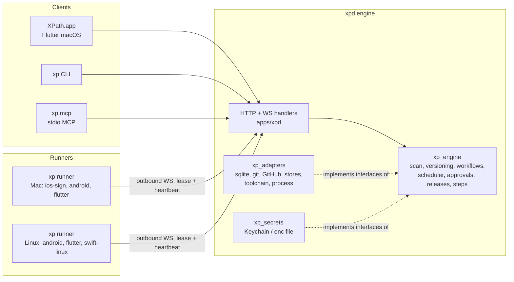

## feat: XPath self-hosted release tool for Flutter apps - Extensive

## Overview

XPath is an open-source (Apache-2.0), self-hosted release tool for Flutter apps. A headless
engine (`xpd`) owns projects, secrets, jobs and store status. Four clients talk to it over
HTTP/JSON plus one WebSocket: a Flutter macOS app, the `xp` CLI, an MCP server (`xp mcp`) for
agents, and remote runners (`xp runner`) on other Macs and Linux machines. You point it at a
repo, it scans the app, and from then on it builds, tests, signs, uploads, tags and tracks
releases to App Store Connect, Google Play, Firebase App Distribution and Shorebird, with
nothing written to the repo except release-model git changes. A typed step library ports
everything the current `ship.sh` scripts do; workflows compose those steps.

It replaces the per-repo `ship.sh` scripts in the Mataa and oneavant repos once it has shipped
a real production release of each app.

Sources: [brainstorm](../brainstorm/2026-10-13-x-path-brainstorm.md),
[step catalogue](../research/step-catalogue.md), [official docs](../research/official-docs.md),
[best practices](../research/best-practices.md), [user-flow gaps](../research/user-flow-gaps.md).

## Problem Statement

- Release logic lives in bash scripts copied per repo (`ship.sh`, `lib/release.sh`,
  `lib/common.sh`) and drifts: captain parses altool rejections, oneavant does not; captain
  hides the app-specific password from `ps`, the customer app does not.
- Per-app assumptions (bundle IDs, plist lists, tag schemes, Firebase IDs, Flutter pins,
  secrets locations) are hardcoded in about 20 places per script.
- Builds run in the developer's checkout unless `--ref` is passed, so local overrides can leak
  into a release; guards catch only some cases.
- Store state is invisible from the tooling, so "merge the release PR once live" is followed
  by memory.
- Only one Mac can build; agents can only drive releases by shelling out with no approval step.
- Codemagic is out of minutes and Fastlane is unused, so the per-repo scripts are the only path.

## Resolved design decisions

Accepted by the owner on 2026-10-13 (grilling rounds 1 to 4, plus the post-research round).

| # | Decision |
|---|---|
| D-01 | Dart and Flutter throughout. Engine plus clients, never a monolith. |
| D-02 | Public, self-hosted, Apache-2.0. One 1.0 release with every feature. Repo `AbdurahmanAlmehdi/x-path`, private until 1.0. CLI `xp`, engine `xpd`. |
| D-03 | Built-in typed steps; repo scripts optional. `ship.sh` stays until XPath ships a prod release of each app. API described by OpenAPI. |
| D-04 | Scan is read-only. XPath writes only release-model git changes to a repo: version commits, tags, `release/*` branches, pushes, PR merges. |
| D-05 | The engine keeps its own bare mirror per repo, keyed by GitHub repo ID; every job gets a fresh worktree from it. The picked folder only identifies the repo and seeds the scan. GitHub rename redirects update the stored remote. |
| D-06 | One owner per engine; one revocable bearer token per device or client. No accounts or roles. |
| D-07 | Secrets live on the engine machine: macOS Keychain (via `security -i` over stdin) or an XChaCha20-Poly1305 file on Linux keyed from a systemd credential, else a 0600 key file. |
| D-08 | Runners dial out over WebSocket with a single-use 15-minute pairing token exchanged for a per-runner credential. Job leases with heartbeats; lost after 90 s; side-effect stages never re-queued. |
| D-09 | Signing material may reach a runner for one job only, in a temporary keychain or tmpfs folder, wiped at job end and at runner start. Store uploads (ASC, Play, Firebase) always run on the engine. |
| D-10 | Mac mini runs the engine as a LaunchAgent under an auto-login user. A locked Keychain puts the engine in "secrets locked": jobs queue, a notification fires, the daemon never prompts. |
| D-11 | Build numbers: one counter per app in the DB, seeded from max(store, tags, DB), allocated at dispatch, never returned. One prod release or patch per project at a time; dev builds unlimited. Existing tag on the same SHA is reused; on another SHA preflight fails; never force-push. |
| D-12 | MCP ships as `xp mcp` (stdio, `dart_mcp` 0.5) with its own device token. Moves to Streamable HTTP when `dart_mcp` 0.6 is published. |
| D-13 | Gated actions (prod release, prod OTA patch, store submission, push, merge, delete) are approved only from the app or `xp approve`. MCP tokens can never approve or loosen gates. Approvals bind to (project, action, SHA, version), first decision wins, expire as denied after 24 h; MCP gets a pending ID and polls. |
| D-14 | Apple upload via `xcrun altool --upload-package` for both API-key and Apple ID flavors, with output parsing for rejections. Status via ASC REST (API key only); Apple ID flavors get the iTunes lookup plus a manual "approved" button. |
| D-15 | Play via androidpublisher v3 with a service account (upload, tracks, `tracks.releases.list` for review state; commit with `ERROR_IF_IN_REVIEW`). Without a service account: manual upload and a "Play: live" button. |
| D-16 | Firebase App Distribution via REST with a service account (no Node, no `firebase` CLI). |
| D-17 | Release states: `draft → building → uploaded → in_review → (rejected | approved) → live → merged`, plus `abandoned`. Rejection offers "new build, same version". PR merge enabled once both stores are live. |
| D-18 | Steps record completion; a re-run resumes at the first unfinished step; uploads first ask the store whether the build already exists. Engine crash marks running jobs `interrupted`; side-effect steps never auto-resume. A power assertion keeps the machine awake while jobs run. |
| D-19 | Runner capabilities: `ios-sign`, `android`, `flutter`, `swift-linux`. `ios-sign` runs one job at a time; other slots default to cores / 4. Engine probes capabilities; does not trust advertisements. The engine is also the local runner. |
| D-20 | Tooling: Flutter pinned per project from `.fvmrc` (fvm if present, else XPath's cache). A Shorebird patch uses the Flutter version recorded at release. Shorebird and gh managed per machine; Xcode detected only. Shorebird auth uses `sb_api_*` keys. |
| D-21 | Tests: `flutter test --machine` results per test, `flutter analyze`, baseline = last green run on the base branch. Device integration tests out of scope. |
| D-22 | Extras in 1.0: artifact retention + "free up space", Firebase App Distribution, R8 / dSYM / Shorebird symbol storage, release notes (Slack and WhatsApp text), macOS + Slack notifications, preflight checks (closed train, build-number reuse, Play target SDK), `min_version_*` reminder. |
| D-23 | Distribution: Developer ID signed, notarized DMG on GitHub Releases, Sparkle 2 embedded directly, Homebrew cask in `AbdurahmanAlmehdi/homebrew-tap`. Linux: bundle tarball, install script, Docker image. Developer ID cert from team AFBD5TBR5U. |
| D-24 | Defaults: no telemetry; logs kept 90 days; light and dark themes; app accepts an engine one minor version behind; engine updates only when idle and backs up the DB before migrating; runners update between jobs. |

## Technical Approach

### Architecture



Dependency rule: `xp_engine` is framework-free. It defines interfaces (repositories, git,
stores, process runner, secret store, clock) and depends on `xp_api` only. `xp_adapters` and
`xp_secrets` implement them. `apps/xpd` wires implementations and owns the shelf handlers.
`tool/check_layers.dart` enforces this in CI.

### Repository layout

Dart pub workspace (Dart 3.13) with Melos 8 configured under `melos:` in the root
`pubspec.yaml`. If Phase 0 shows the Flutter app cannot share the resolution, `apps/xp_desktop`
moves to its own workspace with path dependencies.

```
x-path/
  pubspec.yaml                 # workspace root + melos scripts
  apps/
    xpd/                       # engine entrypoint, shelf handlers, wiring, service install
    xp/                        # very_good dart_cli layout: commands, mcp, runner
    xp_desktop/                # Flutter macOS app, lib/<feature>/{bloc,view,widgets}
  packages/
    xp_api/                    # models (json_serializable + equatable), sealed events,
                               #   error codes, openapi.yaml (grown phase by phase)
    xp_client/                 # HTTP + WS client, reconnect, resume cursor
    xp_engine/                 # domain + application logic, interfaces only
    xp_adapters/               # libraries: sqlite.dart, git.dart, stores.dart,
                               #   toolchain.dart, process.dart
    xp_secrets/                # Keychain + encrypted-file stores, log masking
    xp_repositories/           # desktop repositories over xp_client, offline cache
    xp_macos_services/         # Dart interface + MethodChannel for SMAppService, Sparkle
  tool/
    check_layers.dart
    e2e/                       # fixture repos, fake stores, release_e2e.sh, ...
    release/                   # bundles, sign, notarize, appcast, cask, Linux packaging
  docs/
    adr/  plan/  brainstorm/  research/  guide/
```

Every package has its own `analysis_options.yaml` including a pinned
`very_good_analysis` version; disabled rules carry a one-line reason; `*.g.dart` is excluded
from analysis, format and coverage. Every package has a `dart_test.yaml` declaring the tags
`contract`, `process`, `integration` and `macos`.

### Coverage policy

100% line coverage for `xp_api`, `xp_engine`, `xp_client`, `xp_repositories` and all blocs.
90% floor for `xp_adapters`, `xp_secrets`, `apps/*` and widgets, where real OS calls sit behind
fakes and the real-OS tests are tagged `process` / `macos` / `integration`. The coverage gate
runs on macOS CI; Linux CI runs the same tests without the gate. (Chosen by the owner on
2026-10-13.)

### Data model

```mermaid
erDiagram
  DEVICE_TOKEN { text id PK; text name; text kind "app|cli|mcp|runner"; text hash; ts created; ts revoked }
  PROJECT ||--o{ APP : contains
  PROJECT { text id PK; int github_repo_id; text remote; text default_base_branch; json release_model; json gates }
  APP ||--o{ FLAVOR : has
  APP { text id PK; text project_id FK; text path; text framework; text store_country; int build_counter }
  FLAVOR { text id PK; text app_id FK; text name; text entrypoint; text ios_bundle_id; text android_app_id; bool shorebird; bool prod; json version_files }
  FLAVOR ||--o{ CREDENTIAL_REF : uses
  CREDENTIAL_REF { text id PK; text flavor_id FK; text kind "asc_key|apple_id|play_sa|firebase_sa|keystore|shorebird|github|slack"; text secret_key; ts verified_at }
  WORKFLOW ||--o{ WORKFLOW_VERSION : versions
  WORKFLOW { text id PK; text project_id FK; text name; bool builtin }
  WORKFLOW_VERSION { text id PK; text workflow_id FK; int version; text yaml }
  RELEASE ||--o{ JOB : produced_by
  RELEASE { text id PK; text app_id FK; text version; int build; text state; text tag; text pr_url; json store_status }
  JOB ||--o{ JOB_STEP : runs
  JOB { text id PK; text workflow_version_id FK; text project_id FK; text sha; text state; text runner_id; ts lease_until }
  JOB_STEP { text id PK; text job_id FK; int ordinal; text kind; text state; bool side_effect; json result; text log_path }
  JOB ||--o{ ARTIFACT : produces
  ARTIFACT { text id PK; text job_id FK; text kind "ipa|aab|apk|mapping|dsym|manifest|shorebird_symbols"; text path; int size; text sha256; bool pinned }
  APPROVAL { text id PK; text project_id FK; text action; text sha; text version; text state; text decided_by; ts expires_at }
  RUNNER { text id PK; text name; json capabilities; int slots; ts last_heartbeat }
  JOB ||--o| TEST_RUN : reports
  TEST_RUN { text id PK; text job_id FK; text branch; bool baseline; json results }
  EVENT { int seq PK; text type; json payload; ts at }
```

`EVENT` keeps a bounded window (default 7 days) for WebSocket resume; older rows are pruned.

### Step library (ported)

Each row of the step catalogue becomes a step with typed input and result
(`Step<I, R>`, `StepSucceeded<R>`, `StepFailed`, `StepSkipped`), a `sideEffect` flag and an
`alreadyDone(I, ctx)` idempotency check.

| Step | From | Side effect | Idempotency check |
|---|---|---|---|
| `guard` with `checks:` (source, appStoreTrain, versionSync, patchTarget, newReleaseNumber, patchNativeDiff, playTargetSdk, buildNumberReuse) | R:92-188, O:643-657 | no | n/a |
| `version.bump` | R:70-88, R:336-362 | commit | commit with same tree exists |
| `build.android` / `build.ios` | C:621-712, O:455-496 | no | artifact sha in DB |
| `build.verifyCompiledConfig` | K:430-462 | no | n/a |
| `ios.stripAndReexport` | L:585-629 | no | n/a |
| `test` / `analyze` | new | no | n/a |
| `upload.appStore` | C:752-785, K:559-581 | yes | ASC builds or `altool --build-status` |
| `upload.play` | new | yes | `tracks.releases.list` has versionCode |
| `upload.firebase` | C:737-748 | yes | release with same build exists |
| `shorebird.release` / `shorebird.patch` | C:791-828 | yes | `releases list --json` |
| `symbols.archive` | C:467-553, C:721-735 | no | sha in DB |
| `git.tag` / `git.push` / `git.releaseBranch` | R:227-330 | yes | tag or branch on same SHA |
| `github.mergePr` | new | yes | PR merged state |
| `record.manifest` | R:234-305 | no | n/a |
| `command` | new | declared by user | none |

Processes run in their own process group (Phase 0 picks the mechanism), with SIGTERM, 10 s
grace, SIGKILL on cancel; an allowlisted environment; secrets passed by env var name or file,
never argv; every output line masked against known secret values before it is stored or
streamed.

## Implementation Phases

Ordered so the workspace compiles and tests pass after every phase. One PR per phase or
sub-phase; each fits one context window. Endpoints, `openapi.yaml` entries and contract tests
land in the phase that builds the feature. No public tag until Phase 19.

| Phase | PR | Phase | PR |
|---|---|---|---|
| 0 | Spikes and ADRs | 11 | Workflow engine and scheduler |
| 1 | Workspace and CI | 12a / 12b / 12c | Approvals / Releases and PR merge / Notifications and housekeeping |
| 2 | Engine skeleton | 13 | `xp` CLI and `xp mcp` |
| 3 | Database | 14a / 14b / 14c | Runner protocol / Runner agent / Runner updates and services |
| 4 | Secrets | 15 | Desktop foundation |
| 5 | Git and GitHub | 16a / 16b / 16c | Desktop: jobs / releases and approvals / tests, runners, storage |
| 6 | Scanner and projects | 17 | Workflow builder |
| 7 | Process runner and steps | 18a / 18b / 18c | Linux packaging / Mac signing and DMG / Sparkle, cask, uninstall |
| 8 | Versioning and guards | 19 | Acceptance on real apps, docs, 1.0 |
| 9a / 9b / 9c / 9d | Toolchain / Builds / Shorebird and symbols / Tests | | |
| 10a / 10b / 10c | ASC and Apple / Play / Firebase, Shorebird CLI, credentials | | |

Mataa dev builds through `xp` can start after Phase 13, before the desktop app exists.

### Phase 0: Spikes and ADRs

- **Status:** Done
- **Scope:** Prove four unknowns and record each as an ADR: (1) workspace and build: Flutter
  app in the same pub workspace, `very_good test` coverage in a workspace, `dart build cli`
  cross-compiling to linux-x64/arm64 with the `sqlite3` hook; (2) drift vs raw `sqlite3` in an
  AOT bundle (decides Phase 3); (3) process-group kill on macOS and Linux; (4) Keychain
  read/write via `security -i` without argv exposure.
- **Files touched:** `docs/adr/0001-workspace-and-build.md`, `docs/adr/0002-sqlite-access.md`, `docs/adr/0003-process-groups.md`, `docs/adr/0004-keychain-access.md`
- **Acceptance criteria:** each ADR states the chosen approach and the command that proved it.
- **Validation:** `test $(ls docs/adr/*.md | wc -l) -ge 4`

### Phase 1: Workspace and CI

- **Status:** Done
- **Scope:** Workspace root with Melos scripts, all packages and apps scaffolded (CLI from
  `very_good create dart_cli`, app from `very_good create flutter_app`) with per-package
  analysis options and test tags, `tool/check_layers.dart`, GitHub Actions using
  `very_good_workflows` (dart_package, flutter_package on macOS only, semantic_pull_request,
  spell_check, license_check) with path filters, `LICENSE`, `README.md`.
- **Files touched:** `pubspec.yaml`, `apps/*/**`, `packages/*/**` (stubs), `tool/check_layers.dart`, `.github/workflows/*.yml`, `LICENSE`, `README.md`
- **Acceptance criteria:** CI green on macOS and Linux; the layer check fails when a test file adds `import 'package:shelf/shelf.dart'` to `xp_engine`.
- **Validation:** `dart pub get && dart analyze --fatal-infos && dart format --set-exit-if-changed . && dart run tool/check_layers.dart && melos run test:coverage`

### Phase 2: Engine skeleton

- **Status:** Done
- **Scope:** `xp_api` base models (error envelope, version, health, sealed events) and the first
  `openapi.yaml` entries; `apps/xpd` with shelf router, hashed device-token auth, `/health`,
  `/version`, WebSocket `/events` with sequence numbers and resume, `xpd token create`,
  loopback default, graceful shutdown; contract-test helper; AOT bundle smoke test.
- **Files touched:** `packages/xp_api/**`, `apps/xpd/**`, `tool/e2e/smoke_bundle.sh`
- **Acceptance criteria:** in-process server on port 0 covers auth failure, resume after
  disconnect and contract validation; the bundle starts and answers `/health`.
- **Validation:** `melos run test:coverage && tool/e2e/smoke_bundle.sh`

### Phase 3: Database

- **Status:** Done
- **Scope:** Repository interfaces in `xp_engine`; SQLite implementation in
  `xp_adapters/sqlite.dart` per ADR 0002: schema from the ERD, migrations with a snapshot test
  per version, WAL, `busy_timeout`, foreign keys, single writer, backup before migrate, event
  window pruning.
- **Files touched:** `packages/xp_engine/lib/src/repositories/**`, `packages/xp_adapters/lib/src/sqlite/**`, tests
- **Acceptance criteria:** migrations pass from empty and from every snapshot.
- **Validation:** `melos run test:coverage`

### Phase 4: Secrets

- **Status:** Not started
- **Scope:** `SecretStore` interface in `xp_engine`; `xp_secrets` with the Keychain store
  (`security -i` behind the process interface), the Linux encrypted file (XChaCha20-Poly1305,
  one master key from `$CREDENTIALS_DIRECTORY` or a 0600 file), "secrets locked" state, and the
  log masker.
- **Files touched:** `packages/xp_engine/lib/src/secrets/secret_store.dart`, `packages/xp_secrets/**`
- **Acceptance criteria:** a test tagged `macos` writes, reads and deletes a test item and
  asserts the value never appears in `ps` output; masking tests cover multi-line and partial
  matches.
- **Validation:** `melos run test:coverage`

### Phase 5: Git and GitHub

- **Status:** Not started
- **Scope:** Bare mirror per project keyed by GitHub repo ID, fetch, per-job worktrees, tag and
  branch operations (never force), push; GitHub client for repo lookup with redirect and PR
  create/read/merge, using a token imported from `gh auth token` into the secret store.
- **Files touched:** `packages/xp_engine/lib/src/git/**` (interfaces), `packages/xp_adapters/lib/src/git/**`, `packages/xp_adapters/lib/src/github/**`
- **Acceptance criteria:** tests against a local bare repo cover worktree isolation, tag reuse
  on the same SHA, refusal on another SHA, and the rename redirect (fake HTTP).
- **Validation:** `melos run test:coverage`

### Phase 6: Scanner and projects

- **Status:** Not started
- **Scope:** Detect Flutter apps (single and melos), flavors (Gradle productFlavors, flavorizr,
  xcschemes, `lib/main_*.dart`), bundle/application IDs per flavor (including mismatches such as
  `com.mataaa.captain.dev`), literal vs `$(FLUTTER_BUILD_*)` plist versions, Shorebird app IDs,
  CocoaPods vs SPM, signing teams, keystore reference, `.fvmrc`, branch layout, repo workflow
  YAML. Output a `ProjectProfile` plus findings (error, warning, info, each with a fix).
  Projects endpoints: add by path or remote, scan, edit profile, list, remove.
- **Files touched:** `packages/xp_engine/lib/src/scan/**`, `packages/xp_engine/lib/src/projects/**`, `apps/xpd/lib/src/api/projects/**`, `tool/e2e/fixtures/**`
- **Acceptance criteria:** fixtures shaped like customer, captain, vendor, companion, guest
  monorepo and room spike produce the expected profiles (golden JSON).
- **Validation:** `melos run test:coverage && (cd packages/xp_engine && dart test test/scan/fixtures_test.dart)`

### Phase 7: Process runner and steps

- **Status:** Not started
- **Scope:** Process runner per ADR 0003 (groups, cancellation, line streaming with sequence
  and timestamp, bounded fan-out, log files, masking); `Step<I, R>` contract and `JobRunner`
  with resume and idempotency; power assertion (`caffeinate -w` on macOS, `systemd-inhibit` on
  Linux); orphan reaping on start; job endpoints (get, cancel, resume, logs over WebSocket).
- **Files touched:** `packages/xp_adapters/lib/src/process/**`, `packages/xp_engine/lib/src/steps/**`, `packages/xp_engine/lib/src/jobs/**`, `apps/xpd/lib/src/api/jobs/**`
- **Acceptance criteria:** a `process`-tagged test proves a spawned grandchild dies on cancel;
  resume skips completed steps; an interrupted side-effect step waits for explicit resume.
- **Validation:** `melos run test:coverage && (cd packages/xp_adapters && dart test --tags process)`

### Phase 8: Versioning and guards

- **Status:** Not started
- **Scope:** Version file read/write (pubspec plus listed plists, exactly one match), build
  counter allocation, release-model config (branch and tag patterns, defaults from D-11), the
  `guard` step and its checks, release-branch cut, `version.bump`.
- **Files touched:** `packages/xp_engine/lib/src/versioning/**`, `packages/xp_engine/lib/src/steps/guard/**`, `packages/xp_engine/lib/src/steps/version_bump.dart`
- **Acceptance criteria:** each guard check has a failing and a passing case taken from a real
  incident (90186 closed train, `pubspec_overrides.yaml`, untracked file in `lib/`).
- **Validation:** `melos run test:coverage`

### Phase 9a: Toolchain

- **Status:** Not started
- **Scope:** Flutter resolution (`.fvmrc` → fvm → XPath cache download), Shorebird and gh
  presence and version checks, Xcode detection, recorded tool versions per job.
- **Files touched:** `packages/xp_engine/lib/src/toolchain/**`, `packages/xp_adapters/lib/src/toolchain/**`
- **Acceptance criteria:** resolution tests cover pin present, fvm absent, cache hit and miss.
- **Validation:** `melos run test:coverage`

### Phase 9b: Builds and artifacts

- **Status:** Not started
- **Scope:** `build.android`, `build.ios`, freshness marker, artifact discovery, artifact store
  with sha256, `record.manifest`; artifacts endpoints.
- **Files touched:** `packages/xp_engine/lib/src/steps/build/**`, `packages/xp_engine/lib/src/artifacts/**`, `apps/xpd/lib/src/api/artifacts/**`, `tool/e2e/build_fixture_apk.sh`
- **Acceptance criteria:** the fixture app's dev APK builds on macOS and Linux CI.
- **Validation:** `melos run test:coverage && tool/e2e/build_fixture_apk.sh`

### Phase 9c: Shorebird, symbols and post-build checks

- **Status:** Not started
- **Scope:** `shorebird.release`, `shorebird.patch` (records and reuses the release's Flutter
  version), `symbols.archive` (R8 mappings, dSYMs, Shorebird symbols),
  `build.verifyCompiledConfig`, `ios.stripAndReexport`.
- **Files touched:** `packages/xp_engine/lib/src/steps/shorebird/**`, `packages/xp_engine/lib/src/steps/symbols/**`, `packages/xp_engine/lib/src/steps/build/verify_compiled_config.dart`, `packages/xp_engine/lib/src/steps/build/strip_and_reexport.dart`
- **Acceptance criteria:** tests with a fake process runner cover patch-with-recorded-version and
  a compiled-config miss.
- **Validation:** `melos run test:coverage`

### Phase 9d: Tests and analyze

- **Status:** Not started
- **Scope:** `test` step parsing `flutter test --machine`, `analyze` step, baselines,
  new-failure diff; test-run endpoints.
- **Files touched:** `packages/xp_engine/lib/src/testing/**`, `apps/xpd/lib/src/api/tests/**`
- **Acceptance criteria:** the baseline diff test uses a captured run with 27 pre-existing
  failures and reports only new ones.
- **Validation:** `melos run test:coverage`

### Phase 10a: App Store Connect and Apple

- **Status:** Not started
- **Scope:** ASC JWT (team and individual keys), builds, `appVersionState`, review submissions,
  phased release, rate-limit handling; iTunes lookup with per-app storefront; `upload.appStore`
  via `altool --upload-package` with `-p @env:` and rejection parsing.
- **Files touched:** `packages/xp_engine/lib/src/stores/apple/**` (interfaces), `packages/xp_adapters/lib/src/stores/apple/**`, `tool/e2e/fake_stores/asc/**`
- **Acceptance criteria:** the altool parser fails on captured rejection output that exited 0;
  adapter tests run against the fake ASC server.
- **Validation:** `melos run test:coverage`

### Phase 10b: Google Play

- **Status:** Not started
- **Scope:** Service-account auth, edits, `bundles.upload`, `tracks.update`, commit with
  `ERROR_IF_IN_REVIEW`, `tracks.releases.list` for lifecycle state; `upload.play`.
- **Files touched:** `packages/xp_engine/lib/src/stores/play/**`, `packages/xp_adapters/lib/src/stores/play/**`, `tool/e2e/fake_stores/play/**`
- **Acceptance criteria:** a commit while a review is in progress fails without cancelling it
  (fake server asserts the parameter).
- **Validation:** `melos run test:coverage`

### Phase 10c: Firebase, Shorebird CLI and credentials

- **Status:** Not started
- **Scope:** Firebase App Distribution REST (`upload.firebase`), Shorebird CLI `--json`
  adapter, credential endpoints with verification on save and a daily health check that fails
  preflight on expiry.
- **Files touched:** `packages/xp_adapters/lib/src/stores/firebase/**`, `packages/xp_adapters/lib/src/stores/shorebird/**`, `packages/xp_engine/lib/src/credentials/**`, `apps/xpd/lib/src/api/credentials/**`
- **Acceptance criteria:** an expired ASC key or revoked app-specific password fails preflight
  with a fix hint before any build starts.
- **Validation:** `melos run test:coverage`

### Phase 11: Workflow engine and scheduler

- **Status:** Not started
- **Scope:** YAML schema v1 (stages, jobs, steps, capabilities, matrix, `if`, gates) with
  line-level validation errors; built-in `dev-build`, `prod-release`, `shorebird-patch`, `test`;
  workflow versions with per-job snapshots; scheduler with a project lock for prod release and
  patch, slots, `ios-sign` exclusivity and the local runner; workflow and dispatch endpoints.
- **Files touched:** `packages/xp_engine/lib/src/workflows/**`, `packages/xp_engine/lib/src/scheduler/**`, `apps/xpd/lib/src/api/workflows/**`, `tool/e2e/release_e2e.sh`
- **Acceptance criteria:** `release_e2e.sh dev` builds the fixture app through the engine
  against fake stores, producing an APK, a manifest and a Firebase upload record; a second prod
  release on the same project queues until the first finishes.
- **Validation:** `melos run test:coverage && tool/e2e/release_e2e.sh dev`

### Phase 12a: Approvals

- **Status:** Not started
- **Scope:** Approval requests bound to (project, action, SHA, version), compare-and-set
  decisions, 24 h expiry as denied, per-project gate config (only app tokens may loosen),
  approval endpoints and events.
- **Files touched:** `packages/xp_engine/lib/src/approvals/**`, `apps/xpd/lib/src/api/approvals/**`
- **Acceptance criteria:** two concurrent approvals produce exactly one decision; an MCP-kind
  token gets 403 on approve and on gate changes.
- **Validation:** `melos run test:coverage`

### Phase 12b: Releases and PR merge

- **Status:** Not started
- **Scope:** Release state machine (D-17) driven by store polling (10-minute cache, manual
  refresh) and manual buttons; "new build, same version"; release PR create and merge once both
  stores are live; release endpoints.
- **Files touched:** `packages/xp_engine/lib/src/releases/**`, `apps/xpd/lib/src/api/releases/**`
- **Acceptance criteria:** `release_e2e.sh prod` walks a fixture release from draft to merged
  on a fake GitHub, tags `v<x.y.z>+<build>`, asserts the source folder is unchanged (git status
  and file hashes), and finds no secret in stored logs or captured process arguments.
- **Validation:** `melos run test:coverage && tool/e2e/release_e2e.sh prod`

### Phase 12c: Notifications and housekeeping

- **Status:** Not started
- **Scope:** Slack webhook notifications from the engine, notification events for the app,
  release notes (Slack and WhatsApp text) from commits since the last tag, `min_version_*`
  reminder after a forced update is approved, artifact retention (last N per flavor plus pinned;
  never live or in-review), "free up space" report, 90-day log pruning; storage endpoints.
- **Files touched:** `packages/xp_engine/lib/src/notify/**`, `packages/xp_engine/lib/src/housekeeping/**`, `apps/xpd/lib/src/api/storage/**`
- **Acceptance criteria:** retention tests prove artifacts of in-review releases are kept.
- **Validation:** `melos run test:coverage`

### Phase 13: `xp` CLI and `xp mcp`

- **Status:** Not started
- **Scope:** `xp` commands mirroring the API (`CommandRunner`, `mason_logger`,
  `cli_completion`, update check): connect to an engine, projects, scan, dispatch, `logs -f`,
  approve, releases, runners pair/revoke, storage. `xp mcp` stdio server (`dart_mcp` 0.5,
  behind a thin adapter) with tools for read, create/edit project and workflow, dispatch and
  poll approval; gated actions return a pending ID.
- **Files touched:** `apps/xp/lib/src/commands/**`, `apps/xp/lib/src/mcp/**`, `tool/e2e/mcp_gate_e2e.sh`
- **Acceptance criteria:** an MCP-dispatched prod release stops at a pending approval and the
  MCP token cannot approve it.
- **Validation:** `melos run test:coverage && tool/e2e/mcp_gate_e2e.sh`

### Phase 14a: Runner protocol (engine side)

- **Status:** Not started
- **Scope:** Pairing tokens (single use, 15 minutes), credential exchange (hash stored), job
  leases and heartbeats, 90 s loss rule, never re-queue side-effect stages, capability probing,
  slots, sequence-numbered log chunks and artifact upload with sha256; runner endpoints.
- **Files touched:** `packages/xp_engine/lib/src/runners/**`, `apps/xpd/lib/src/api/runners/**`
- **Acceptance criteria:** lease-lapse and duplicate-chunk tests pass with a fake clock.
- **Validation:** `melos run test:coverage`

### Phase 14b: Runner agent

- **Status:** Not started
- **Scope:** `xp runner`: pairing, outbound WebSocket with backoff, job execution through the
  shared step runner, per-job secrets in a temporary keychain or tmpfs folder wiped at job end
  and at start, drain, one-shot mode.
- **Files touched:** `apps/xp/lib/src/runner/**`, `tool/e2e/runner_loss_e2e.sh`
- **Acceptance criteria:** killing the runner mid-job fails the job after the lease lapses and
  leaves no secret files behind after the runner restarts.
- **Validation:** `melos run test:coverage && tool/e2e/runner_loss_e2e.sh`

### Phase 14c: Runner updates and services

- **Status:** Not started
- **Scope:** Runner self-update to the engine's version between jobs; macOS LaunchAgent and
  Linux systemd units for runners and the engine; `xpd install-service`.
- **Files touched:** `apps/xp/lib/src/runner/update/**`, `apps/xpd/lib/src/service/**`, `tool/release/linux/*.service`
- **Acceptance criteria:** an outdated runner updates after its current job and reconnects.
- **Validation:** `melos run test:coverage`

### Phase 15: Desktop foundation

- **Status:** Not started
- **Scope:** `xp_repositories` (engines, projects, jobs, releases, approvals, runners; streams
  plus offline cached snapshot), `xp_macos_services` (SMAppService registration of the bundled
  `xpd` LaunchAgent), app shell with `lib/<feature>/{bloc,view,widgets}`, l10n ARB, light and
  dark themes, `test/helpers/pump_app.dart`. App-level `EngineConnectionBloc` owns the active
  engine; switching engines rebuilds the `RepositoryProvider` subtree. Onboarding (register
  agent, link `xp` into PATH, check tools), engine list (local plus remote by URL and token),
  connection banner with cached read-only view, add project by folder with scan review,
  credentials editor. Feature blocs use `bloc_concurrency`: `restartable` for streams,
  `droppable` for commands.
- **Files touched:** `packages/xp_repositories/**`, `packages/xp_macos_services/**`, `apps/xp_desktop/lib/**`, `apps/xp_desktop/macos/Runner/**`, `apps/xp_desktop/macos/Runner/Library/LaunchAgents/dev.xpath.xpd.plist`
- **Acceptance criteria:** switching engines tears down and rebuilds streams (bloc test);
  `flutter build macos` succeeds in CI.
- **Validation:** `melos run test:coverage && (cd apps/xp_desktop && flutter build macos --debug)`

### Phase 16a: Desktop jobs

- **Status:** Not started
- **Scope:** Project overview (flavors with local, TestFlight/Play and live versions), dispatch
  sheet, live job view (steps, logs with resume, cancel, resume-from-step).
- **Files touched:** `apps/xp_desktop/lib/project_overview/**`, `apps/xp_desktop/lib/dispatch/**`, `apps/xp_desktop/lib/job/**`
- **Acceptance criteria:** goldens for the job view in light and dark.
- **Validation:** `melos run test:coverage`

### Phase 16b: Desktop releases and approvals

- **Status:** Not started
- **Scope:** Releases board with store status, manual approved/live buttons and merge;
  approvals inbox with macOS notifications.
- **Files touched:** `apps/xp_desktop/lib/releases/**`, `apps/xp_desktop/lib/approvals/**`
- **Acceptance criteria:** goldens for the releases board in light and dark; approve flow bloc
  test covers "already decided by another device".
- **Validation:** `melos run test:coverage`

### Phase 16c: Desktop tests, runners and storage

- **Status:** Not started
- **Scope:** Tests view with baseline diff, runners view with pairing, storage view with "free
  up space".
- **Files touched:** `apps/xp_desktop/lib/tests/**`, `apps/xp_desktop/lib/runners/**`, `apps/xp_desktop/lib/storage/**`
- **Acceptance criteria:** widget tests for each screen.
- **Validation:** `melos run test:coverage`

### Phase 17: Workflow builder

- **Status:** Not started
- **Scope:** Visual editor for stages, jobs, steps, matrix, conditions and gates with a live
  YAML view of the same document; validation errors with line numbers; import and export.
- **Files touched:** `apps/xp_desktop/lib/workflow_builder/**`
- **Acceptance criteria:** round trip: visual edit → YAML → parse equals the edited model.
- **Validation:** `melos run test:coverage`

### Phase 18a: Linux packaging

- **Status:** Not started
- **Scope:** Engine and `xp` bundles for macOS arm64/x64 and Linux x64/arm64, Linux tarball,
  `install.sh`, Docker image, release workflow for XPath itself.
- **Files touched:** `tool/release/bundles.sh`, `tool/release/linux/**`, `Dockerfile`, `.github/workflows/release.yml`
- **Acceptance criteria:** the Docker image starts `xpd` and answers `/health`.
- **Validation:** `tool/release/bundles.sh && docker build -t xpath:test . && docker run --rm xpath:test xpd --version`

### Phase 18b: Mac signing and DMG

- **Status:** Not started
- **Scope:** Embed `xpd` and `xp` in the app, sign inner binaries then the app with Developer
  ID and Hardened Runtime, build the DMG, notarize and staple.
- **Files touched:** `tool/release/build_mac.sh`, `apps/xp_desktop/macos/**`
- **Acceptance criteria:** Gatekeeper accepts the DMG.
- **Validation:** `manual 1. Run tool/release/build_mac.sh on a pre-release tag. 2. spctl -a -vv -t install dist/XPath.dmg reports "accepted, source=Notarized Developer ID". 3. xcrun stapler validate dist/XPath.dmg succeeds.`

### Phase 18c: Sparkle, cask and uninstall

- **Status:** Not started
- **Scope:** Sparkle 2 behind `xp_macos_services` with an appcast on GitHub Releases, Homebrew
  cask in `AbdurahmanAlmehdi/homebrew-tap` with a `zap` stanza, "Remove XPath" in the app
  (unload agent, revoke runner tokens, optional data and Keychain wipe).
- **Files touched:** `packages/xp_macos_services/**`, `tool/release/appcast.sh`, `tool/release/cask/xpath.rb`, `apps/xp_desktop/lib/settings/**`
- **Acceptance criteria:** an older pre-release updates itself through Sparkle.
- **Validation:** `manual 1. Install the previous pre-release. 2. Choose Check for Updates. 3. Confirm the new version runs and the engine restarted. 4. brew install --cask AbdurahmanAlmehdi/tap/xpath on a clean user succeeds.`

### Phase 19: Acceptance on real apps, docs, 1.0

- **Status:** Not started
- **Scope:** Mataa customer dev build to Firebase and TestFlight, then a real prod release
  through XPath (store approval, PR merge from the app); Android dev build on a paired Linux
  runner while the Mac builds iOS; then captain; then oneavant companion and guest. Docs (one
  page per topic under `docs/guide/`: install, projects, credentials, workflows, runners, MCP,
  approvals, releases, storage, uninstall), CONTRIBUTING, SECURITY. Repo made public, 1.0 tagged,
  `ship.sh` retirement PRs opened in each app repo.
- **Files touched:** `docs/guide/**`, `README.md`, `CONTRIBUTING.md`, `SECURITY.md`
- **Acceptance criteria:** every app has an XPath-produced release whose tag, manifest and store
  build match.
- **Validation:** `manual 1. Dispatch prod-release for mataa_new_app prod, approve in the app, wait for both stores to show live, press Merge, confirm main contains the release tag. 2. Pair a Linux runner, dispatch dev-build for both platforms, confirm the Android job ran on it. 3. Repeat step 1 for captain, companion and guest; confirm each release shows "merged" and its tag matches the manifest SHA and store build.`

## Alternative Approaches Considered

- **Swift (SwiftUI app + Swift engine):** best Mac feel and native Keychain, but thinner Linux
  server ecosystem, a separate web dashboard later, and fewer contributors among Flutter teams.
- **Swift UI over a Dart engine:** two languages and two build systems.
- **Wrapping each repo's `ship.sh`:** keeps per-repo drift and requires scripts in every repo.
- **Monolithic Mac app:** blocks headless use, MCP with the window closed, runners, Mac mini.
- **gRPC API:** awkward for a future web dashboard and shell scripts.
- **dart_frog or Relic instead of shelf:** dart_frog targets hosted backends; Relic 2.0 is still
  in RC. Handlers stay thin so Relic can replace shelf later.
- **ASC build upload API instead of altool:** needs an API key, which the prod Apple team lacks.

## Success Criteria

```success-criteria
GOAL: XPath 1.0 lets one owner add any Flutter repo by folder, and build, test, sign, upload, tag and track releases to App Store Connect, Google Play, Firebase and Shorebird from a Mac app, a CLI, an MCP agent or remote runners, with nothing written to the repo except release-model git changes.

SUCCESS CRITERIA:
- Analysis, formatting, layer rules and the coverage policy pass on macOS | verify: dart analyze --fatal-infos && dart format --set-exit-if-changed . && dart run tool/check_layers.dart && melos run test:coverage
- Every API response in the test suite matches openapi.yaml | verify: melos exec -- dart test --tags contract
- The engine AOT bundle builds and answers /health | verify: tool/e2e/smoke_bundle.sh
- The scanner produces the expected profile for all six fixture repos | verify: cd packages/xp_engine && dart test test/scan/fixtures_test.dart
- Cancelling a job kills its whole process tree | verify: cd packages/xp_adapters && dart test --tags process
- A dev build of the fixture app runs end to end against fake stores | verify: tool/e2e/release_e2e.sh dev
- A prod release of the fixture app goes from draft to merged, leaves the source folder unchanged, and leaks no secret into logs or process arguments | verify: tool/e2e/release_e2e.sh prod
- A prod release dispatched from MCP stops at a pending approval that the MCP token cannot approve | verify: tool/e2e/mcp_gate_e2e.sh
- Losing a runner mid-job fails the job and leaves no secret files behind | verify: tool/e2e/runner_loss_e2e.sh
- The notarized DMG passes Gatekeeper and Sparkle updates a previous version | verify: manual see Phase 18b and 18c validation steps
- Every current app ships a real release through XPath, including a Linux-runner Android build | verify: manual see Phase 19 validation steps

NON-GOALS:
- Hosted cloud version, relay service, multi-user accounts and roles
- GitLab or Bitbucket
- Device or emulator integration tests
- Native iOS/Android project types beyond command steps
- ASC build upload API and ASC webhooks
- Windows engine or runners
- Streamable HTTP MCP (follows dart_mcp 0.6, per D-12)

VERIFICATION COMMAND: dart analyze --fatal-infos && dart format --set-exit-if-changed . && dart run tool/check_layers.dart && melos run test:coverage && melos exec -- dart test --tags contract && (cd packages/xp_engine && dart test test/scan/fixtures_test.dart) && (cd packages/xp_adapters && dart test --tags process) && tool/e2e/smoke_bundle.sh && tool/e2e/release_e2e.sh dev && tool/e2e/release_e2e.sh prod && tool/e2e/mcp_gate_e2e.sh && tool/e2e/runner_loss_e2e.sh
```

## Success Metrics

- `ship.sh` retired in every app repo (Phase 19).
- Time from "dispatch prod release" to "uploaded to both stores" no worse than `ship.sh`,
  compared against the 5.4.1 run using job timestamps.

## Dependencies & Prerequisites

- Developer ID Application certificate on team AFBD5TBR5U (before Phase 18b).
- ASC API key per team for full status (Mataa LLC has one; FANNAK after the account transfer).
- Google Play service account per Play developer account (none yet; manual fallback until then).
- Firebase service-account JSON per Firebase project.
- Shorebird `sb_api_*` key per account (oneavant has one; Mataa uses interactive login today).
- GitHub token for the engine (imported from `gh` on first run).
- Toolchain: Dart 3.13+, Flutter 3.47.x, Xcode 27.x on macOS machines.
- Packages: shelf, shelf_router, shelf_web_socket, sqlite3 3.x (drift per ADR 0002),
  cryptography, dart_mcp 0.5, googleapis_auth, http, json_serializable, equatable, bloc,
  flutter_bloc, bloc_concurrency, very_good_analysis, mocktail, bloc_test, mason_logger,
  cli_completion, melos 8.

## Risk Analysis & Mitigation

| Risk | Impact | Mitigation |
|---|---|---|
| `dart build cli` cannot cross-compile with the sqlite3 hook | Linux bundles need Linux CI | ADR 0001; build per OS in CI |
| Flutter app cannot share the workspace resolution | Build friction | Separate workspace with path deps (ADR 0001) |
| Process-group kill unreliable on macOS | Orphaned xcodebuild/gradle after cancel | FFI `setpgid` fallback; orphan reaping on start |
| `dart_mcp` 0.x API churn | MCP breaks on upgrade | Thin adapter in `apps/xp/lib/src/mcp`; pinned version |
| Store API changes (ASC states, Play lifecycle) | Wrong status | Adapters isolated; fake servers in tests; manual override buttons |
| Single 1.0 release takes long to deliver value | Late feedback | Mataa dev builds through `xp` after Phase 13 |

## Resource Requirements

- One developer (owner) with AI-assisted implementation, one phase per context window.
- Machines: owner's Mac (dev + local engine), Mac mini (remote engine + `ios-sign` runner), one
  Linux machine or VM (runner: `android`, `flutter`, `swift-linux`).
- Apple Developer Program on AFBD5TBR5U; GitHub repos `AbdurahmanAlmehdi/x-path` and
  `AbdurahmanAlmehdi/homebrew-tap`.

## Documentation Plan

- `README.md`: what XPath is, install (DMG, brew, Linux), first project in five minutes.
- `docs/guide/`: one page per topic listed in Phase 19.
- `docs/adr/`: Phase 0 outcomes plus D-05, D-07, D-09, D-12, D-14.
- `openapi.yaml` published with each release.
- Mataa repos: `docs/RELEASING.md` points at XPath once Phase 19 passes.

## References & Research

### Internal References

- Guards and versioning: `mataa_new_app/scripts/lib/release.sh:25-188`
- Worktree re-run: `mataa_new_app/scripts/lib/release.sh:196-221`
- Manifest: `mataa_new_app/scripts/lib/release.sh:234-305`
- altool rejection parsing: `mataa_new_app/scripts/ship.sh:752-762`, `mataa_captain/scripts/ship.sh:559-581`
- Compiled-config check: `mataa_captain/scripts/ship.sh:430-462`
- Multi-target config and build-number ledger: `oneavant/mobile-apps/scripts/ship.sh:216-260`, `oneavant/mobile-apps/scripts/lib/common.sh:86-137`
- ASC auth resolution: `oneavant/mobile-apps/scripts/lib/common.sh:298-387`
- Agora strip and re-export: `oneavant/mobile-apps/scripts/lib/common.sh:585-629`
- Release model: `mataa_new_app/docs/RELEASING.md`

### External References

- ASC tokens: https://developer.apple.com/documentation/appstoreconnectapi/generating-tokens-for-api-requests
- ASC 4.1 build uploads: https://developer.apple.com/documentation/appstoreconnectapi/app-store-connect-api-4-1-release-notes
- altool: https://help.apple.com/asc/appsaltool/en.lproj/static.html
- Play edits: https://developers.google.com/android-publisher/edits
- Play releases list: https://developers.google.com/android-publisher/api-ref/rest/v3/applications.tracks.releases/list
- MCP spec: https://modelcontextprotocol.io/specification/2026-07-28/changelog
- dart_mcp: https://pub.dev/packages/dart_mcp
- SMAppService: https://developer.apple.com/documentation/servicemanagement/smappservice
- Notarization: https://developer.apple.com/documentation/security/customizing-the-notarization-workflow
- Sparkle: https://github.com/sparkle-project/Sparkle
- Shorebird CI scripting: https://docs.shorebird.dev/code-push/ci/scripting
- Firebase App Distribution REST: https://firebaseappdistribution.googleapis.com/$discovery/rest?version=v1
- Dart workspaces: https://dart.dev/tools/pub/workspaces
- dart build: https://dart.dev/tools/dart-build
- systemd credentials: https://systemd.io/CREDENTIALS/
- VGV architecture: https://verygood.ventures/blog/very-good-flutter-architecture
- very_good_workflows: https://github.com/VeryGoodOpenSource/very_good_workflows

### Related Work

- Mataa Phase 3 release scripts: Mataa-CO/mataa_new_app#73, Mataa-CO/mataa_track#28
- Mataa release-flow audit: `mataa_new_app/plans/release-flow-audit.md` (untracked)
