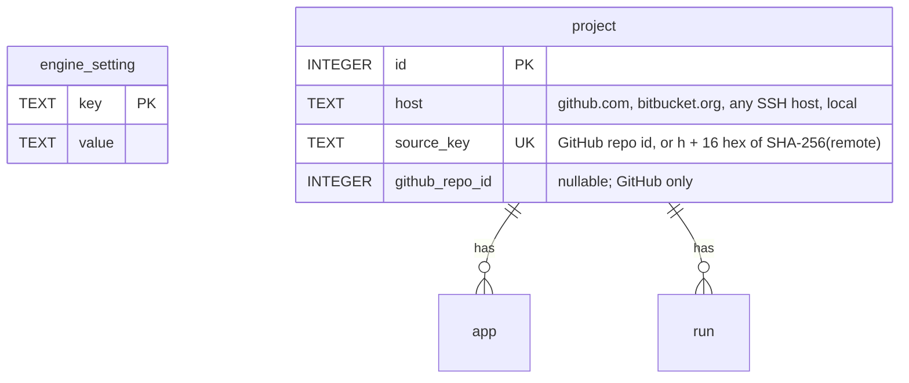

## feat: make a first remote runner useful, part 1: runner core

> Part 1 of 2 of the [runner onboarding plan](2026-10-22-feat-remote-runner-onboarding-plan.md),
> PR 1 of 6 across the three plans. The parent has the problem statement, the feedback it
> answers, the risks and the cross-plan ownership table.

The runner says what it offers and why not, answers "will this machine get jobs?" offline,
shows up in `xp runners list`, MCP and the engine log, pairs with a URL that works from another
machine, survives hours offline without acting on a lost lease, installs its own Android tools,
ships as an image, and the version rules are written down.

## Dependencies

- None. This is the first of the six PRs.
- The owner's answers to Q1, Q2 and Q4 below (the plan assumes the recommended option).
- Docs pages created here (`docs/guide/runners.md`, `docs/guide/install.md`) are extended by
  PRs 4 and 6.

## Decisions for the owner

The plan assumes the recommended option of each. Confirm before the PR that needs it starts.

| # | Question | Recommended | Alternative | Needed by |
|---|---|---|---|---|
| Q1 | A runner's lease has run out while it was unreachable. What happens to the running step? | Stop it as a `cancel` frame would. The lease is the single source of truth (D-08), the engine has already decided, and side-effect steps ask `alreadyDone` on resume. | Let a running side-effect step finish but start nothing after it. This saves a half-done Shorebird upload, but the runner keeps acting on a lease it no longer holds. | R5 |
| Q2 | Where does the runner URL live? | An engine setting in the database, set with `xp runners url <url>` or in the app (Settings → Runners), returned with every pairing token. | `xpd serve --public-url`. Simpler, but the app's own LaunchAgent passes no flags, so the app could not set it. | R4 |
| Q3 | First step for other git hosts: which workflows may run? | Only workflows with no `github.*` and no `git.push` step: the built-in `dev-build` and `test`, and custom ones like them. The engine can push only with the GitHub token. | Also allow `git.push` and `git.tag` over the engine's SSH key. That makes `prod-release` almost work, but its `finalize` still needs `github.createPr`. | R10 |
| Q4 | Which recipe do the docs name for reaching the engine? | Tailscale with `tailscale serve`: TLS on a `*.ts.net` name, no public port, and the engine stays on loopback. Cloudflare Tunnel and an autossh LaunchAgent are listed as alternatives. | A command (`xpd expose ...`). Not now; the docs come first. | R6 |
| Q5 | How do we relax `project.github_repo_id NOT NULL`? | A table rebuild (SQLite's 12-step procedure) in a migration that runs with foreign keys off. This needs a small extension to the migration runner. | Keep the column and give non-GitHub projects negative synthetic ids. No rebuild, but a fake GitHub id ends up in the API and in step inputs. | R10a |
| Q6 | An SSH host key the engine or a runner has never seen. | `StrictHostKeyChecking=accept-new` in the `GIT_SSH_COMMAND` XPath sets: the first connection records the key, a changed key still fails. No interactive `ssh -T` step, which is awkward under a LaunchAgent or in Docker. | An explicit known-hosts step (`xp runner trust-host <host>`), which is stricter but one more thing to do. | R10b |

## Architecture

- **One probe model.** `RunnerProbe.evaluate` returns `ProbeFindings{capabilities,
  operatingSystem, missing}`, where `missing` is a list of `MissingCapability{capability,
  reason, fix}`. The engine (`LocalCapabilities`), the runner (`probed` frame) and
  `xp runner doctor` all read the same findings, so they never disagree. The iOS plan adds
  `ios-linux` to this model, and the UX plan's `xp doctor` reuses it (see Related plans).
- **Wording.** `reason` and `fix` follow the UX plan's UX-09: one sentence each, no HTTP paths
  and no CLI commands in engine text. The CLI adds its own command hints when it prints them.
  The one exception is an install command for a system package (`apt-get install ...`), which
  is the fix itself.
- **Protocol.** A new `EngineFrame` `probed`, sent after the engine stores the capabilities. A
  runner ignores unknown frame types, so an older runner keeps working.
- **Storage.** One new table `engine_setting` (R4), then a rebuild of `project` (R10a).
  Migration numbers are assigned in merge order. Today's last migration is v14; the UX plan's
  U2a, U3d and U7b and the iOS plan's Phase 4a also add migrations. Any migration that
  changes `project` must land before R10a's rebuild, or R10a's rebuild and golden are redone
  on top of it.
- **Docs live in the guide.** Runner docs go straight into `docs/guide/runners.md` (offline
  behaviour, reaching the engine, the image) and `docs/guide/install.md` (versions), with one
  link each from the README. Links printed by the CLI and the app point at those guide anchors,
  which stay stable when the UX plan's U8 trims the README.




## Implementation Phases

`/build` runs these phases in order, one per context window, then reviews the whole branch
once and opens one pull request.

### Phase R1: The runner says what it offers and why not

- **Status:** Done
- **Scope:** At start, the runner prints what it offers and, for each capability it does not
  offer, the reason and the fix. The engine prints the same reasons for itself.
- **Files touched:** `packages/xp_engine/lib/src/runners/{runner_probe,runner_hub}.dart`,
  `packages/xp_engine/lib/src/scheduler/local_capabilities.dart`, `DirectoryAndroidSdk`,
  `packages/xp_api/lib/src/runner.dart`, `packages/xp_api/openapi.yaml`,
  `apps/xp/lib/src/runner/runner_agent.dart`, `apps/xpd/lib/src/cli/serve_command.dart`,
  `apps/xp_desktop/lib/runners/**`, the matching tests,
  `apps/xpd/test/contract/runners_contract_test.dart`
- **Acceptance criteria:** `xp runner start` on a box without a JDK prints `No android: no JDK:
  java not found.` with the fix; `xpd serve` prints one `no <capability>: ...` line per missing
  capability; the `probed` frame is in the contract test.
- **Validation:** `(cd packages/xp_engine && dart test test/src/runners/runner_probe_test.dart) && (cd apps/xp && dart test test/src/runner/runner_agent_test.dart) && (cd apps/xp_desktop && flutter test test/runners) && melos run test:contract`

Details:

- **Probe reasons.** The reason comes from the probe result that failed: not installed, a
  non-zero exit with the first line of stderr, or a timeout. Examples:
  - `android`: "no Android SDK in ANDROID_HOME, ANDROID_SDK_ROOT or ~/Android/Sdk". Fix:
    "install the Android command-line tools or set ANDROID_HOME". (The CLI adds
    "install.sh --with-android" once R7 lands.)
  - `android`: "no JDK: java not found". Fix: "install JDK 17 (apt-get install
    openjdk-17-jdk-headless) or set JAVA_HOME".
  - A capability that cannot exist on this OS (`ios-sign` on Linux, `swift-linux` on macOS) is
    not listed as missing.
- **Better rules.**
  - `android` also needs a JDK: `$JAVA_HOME/bin/java -version`, else `java -version`, version
    17 or later. `JAVA_HOME` is already passed to the build (`build_android.dart:95-105`).
  - On Linux, `flutter` also needs `curl`, `unzip` and `xz`, which the SDK download needs on
    first run. One `sh -c 'command -v ...'` probe names the tools it did not find.
  - `LocalCapabilities` and `DirectoryAndroidSdk` get the same rules and return the same
    `missing` list.
- **Protocol.** `EngineFrame` `probed` `{capabilities, missing}`, sent right after `_probed`
  stores the capabilities (`runner_hub.dart:704-742`). Add the schema to `openapi.yaml` and the
  frame to the "every engine frame" contract test (`runners_contract_test.dart:324`).
- **API.** `Runner` gains `missing` (optional, present while the runner is online, kept in
  memory only, so no migration). The desktop runners table shows it inline under
  "Capabilities", not in a tooltip (the UX plan's U1a-1 removes tooltip-only messages).
- **Queue reason with offline runners.** The hub removes a runner from the scheduler when it
  disconnects (`runner_hub.dart:668`), and `_whyNoRunner` (`scheduler.dart:316-328`) looks only
  at connected runners. So with the engine just woken, the owner reads "No runner can do
  android" although a paired runner offers it. `_whyNoRunner` also reads the paired runners'
  last known capabilities from the runner repository and says "AWS Instance offers android;
  offline since 14:02". "No runner can do X" is kept for when no paired runner ever offered
  X.
- **Output.** `xp runner start` prints, after the connect line, and again only when the set
  changes:

  ```text
  Runner "AWS Instance" connects to https://mac.tailnet.ts.net.
  Nothing was left by an earlier run.
  Connected. The engine runs 1.1.2; this runner offers flutter, 2 slots.
  No android: no JDK: java not found. Install JDK 17 (apt-get install openjdk-17-jdk-headless) or set JAVA_HOME.
  ```

  When the runner offers nothing, it says so plainly: "This runner offers nothing yet, so it
  will get no jobs. Run `xp runner doctor`." `xpd serve` keeps `xpd runs jobs here with 2 slots
  and flutter, android, ios-sign` and adds one `no <capability>: ...` line per missing one.
- **Tests.** `runner_probe_test` covers each reason. The hub tests check that `probed` follows
  `probe_result`. `runner_agent_test` checks the printed lines and that a change of set is
  printed once. The xpd serve test checks the `no ...` lines.

### Phase R2: `xp runner doctor`

- **Status:** Done
- **Scope:** Answer "will this machine get jobs?" without connecting, and with no engine at
  all.
- **Files touched:** `apps/xp/lib/src/runner/runner_command.dart` (new `doctor` subcommand),
  `apps/xp/lib/src/runner/**` (`probe_executor.dart` reused), `apps/xp/test/src/command_runner_test.dart`, a new
  `apps/xp/test/src/runner/runner_doctor_test.dart`
- **Acceptance criteria:** on a box with no JDK, `xp runner doctor` prints `missing` for
  `android` with the fix and exits 0 if `flutter` is offered, 1 if nothing is; `--json` prints
  the same checks.
- **Validation:** `(cd apps/xp && dart test test/src/runner/runner_doctor_test.dart test/src/command_runner_test.dart)`

Details:

```sh
xp runner doctor [--data-dir <dir>] [--git-host github.com]...
```

- It runs `RunnerProbe.commands` through the runner's own `ProbeExecutor` and evaluates them
  with `RunnerProbe.evaluate`, the same code the engine runs, so doctor and the engine agree by
  construction.
- It also checks:
  - `perl`, which the process supervisor needs (exit 69 today).
  - The data directory, and whether the runner is paired: `runner.json`, and whether the
    credential can be read.
  - When paired, whether the engine answers `GET /version` with the same API version. Unpaired,
    this check is skipped and says so.
  - The service state (`service-status`).
  - `ssh -T git@<host>` for each `--git-host` (default `github.com`), with `BatchMode=yes`. It
    reads the output rather than the exit code: GitHub exits 1 on success, Bitbucket exits 0.
    When no key exists, it prints the command to make one and the public key path.
  - Free disk space in the data directory, against what the offered capabilities need (a
    Flutter SDK plus Gradle caches; the iOS plan adds about 7 GB per Flutter version for
    `ios-linux`).
- Output is one line per check (`ok`, `missing`, `skipped`) followed by the fix. Exit 0 when
  the runner can take at least one kind of job, 1 otherwise. `--json` follows the global flag.
- The check model is `DoctorCheck{name, state, detail, fix}`. The UX plan's `xp doctor` (U5b)
  shows the same model for the engine host, but it reads the engine's own findings over the
  API (`GET /runners` for the local runner's `missing`) rather than re-running the probes in
  the CLI's shell, whose `PATH` and `JAVA_HOME` differ from the engine's LaunchAgent and which
  may be on another machine. Project-level checks (does this project's Flutter version work
  here) belong to scan and the UX plan's U2c dry run, not to doctor.
- **Tests.** A fake `ProcessRunner` for the probe and ssh, a temporary data directory, and a
  fake engine for `/version`. `command_runner_test` lists the new subcommand.

### Phase R3: `xp runners list`, `list_runners`, engine log lines

- **Status:** Not started
- **Scope:** See every runner from the CLI and MCP, and see connects, disconnects and refusals
  in the engine log.
- **Files touched:** `apps/xp/lib/src/commands/runners_commands.dart`,
  `packages/xp_api/lib/src/runner.dart` (status extension moved from
  `apps/xp_desktop/lib/runners/widgets/runner_labels.dart`), `apps/xp/lib/src/mcp/xp_tools.dart`,
  `apps/xpd/lib/src/cli/serve_command.dart`, `apps/xpd/lib/src/api/runners/**`,
  `packages/xp_engine/lib/src/runners/runner_hub.dart`, `README.md`,
  `skills/xpath-release/references/mcp-tools.md`, tests
- **Acceptance criteria:** `xp runners list` and `list_runners` show name, id, status, last
  seen, capabilities, slots and jobs; the engine log has one line per connect, disconnect and
  refusal.
- **Validation:** `(cd apps/xp && dart test) && (cd apps/xpd && dart test)`

Details:

- **CLI.** `xp runners list [--all]`, modelled on `ProjectsListCommand` (`renderTable`,
  `formatTime`, the empty hint "No runners. Pair one: xp runners pair <name>", and `--json` as
  `[runner.toJson()]`).
  - Columns: NAME, ID, STATUS, LAST SEEN, CAPABILITIES, SLOTS (`busy/slots`), JOBS, MACHINE. A
    runner with `missing` capabilities shows them in `--json` and in a footnote line under the
    table.
  - STATUS uses the desktop labels: idle, busy, updating, lost (offline and holding jobs),
    offline, revoked. That logic moves into `xp_api` (a `Runner` extension) so the CLI and the
    app share it.
  - Revoked runners are hidden unless `--all` is given.
  - Update `command_runner_test.dart:178-183`.
- **MCP.** A `list_runners` tool in `xp_tools.dart`, `readOnly: true`, no inputs, like
  `list_projects`. Add runners to `mcpInstructions`. Update the tool list test, the README table
  and `skills/xpath-release/references/mcp-tools.md`. (This replaces the `xp runners list` and
  `list_runners` items in the UX plan's U4a.)
- **Engine log.**
  - **Connect and disconnect.** `serve_command.dart` subscribes to the `EventLog` for
    `runner.connected`, `runner.disconnected` and `runner.capabilities_changed` and writes:
    - `runner "AWS Instance" connected: xp 1.1.2, linux x86_64, 2 slots, flutter (no android: no JDK)`
    - `runner "AWS Instance" disconnected (no frame for 90 s)`

    `xp_engine` stays free of logging.
  - **Refusals.** `RunnerConnectRoute` and `RunnerHub` get an `onRefused(String)` callback,
    like the hub's `onError`, and serve writes `refused a runner connection from <address>:
    <why>`. The reasons: an unknown or revoked credential (the 401 from `authMiddleware` on
    `/runners/connect`), the wrong token kind (403), not a WebSocket upgrade (426), replaced
    (4001), timeout (4008), a protocol error (4400).
  - Disconnect lines carry the close code's meaning.
- **Tests.** CLI tests with an online sample runner (`test/helpers/samples.dart` has only a
  revoked one), the MCP tool test, and an xpd test that pairs, connects and drops a
  `RunnerClient` and checks the three lines.

### Phase R4: A runner URL for pairing

- **Status:** Not started
- **Scope:** Both pairing flows print a command that works on the runner machine.
- **Files touched:** `packages/xp_adapters/lib/src/sqlite/migrations.dart` and a new snapshot
  golden, an `EngineSettingRepository` interface in `packages/xp_engine/lib/src/` and a
  `SqliteEngineSettingRepository` in `packages/xp_adapters/lib/src/sqlite/` (modelled on
  `sqlite_housekeeping_repository.dart`), wired in `apps/xpd`,
  `apps/xpd/lib/src/api/runners/**` (runner URL routes),
  `packages/xp_repositories/lib/src/runners_repository.dart`,
  `apps/xp_desktop/lib/settings/bloc/runner_url_bloc.dart` (new, like `github_token_bloc.dart`),
  `docs/guide/runners.md` (new: the page and its `#reaching-the-engine` heading, filled by R6), `packages/xp_api/lib/src/runner.dart` (`PairingToken`),
  `packages/xp_api/openapi.yaml`, `packages/xp_client/lib/src/xp_client.dart`,
  `apps/xp/lib/src/commands/runners_commands.dart`, `apps/xp_desktop/lib/runners/**`
  (`pair_runner_sheet.dart`), `apps/xp_desktop/lib/settings/**`, tests
- **Acceptance criteria:** with a runner URL set, `xp runners pair <name>` and the app's pair
  sheet print `xp runner pair --engine <runner URL> --token ...`; without one and with a
  loopback engine URL, both warn and say how to set it.
- **Validation:** `melos run test:coverage && melos run test:contract`

Details:

- **Storage.** A new migration: `engine_setting(key TEXT PRIMARY KEY, value TEXT NOT NULL)
  STRICT`, with its snapshot golden. `housekeeping_setting` has the same shape but is named for
  housekeeping, so it is not reused.
- **API.**
  - `GET /settings/runner-url` and `PUT /settings/runner-url` (`{url}` or `{url: null}`). Only
    `app` and `cli` tokens may change it; `mcp` may read it.
  - `PairingToken` gains `engineUrl`: the runner URL, or null when none is set.
  - The URL is validated as an absolute `http` or `https` URL with no user info. A plain `http`
    URL that is not loopback, a tailnet address (`100.64.0.0/10`) or a `*.ts.net` name is
    accepted with a warning in the response, because the socket carries signing material.
- **CLI.**
  - `xp runners url [<url> | --clear]` shows or sets the URL.
  - `xp runners pair <name>` prints the whole command:

    ```text
    On the runner machine, within 15 minutes:
      xp runner pair --engine https://mac.tailnet.ts.net --token xpp_...
    ```

    Without a runner URL it uses the CLI's own engine URL. When that is loopback it adds "This
    address only works on this machine. Set the address runners use: xp runners url <url>" and
    a link to `docs/guide/runners.md#reaching-the-engine` (R6).
- **App.** The pair sheet uses `engineUrl` from the response, else the profile URL with the
  same loopback warning and a field to set the runner URL in place. Settings → Runners gets
  the same field. When the token expires before it is used (15 minutes), the sheet offers
  "New token" rather than an error.
- **Changing the URL later.** Paired runners keep the URL they were paired with
  (`runner.json`), for example when moving from an SSH tunnel to Tailscale. They are paired
  again with the new URL (`xp runners pair <name>` on the engine, then `xp runner pair` on the
  runner, which replaces the old credential). The settings field and the guide say so. A
  dedicated command can follow if re-pairing proves a chore.
- **Tests.** The migration golden, the repository test, route tests (token kinds, validation,
  warning), the contract test, `runners_repository` tests (100%), the CLI output, a `blocTest`
  for `RunnerUrlBloc`, and a widget test for the sheet with and without a runner URL.

### Phase R5: Offline for hours: lease fence and quiet reconnects

- **Status:** Not started
- **Scope:** A runner may be offline for hours (the Mac asleep, the tunnel down). It comes back
  within about a minute of the engine, and it never keeps working on a job the engine has
  already given up.
- **Files touched:** `apps/xp/lib/src/runner/{runner_agent,backoff}.dart`, the runner outbox,
  `apps/xp/test/src/runner/runner_agent_test.dart`, a new `tool/e2e/runner_offline_e2e.sh`,
  `apps/xpd/tool/release_e2e.dart` (new mode), the lease duration setting in `xp_engine`,
  `docs/guide/runners.md`, `README.md` (link)
- **Acceptance criteria:** a runner under its service survives the engine being away for longer
  than a lease: it stops the lost job, reconnects within 60 s of the engine coming back, and
  the job follows the loss rule.
- **Validation:** `(cd apps/xp && dart test test/src/runner/runner_agent_test.dart) && tool/e2e/runner_offline_e2e.sh`

Details:

- **Lease fence (Q1).**
  - The runner records `leaseUntil` from each `heartbeat_ack`; today it ignores it.
  - When a lease's `leaseUntil` plus 15 s has passed with no ack, the runner handles the job as
    a `cancel` frame would: it stops the process groups, wipes the secrets and reports nothing
    more (`_cancelled`, `runner_agent.dart:495-510`). The 15 s covers one sweep (every 10 s)
    plus clock skew.
  - The time is measured with a monotonic `Stopwatch` from when the ack arrived, so the
    engine's clock and the runner's need not agree.
  - The runner logs `Lost the lease of job <id> while the engine was unreachable; stopped it.`
- **Bounded outbox.** Once a lease is fenced, its outbox entries are dropped. Until then the
  outbox keeps its chunks as it does today. A fenced job is at most 90 s + 15 s of output.
- **Quiet reconnects.** One line when the connection is lost. One line on the first failed
  attempt. Then at most one line every 10 minutes ("The engine has been unreachable for 2 h 10
  min; still trying every 60 s"). One line when it is back ("Connected again after 3 h 12
  min"). Hours offline fill a service log with a few dozen lines rather than thousands.
- **Prove it.**
  - Agent tests with a fake clock: the engine is unreachable at start, a drop mid-job is longer
    than the lease, a drop is shorter than the lease (the job continues, as today), and the log
    rate stays within the limit.
  - `tool/e2e/runner_offline_e2e.sh`, modelled on `runner_loss_e2e.sh`, with a new
    `--mode runner-offline` in `apps/xpd/tool/release_e2e.dart` that starts the engine with a
    short lease (a test-only lease duration, so the script runs in seconds rather than 90 s):
    1. start a runner with that engine
    2. stop the engine (SIGSTOP, then SIGKILL) for longer than the lease
    3. check that the runner fenced the job
    4. start the engine again
    5. check that the runner reconnects without a restart and that the job follows the loss
       rule
  - Run the same check once by hand under the systemd unit and the LaunchAgent. The result
    goes in the PR description.
- **Docs.** `docs/guide/runners.md` (linked from the README's runner agent section) says
  that a runner may be offline for hours, what happens to its jobs, and that the engine Mac
  should not sleep while runners have work. D-10 already covers the Mac mini; a laptop engine
  is the owner's choice.

### Phase R6: Docs: reaching the engine from another machine

- **Status:** Not started
- **Scope:** A section "Reaching the engine" in `docs/guide/runners.md` (anchor
  `#reaching-the-engine`, which R4's output links to), a README link to it, and a short version
  in `skills/xpath-setup/SKILL.md`. It names one setup and two alternatives (Q4).
- **Files touched:** `docs/guide/runners.md`, `README.md` (link), `skills/xpath-setup/SKILL.md`
- **Acceptance criteria:** the section gives the exact commands for Tailscale, the version of
  Tailscale they were checked against, and the two alternatives.
- **Validation:** `grep -q "tailscale serve" docs/guide/runners.md` and `manual 1. On a second machine, follow the Tailscale recipe only. 2. Pair a runner with the printed command. 3. It connects.`

Details:

1. **Tailscale (recommended).** Tailscale on both machines. On the engine Mac,
   `tailscale serve --bg http://127.0.0.1:7480` publishes `https://<mac>.<tailnet>.ts.net` with
   a real certificate (HTTPS certificates must be on in the tailnet). WebSockets pass through.
   - The engine keeps listening on loopback, nothing is public, and the traffic is encrypted
     twice.
   - Then `xp runners url https://<mac>.<tailnet>.ts.net`.
   - The exact commands are checked against the current Tailscale docs when the PR is written.
2. **Cloudflare Tunnel.** `cloudflared` on the engine machine maps a hostname to
   `http://127.0.0.1:7480`.
   - The engine becomes reachable from the internet, protected by its bearer tokens (every
     route but `/health` and `/version` needs one).
   - Cloudflare Access in front is **not** supported yet: the runner cannot send the
     service-token headers. A follow-up could add `XP_ENGINE_HEADERS`.
3. **SSH reverse tunnel.** autossh as a LaunchAgent on the engine Mac:

   ```sh
   autossh -M 0 -N -o ServerAliveInterval=30 -o ExitOnForwardFailure=yes -R 127.0.0.1:7480:127.0.0.1:7480 user@runner
   ```

   - The guide shows a LaunchAgent plist for it to copy, with placeholders. XPath does not
     ship or install it.
   - The runner URL is then `http://127.0.0.1:7480` on the runner, and SSH encrypts the
     traffic.
   - It only works for a runner whose SSH port the Mac can reach, one tunnel per runner.

The section also says what not to do: `--host 0.0.0.0` without TLS in front.

### Phase R7: `install.sh --with-android` and the next steps

- **Status:** Not started
- **Scope:** One installer flag gives a Debian or Ubuntu box everything `android` and `flutter`
  need, and `--runner` ends with the three next steps.
- **Files touched:** `tool/release/linux/install.sh`, `tool/release/linux/install_test.sh`,
  `apps/xp/lib/src/command_runner.dart` (completion auto-install), `apps/xp/lib/src/runner/**`
  (`install-service` writes `ANDROID_HOME`)
- **Acceptance criteria:** on a clean `ubuntu:24.04` container, `install.sh --runner
  --with-android` then `xp runner doctor` reports `flutter` and `android` as `ok`; no
  completion hint appears during the install.
- **Validation:** `tool/release/linux/install_test.sh`

Details:

- **`--with-android`** (`XPATH_WITH_ANDROID=1`), on Debian or Ubuntu only (`/etc/os-release`
  `ID` or `ID_LIKE`); elsewhere it fails with a clear message.
  - It installs `openjdk-17-jdk-headless git openssh-client curl unzip xz-utils zip perl` with
    `apt-get` (through `sudo` when not root; without either it prints the command and stops).
  - It downloads the Android command-line tools, pinned by version and SHA-256 in the script.
  - It accepts the licences with `sdkmanager --licenses`.
  - It installs `platform-tools`, one `platforms;android-N` and one `build-tools;X`. The
    Flutter Gradle plugin downloads other versions on demand once the licences are accepted.
  - The SDK goes to `--android-sdk <dir>` (default `~/Android/Sdk`), a place the probe and
    Flutter already look, so no `ANDROID_HOME` is needed. When the directory is elsewhere, the
    installer prints the `ANDROID_HOME` line, and `xp runner install-service` writes it into
    the unit when it is set at install time.
  - Running it again skips what is already installed.
- **Next steps** for `--runner`:
  1. `xp runner doctor` (R2), which shows the capabilities now.
  2. The pair command, with a note that `xp runners pair <name>` on the engine prints it in
     full (R4).
  3. `xp runner install-service`.
- **Completion hint.** Reproduce on a clean Ubuntu 24.04 container. If `cli_completion`'s
  auto-install fires on the installer's `xp --version` check, turn auto-install off for
  `--version` (override `enableAutoInstall` in `XpCommandRunner`).
- **Tests.** Extend `install_test.sh` with a fake `apt-get`, `sudo` and `sdkmanager` on `PATH`
  and a local `file://` command-line tools zip, covering a wrong SHA-256, a non-Debian
  `os-release` and a re-run. A real install runs in an `ubuntu:24.04` container in CI as a side
  effect of R8.

### Phase R8: The `xpath-runner` image

- **Status:** Not started
- **Scope:** A Docker image that is a working Android and Flutter runner out of the box, built
  by the R7 installer.
- **Files touched:** `Dockerfile.runner` (new), `tool/release/linux/xpath-runner` (entrypoint,
  new), `.github/workflows/release.yml`, `Dockerfile` (comment), `README.md`
- **Acceptance criteria:** CI builds the image, runs `xp runner doctor --json` in it, finds
  `flutter` and `android` offered, and pushes `ghcr.io/abdurahmanalmehdi/xpath-runner:<version>`.
- **Validation:** `docker build -f Dockerfile.runner -t xpath-runner:test . && docker run --rm xpath-runner:test runner doctor --json | jq -e '[.checks[] | select(.state=="ok") | .name] | index("android") and index("flutter")'`

Details:

- **`Dockerfile.runner`, based on `ubuntu:24.04`.** It runs `install.sh` from the bundle with
  `--archive /bundles/linux-x64 --runner --with-android --android-sdk /opt/android-sdk
  --no-service`, so the image is built by the installer and tests it.
  - Flutter is not in the image: the runner clones the pinned SDK into the volume at
    `/data/toolchains/flutter/<version>` as it does today. One image serves every Flutter
    version, and the volume caches them.
  - It runs as `xpath` (uid 10001) with `XP_RUNNER_DATA_DIR=/data`, `HOME=/data/home` (so
    `~/.ssh` and `~/.gradle` persist in the volume), `ANDROID_HOME=/opt/android-sdk` and
    `XP_RUNNER_MANAGED=1`.
  - **amd64 only:** Google ships no Linux arm64 Android build tools (`aapt2`).
- **Entrypoint `xpath-runner`.**
  - It runs `/data/current/bin/xp` when it exists, else the image's `xp`. A runner that updated
    itself to its engine's version keeps that version across container restarts.
  - Exit 75 (switched version) is passed on, so `--restart on-failure` starts it again.
  - Exits 77 (revoked), 73 (replaced) and 78 (not paired) print why and exit 0, so Docker does
    not restart a runner that must not run. This matches `RestartPreventExitStatus` in the
    systemd unit.
  - Usage:

    ```sh
    docker volume create xpath-runner
    docker run --rm -it -v xpath-runner:/data ghcr.io/abdurahmanalmehdi/xpath-runner \
      runner pair --engine https://mac.tailnet.ts.net --token xpp_...
    docker run --rm -v xpath-runner:/data ghcr.io/abdurahmanalmehdi/xpath-runner runner doctor
    docker run -d --name xpath-runner --restart on-failure -v xpath-runner:/data \
      ghcr.io/abdurahmanalmehdi/xpath-runner            # CMD: runner start
    ```

    The SSH key for the source (ADR 0009) is made in the volume with `docker exec xpath-runner
    ssh-keygen -t ed25519`, or mounted read-only. `doctor` prints the public key to add as a
    deploy key.
- **CI.** A `docker-runner` job in `.github/workflows/release.yml` after `bundles`, like
  `docker`. It builds the image, runs `xp runner doctor --json` in it and checks that `android`
  and `flutter` are offered, then pushes `ghcr.io/abdurahmanalmehdi/xpath-runner:<version>`
  (and `:latest` unless it is a pre-release).
- **Docs.** `docs/guide/runners.md` gets the runner image, with a link from the README's
  Docker section. Also correct the engine `Dockerfile` comment "no Flutter": it has git, so its
  local runner reports `flutter`. Either set `--slots 0` there or say so.

### Phase R9: Versions: what must match

- **Status:** Not started
- **Scope:** Write down which versions must match, make the 1.0 plan agree with the code, and
  stop the misleading update nag on runners.
- **Files touched:** `docs/guide/install.md` (new), `README.md` (link),
  `docs/plan/2026-10-13-feat-xpath-release-tool-plan.md` (D-24),
  `apps/xp/lib/src/command_runner.dart`, `apps/xp/lib/src/runner/runner_agent.dart`, tests
- **Acceptance criteria:** `xp runner start` makes no GitHub release check; when the runner and
  engine versions differ, it prints "The engine runs 1.1.3; this runner updates to it between
  jobs"; D-24 matches the code.
- **Validation:** `(cd apps/xp && dart test test/src/command_runner_test.dart test/src/runner/runner_agent_test.dart)`

Details:

- **`docs/guide/install.md`, new short section "Which versions work together"** (linked from
  the README):
  - A runner always runs its engine's version. It updates itself between jobs, so a runner and
    an engine on different versions are supported only for the minutes the update takes.
  - The app, the CLI and `xp mcp` need an engine with the same API version. Every 1.x release
    is API 1, so they need not be upgraded together.
  - Upgrade the engine first; runners follow by themselves.
  - Tools a runner uses but XPath does not install (today the Android SDK; with the iOS plan,
    omarchy-apple-dev at a pinned commit) are checked again after each self-update, and a
    capability lost that way is printed with its reason (R1) and logged by the engine (R3).
- **Correct D-24.** Its "accepts an engine one minor version behind" is not what the code does.
  Change the 1.0 plan's D-24 row to the rule above.
- **`xp runner` skips the GitHub update check** for the `runner` command tree in
  `command_runner.dart:168-173`, as for `mcp`. In its place, `xp runner start` prints the
  engine-version line from R1's connected line when the versions differ.
- Find where the "engine" 1.1.3 warning came from. xpd has no update check, so it was probably
  `xp` on the Mac or the app's Sparkle prompt. If it came from xpd, apply the same treatment.

## Success Criteria

```success-criteria
GOAL: A fresh Linux box becomes a useful XPath runner without guesswork, and stays useful while the engine is unreachable for hours.

SUCCESS CRITERIA:
- The runner prints what it offers and, for each missing capability, the reason and the fix | verify: (cd apps/xp && dart test test/src/runner/runner_agent_test.dart) && (cd packages/xp_engine && dart test test/src/runners/runner_probe_test.dart)
- `xp runner doctor` answers offline and exits 1 when the runner can take no job | verify: (cd apps/xp && dart test test/src/runner/runner_doctor_test.dart)
- `xp runners list` and `list_runners` show name, id, status, last seen, capabilities, slots and jobs | verify: (cd apps/xp && dart test test/src/commands test/src/mcp)
- The engine log has one line per runner connect, disconnect and refusal | verify: (cd apps/xpd && dart test)
- Both pairing flows print a URL that works from the runner once a runner URL is set | verify: melos run test:contract && (cd apps/xp_desktop && flutter test test/runners)
- A runner fences a lost lease and reconnects within 60 s of the engine returning | verify: tool/e2e/runner_offline_e2e.sh
- `install.sh --runner --with-android` gives a box that offers `flutter` and `android`; CI's docker-runner job checks the same in the image | verify: tool/release/linux/install_test.sh
- The guide says which versions must match, and D-24 matches the code | verify: grep -q "Which versions work together" docs/guide/install.md
- A runner set up by following only `docs/guide/runners.md` connects from a second machine | verify: manual 1. On a second machine, follow the Tailscale recipe. 2. Pair with the printed command. 3. It connects.
- The workspace stays green | verify: dart analyze --fatal-infos && dart format --set-exit-if-changed . && dart run tool/check_layers.dart && melos run test:coverage && melos run test:contract

NON-GOALS:
- Projects on hosts other than GitHub (part 2).
- A built-in tunnel command (`xpd expose`); Cloudflare Access headers; arm64 runner images.

VERIFICATION COMMAND: dart analyze --fatal-infos && dart format --set-exit-if-changed . && dart run tool/check_layers.dart && melos run test:coverage && melos run test:contract && tool/e2e/runner_offline_e2e.sh && tool/release/linux/install_test.sh
```
