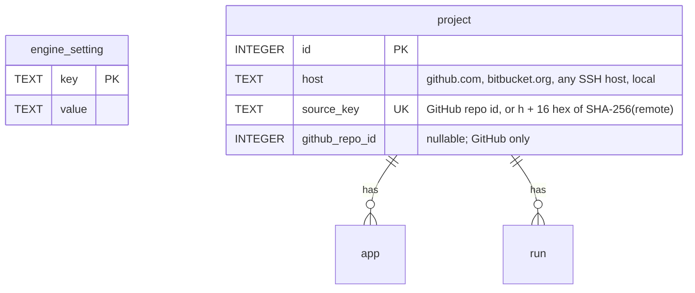

## feat: make a first remote runner useful, part 2: projects on any git host

> Part 2 of 2 of the [runner onboarding plan](2026-10-22-feat-remote-runner-onboarding-plan.md),
> PR 2 of 6 across the three plans. The parent has the problem statement, the feedback it
> answers, the risks and the cross-plan ownership table.

Projects whose origin is not on GitHub (Bitbucket, any SSH host, `file://`) can be added,
scanned and built with workflows that need no GitHub step (`dev-build`, `test`).

## Dependencies

- **PR 1 (runner core)** merged: R2's `--git-host` check and R1's reasons are reused here.
- **ADR 0015 "Projects on any git host"** written and accepted first, as the first commit of
  Phase R10a (its content is below).
- The owner's answers to Q3, Q5 and Q6 below.
- Any other migration that changes the `project` table lands before R10a, or R10a's rebuild and
  golden are redone on top of it. The iOS plan's PR 6 (Phase 4a) reuses the foreign-keys-off
  migration support added here.
- The UX plan's PR 4 (U5a's setup checklist) and PR 3 (U1a-2's Releases empty state): whichever
  of those and R10d lands second adds the non-GitHub branch.

## Decisions for the owner

The plan assumes the recommended option of each. Confirm before the PR that needs it starts.

| # | Question | Recommended | Alternative | Needed by |
|---|---|---|---|---|
| Q1 | A runner's lease has run out while it was unreachable. What happens to the running step? | Stop it as a `cancel` frame would. The lease is the single source of truth (D-08), the engine has already decided, and side-effect steps ask `alreadyDone` on resume. | Let a running side-effect step finish but start nothing after it. This saves a half-done Shorebird upload, but the runner keeps acting on a lease it no longer holds. | R5 |
| Q2 | Where does the runner URL live? | An engine setting in the database, set with `xp runners url <url>` or in the app (Settings → Runners), returned with every pairing token. | `xpd serve --public-url`. Simpler, but the app's own LaunchAgent passes no flags, so the app could not set it. | R4 |
| Q3 | First step for other git hosts: which workflows may run? | Only workflows with no `github.*` and no `git.push` step: the built-in `dev-build` and `test`, and custom ones like them. The engine can push only with the GitHub token. | Also allow `git.push` and `git.tag` over the engine's SSH key. That makes `prod-release` almost work, but its `finalize` still needs `github.createPr`. | R10 |
| Q4 | Which recipe do the docs name for reaching the engine? | Tailscale with `tailscale serve`: TLS on a `*.ts.net` name, no public port, and the engine stays on loopback. Cloudflare Tunnel and an autossh LaunchAgent are listed as alternatives. | A command (`xpd expose ...`). Not now; the docs come first. | R6 |
| Q5 | How do we relax `project.github_repo_id NOT NULL`? | A table rebuild (SQLite's 12-step procedure) in a migration that runs with foreign keys off. This needs a small extension to the migration runner. | Keep the column and give non-GitHub projects negative synthetic ids. No rebuild, but a fake GitHub id ends up in the API and in step inputs. | R10a |
| Q6 | An SSH host key the engine or a runner has never seen. | `StrictHostKeyChecking=accept-new` in the `GIT_SSH_COMMAND` XPath sets: the first connection records the key, a changed key still fails. No interactive `ssh -T` step, which is awkward under a LaunchAgent or in Docker. | An explicit known-hosts step (`xp runner trust-host <host>`), which is stricter but one more thing to do. | R10b |

## Architecture

- **One probe model.** `RunnerProbe.evaluate` returns `ProbeFindings{capabilities,
  operatingSystem, missing}`, where `missing` is a list of `MissingCapability{capability,
  reason, fix}`. The engine (`LocalCapabilities`), the runner (`probed` frame) and
  `xp runner doctor` all read the same findings, so they never disagree. The iOS plan adds
  `ios-linux` to this model, and the UX plan's `xp doctor` reuses it (see Related plans).
- **Wording.** `reason` and `fix` follow the UX plan's UX-09: one sentence each, no HTTP paths
  and no CLI commands in engine text. The CLI adds its own command hints when it prints them.
  The one exception is an install command for a system package (`apt-get install ...`), which
  is the fix itself.
- **Protocol.** A new `EngineFrame` `probed`, sent after the engine stores the capabilities. A
  runner ignores unknown frame types, so an older runner keeps working.
- **Storage.** One new table `engine_setting` (R4), then a rebuild of `project` (R10a).
  Migration numbers are assigned in merge order. Today's last migration is v14; the UX plan's
  U2a, U3d and U7b and the iOS plan's Phase 4a also add migrations. Any migration that
  changes `project` must land before R10a's rebuild, or R10a's rebuild and golden are redone
  on top of it.
- **Docs live in the guide.** Runner docs go straight into `docs/guide/runners.md` (offline
  behaviour, reaching the engine, the image) and `docs/guide/install.md` (versions), with one
  link each from the README. Links printed by the CLI and the app point at those guide anchors,
  which stay stable when the UX plan's U8 trims the README.



## What ADR 0015 decides

First write **ADR 0015 "Projects on any git host"** (0014 is taken by iOS builds on Linux). It
refines D-05 and ADR 0009 and removes "GitLab or Bitbucket" from the 1.0 non-goals. It decides:

- **Identity.**
  - A project has a `host` (`github.com`, `bitbucket.org`, any SSH host, or `local` for
    `file://`) and a `source_key`, a stored opaque string that keys the engine mirror, the
    runner cache and the worktrees.
  - For GitHub the key is the repository id in decimal, so existing `mirrors/<id>.git` folders
    stay where they are. For other hosts it is `h` plus 16 hex digits of the SHA-256 of the
    normalised remote URL, fixed when the project is added.
  - `github_repo_id` becomes nullable; it is present only for GitHub projects.
- **Source.**
  - Other hosts are added by an SSH URL (scp-like or `ssh://`) or a `file://` URL.
  - Bitbucket clones are usually HTTPS. For an HTTPS origin that is not GitHub, XPath derives
    the SSH URL (`https://bitbucket.org/ws/repo.git` → `git@bitbucket.org:ws/repo.git`) and
    asks the owner to confirm it; the owner's clone is not changed. Without confirmation it
    refuses with "XPath has no credentials for <host> over HTTPS; use the SSH URL".
  - **Normalisation.** The scp-like, `ssh://` and derived forms of one repository give the same
    `source_key`: lower-case host, default port and user dropped, a trailing `.git` and `/`
    removed. So one repository cannot be added twice.
  - The engine fetches with its own SSH key, using
    `GIT_SSH_COMMAND='ssh -o BatchMode=yes -o ConnectTimeout=30 -o StrictHostKeyChecking=accept-new'`
    (Q6), as the runner does. The engine machine needs a key that can read the repository
    without a passphrase prompt (the LaunchAgent has no terminal). When adding fails, the
    error names the public key the engine used (`~/.ssh/id_ed25519.pub` of the engine's user)
    and where to add it as an access key. The UX plan's `xp doctor` shows the same check for
    the engine host.
- **What runs (Q3).**
  - A workflow with a `github.*` or `git.push` step is refused at dispatch on a non-GitHub
    project, with an error that names the host, the step and the workarounds (`dev-build`,
    `test`, or a private GitHub mirror).
  - Pull requests on Bitbucket are later work.


## Implementation Phases

`/build` runs these phases in order, one per context window, then reviews the whole branch
once and opens one pull request.

### Phase R10a: Schema and identity

- **Status:** Done
- **Scope:** The migration runner learns foreign-keys-off migrations, and `project` is rebuilt
  with `host`, `source_key` and a nullable `github_repo_id`.
- **Files touched:** `docs/adr/0015-projects-on-any-git-host.md` (new),
  `packages/xp_adapters/lib/src/sqlite/{sqlite_database,migrations}.dart`, a new snapshot
  golden, `packages/xp_engine/lib/src/projects/**` (`ProjectRecord`),
  `packages/xp_adapters/lib/src/sqlite/sqlite_project_repository.dart` (`findByGithubRepoId`),
  `packages/xp_api/lib/src/project.dart`, `packages/xp_api/openapi.yaml`, and every call site
  of `githubRepoId` that `int?` breaks in `xp_client`, `xp_repositories`, `apps/xp` (CLI and
  MCP) and `apps/xp_desktop`, so the workspace stays green; tests
- **Acceptance criteria:** a populated database at the previous version migrates with every
  row and foreign key intact; `Project.githubRepoId` is `int?` and `host` and `sourceKey` are
  present.
- **Validation:** `(cd packages/xp_adapters && dart test test/src/sqlite) && melos run test:contract`

Details:

- Extend the migration runner (`sqlite_database.dart`) with migrations that run with `PRAGMA
  foreign_keys=OFF` outside the per-migration transaction. The runner runs `PRAGMA
  foreign_key_check` before it commits and fails the migration on any row.
- The migration rebuilds `project` following SQLite's 12-step procedure, with `host`,
  `source_key UNIQUE NOT NULL` and a nullable `github_repo_id`. Existing rows get
  `host='github.com'` and `source_key=github_repo_id`.
- A test migrates a populated database (apps, flavors, jobs, runs, approvals) and finds every
  row and foreign key intact. The pre-migration backup (`xpath.db.bak-v<N>`) is already made.
- In `ProjectRecord`, `Project` (xp_api) and `openapi.yaml`, `githubRepoId` becomes `int?`, and
  the records gain `host` and `sourceKey`. `findBySourceKey` replaces `findByGithubRepoId`
  wherever the key is meant.
- An app one minor version behind cannot read a project without `githubRepoId`. R9's version
  section says so.

### Phase R10b: Mirrors, runner cache and the lease

- **Status:** Done
- **Scope:** Everything keyed by `githubRepoId` is keyed by `sourceKey`, and runner errors are
  host-aware.
- **Files touched:** `packages/xp_engine/lib/src/git/**` (`GitService`, `GitMirror`,
  `ReleaseWorktree`), `packages/xp_adapters/lib/src/git/**` (`CliGitService`),
  `packages/xp_engine/lib/src/runners/**` (`LeasePaths`, `LeaseRepository`),
  `packages/xp_adapters/lib/src/housekeeping/directory_data_files.dart`,
  `apps/xp/lib/src/runner/**` (`RemoteCheckoutStep`), `packages/xp_api/openapi.yaml`, tests
- **Acceptance criteria:** a GitHub project's mirror path is unchanged after the upgrade; a
  `file://` project's mirror is `mirrors/h<16 hex>.git`; the lease contract test passes with
  `cacheKey`.
- **Validation:** `melos run test:coverage && melos run test:contract`

Details:

- In `GitService.ensureMirror`, `GitMirror`, `CliGitService` paths, `ReleaseWorktree`
  (`mirror.key`; still read `mirror.githubRepoId` from jobs serialised before the upgrade),
  `LeasePaths` and housekeeping (`directory_data_files.dart`: the regex
  `^(\d+|h[0-9a-f]{16})\.git$`; the planner looks up by key), replace `githubRepoId` with
  `sourceKey`.
- `LeaseRepository` gains `cacheKey`, and `githubRepoId` becomes optional. Runners update to
  the engine's version before they take offers, so both ends change together.
- `RemoteCheckoutStep._explain` becomes host-aware: "run `ssh -T git@bitbucket.org` once", "add
  this runner's SSH key as an access key of <workspace/repo> (Bitbucket: Repository settings,
  Access keys)", "<host> has no commit".
- `CliGitService` sets the BatchMode `GIT_SSH_COMMAND`, with `accept-new` (Q6), for non-GitHub
  remotes; the runner's checkout uses the same command.

### Phase R10c: Adding, scanning and dispatching

- **Status:** Done
- **Scope:** Projects whose origin is not GitHub can be added and scanned, and workflows that
  need GitHub are refused at dispatch with the reason.
- **Files touched:** `packages/xp_engine/lib/src/projects/project_service.dart`,
  `packages/xp_engine/lib/src/git/**` (`GitService.lsRemote`, new),
  `packages/xp_adapters/lib/src/git/**` (`CliGitService.lsRemote`),
  `packages/xp_engine/lib/src/dispatch/workflow_dispatcher.dart`,
  `apps/xp/lib/src/commands/projects_commands.dart`, `apps/xp/lib/src/mcp/xp_tools.dart`, a new
  `tool/e2e/runner_any_host_e2e.sh`, tests
- **Acceptance criteria:** a project whose origin is `file://` or on Bitbucket can be added and
  runs `dev-build` and `test` on a runner with no GitHub token on the engine; `prod-release`
  is refused with a reason that names the host and the step.
- **Validation:** `(cd packages/xp_engine && dart test test/src/projects test/src/dispatch) && tool/e2e/runner_any_host_e2e.sh`

Details:

- `ProjectService.add` and `_addFolder` keep `GitHubRemote.parse` for GitHub. For any other
  origin they:
  1. derive the host and `owner/name` from the URL path, keeping more than two segments for
     GitLab subgroups
  2. call `GitService.lsRemote` (`git ls-remote --symref <url> HEAD` in `CliGitService`, with
     the engine's SSH environment) to prove access and read the default branch; `xp_engine`
     runs no process itself
  3. refuse with the host-aware fix on failure
  4. register the project without any GitHub call
- `scan` skips `getRepoById`, which follows renames, when `host != github.com`.
- Dispatch refuses as decided above (`workflow_dispatcher.dart:133-134` already computes the
  step kinds). The refusal lives only in the engine dispatcher: the app and MCP show the
  engine's error, and once the UX plan's U2c dry run lands, its preview shows it before
  dispatch. The client-side `dispatch_preview.dart`, which U2c removes, is not taught the rule.
- The CLI help, the `add_project` tool description ("Add a GitHub repository") and the error
  "is not on GitHub" change to match.
- **Tests:** replace `project_service_test.dart:178` with tests for a `file://` and an SSH
  origin, an HTTPS non-GitHub origin (derived SSH URL), the three URL forms giving one
  `source_key`, and `ls-remote` failures; a fake `ssh` on `PATH` covers an unknown host key, a
  changed host key and the `ssh -T` output of GitHub and Bitbucket; dispatcher refusal tests;
  the new e2e runs a `dev-build` on a runner from a `file://` bare repository.
- `xp projects add` recognises `git@host:path`, `ssh://` and `file://` as remotes before the
  UX plan's U1b rule (a path-like argument that does not exist is a usage error) applies.

### Phase R10d: The app

- **Status:** Done
- **Scope:** The app adds and shows non-GitHub projects correctly.
- **Files touched:** `apps/xp_desktop/lib/{add_project,projects,project_overview,dispatch}/**`,
  `apps/xp_desktop/lib/l10n/arb/app_en.arb`, tests
- **Acceptance criteria:** the add-project page says the GitHub token is needed for GitHub
  projects only and offers the derived SSH URL for an HTTPS origin; projects show their host;
  workflows that cannot run are greyed out with the reason; the Releases empty state and the
  setup checklist (UX plan U1a-2, U5a) do not offer a prod release or a GitHub step for a
  non-GitHub project; a `fullName` with three segments renders.
- **Validation:** `(cd apps/xp_desktop && flutter test test/add_project test/projects test/project_overview test/dispatch)`
- **Tests.** Bloc tests (`blocTest`) for the add-project bloc's derived SSH URL and for the
  host-dependent checklist and empty state; widget tests for the greyed-out workflows and a
  three-segment `fullName`. The Releases empty state and setup checklist come from the UX
  plan's U1a-2 and U5a; whichever of R10d and those lands second adds the non-GitHub branch.

## Success Criteria

```success-criteria
GOAL: A project whose origin is not on GitHub can be added and built on a runner with workflows that need no GitHub step, and workflows that need GitHub are refused with the reason.

SUCCESS CRITERIA:
- A populated database migrates with every row and foreign key intact | verify: (cd packages/xp_adapters && dart test test/src/sqlite)
- A GitHub project's mirror path is unchanged; scp-like, `ssh://` and derived HTTPS forms give one `source_key` | verify: (cd packages/xp_engine && dart test test/src/projects test/src/git)
- Unknown and changed host keys and `ssh -T` output are handled as decided in Q6 | verify: (cd packages/xp_adapters && dart test test/src/git)
- A Bitbucket or `file://` project runs `dev-build` and `test` on a runner, and `prod-release` is refused with the reason | verify: tool/e2e/runner_any_host_e2e.sh
- The app adds a non-GitHub project and shows its host | verify: (cd apps/xp_desktop && flutter test test/add_project test/projects)
- The workspace stays green | verify: dart analyze --fatal-infos && dart format --set-exit-if-changed . && dart run tool/check_layers.dart && melos run test:coverage && melos run test:contract

NON-GOALS:
- Pull requests, merges or tags on Bitbucket, GitLab or other hosts.
- HTTPS credentials for hosts other than GitHub.

VERIFICATION COMMAND: dart analyze --fatal-infos && dart format --set-exit-if-changed . && dart run tool/check_layers.dart && melos run test:coverage && melos run test:contract && tool/e2e/runner_any_host_e2e.sh
```
