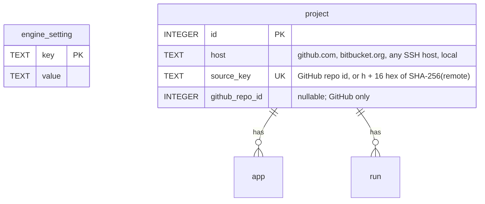

## feat: make a first remote runner useful - Extensive

> Consolidated from the 2026-10-21 runner onboarding plan (branch
> `claude/implementation-plan-pwhgx5`). It is checked against the
> [UX plan](2026-10-22-feat-ux-improvements-plan.md) and the
> [iOS-on-Linux plan](2026-10-22-feat-ios-builds-on-linux-plan.md); see
> [Related plans](#related-plans) for what each plan owns.

> **Note:** This plan was split into parts for building. See the -part-N files in this
> directory; run `/build` on a part file, one pull request per part, never on this file.

## Overview

This plan answers the feedback from pairing a first remote runner
([2026-10-20 feedback](../feedback/2026-10-20-remote-runner-onboarding.md)). The setup was an
AWS Ubuntu 24.04 box against an engine on the owner's Mac (`127.0.0.1:7480`, engine 1.1.2),
building two Flutter apps hosted on Bitbucket. Pairing worked, but the runner was not useful
yet. The plan turns each finding into a pull request that ships on its own, in the order they
pay off.

The owner asked for two things in particular. A runner should get its build tools (R1, R2,
R7, R8), and it should stay connected without someone watching it (R4, R5, R6). Both come
first.

## Problem Statement

The feedback was checked against the code. Some of what it describes is already in place.
Some of it works differently from how it looked from outside.

| Finding | What the code does | So the work is |
|---|---|---|
| "No `flutter` capability" | `flutter` only means `git --version` runs (`packages/xp_engine/lib/src/runners/runner_probe.dart:104`). The runner clones the pinned SDK into `<data dir>/toolchains/flutter/<version>` when a job needs it (`apps/xp/lib/src/runner/runner_steps.dart:55-65`). A stock Ubuntu box with git most likely offered `flutter` and lacked `android`. | Say what is offered. Make `flutter` check what Flutter needs on Linux (curl, unzip, xz). |
| `android` | Offered when one of `ANDROID_HOME`, `ANDROID_SDK_ROOT`, `~/Android/Sdk` or `~/Library/Android/sdk` contains `platform-tools`, `cmdline-tools` or `build-tools`. **No JDK check**, although `capability.dart:5-17` documents `android` as "Android SDK and a JDK". | Probe for a JDK. Install both (installer flag, image). |
| Nothing says what is missing | `RunnerProbe.evaluate` keeps only the capability set. The stdout, stderr and status of each result are dropped (`runner_hub.dart:711`). The runner never learns what the engine derived. | Keep a reason and a fix for each missing capability. Send them to the runner. Print them. |
| Reconnect with backoff | Already implemented. It retries forever, starting at 1 s and doubling to 60 s, with jitter, and resets on `welcome` (`runner_agent.dart:180-221`, `backoff.dart`). It stops only on 4003 revoked, 4001 replaced or a refused credential. The systemd unit has `Restart=on-failure` and the LaunchAgent has `KeepAlive`. | Prove it for hours offline. Fix what goes wrong over hours. |
| Leased jobs follow the loss rule | The engine side is correct: the lease outlives the connection, `LeaseSweeper` runs, `waiting_for_resume` is set. **The runner has no lease clock.** It ignores `heartbeat_ack` (`runner_agent.dart:343-344`) and keeps running a lost job, buffering its output in memory without a limit, until it reconnects and is told `cancel`. | Add a lease fence on the runner. |
| Pairing prints `127.0.0.1` | The desktop sheet uses the URL of the app's engine profile, which for "This Mac" is the hardcoded `localEngineUrl` (`engine_profile.dart:9`). `xp runners pair` prints only the token. The engine has no notion of the URL runners use. | Add a runner URL setting to the engine, used by both pairing flows. |
| `xp runners list` | `GET /runners`, `XpClient.listRunners()`, the `Runner` schema and a contract test all exist, with status, capabilities, slots, `jobIds`, `lastHeartbeat`, version, os and arch. Only the CLI command and an MCP tool are missing. | Small. |
| Engine log on connect, disconnect, refuse | `runner.connected` and `runner.disconnected` events exist. Nothing writes a log line, and refusals (401/403/426, close codes 4001/4008/4400) leave no trace. | Log lines from `xpd serve`, plus a refusal callback on the route. |
| Bitbucket | GitHub is assumed in every layer: `GitHubRemote.parse` (`project_service.dart:174-177`); `project.github_repo_id INTEGER NOT NULL UNIQUE` keys the project, the engine mirror, the runner cache, the lease protocol, housekeeping and `ReleaseWorktree`; the engine authenticates git only through a `https://github.com` credential helper. The 1.0 plan lists Bitbucket as a non-goal. | An ADR, then four PRs (R10a–R10d). |
| `install --runner` ends with the completion hint | `install.sh:176-180` already prints `xp runner pair ...` and `xp runner install-service` for `--runner`. The completion hint most likely comes from `cli_completion` auto-installing when the installer runs `xp --version` (`install.sh:148-155`). | Check on a clean box. Turn auto-install off for that call. Add the capability check to the next steps. |
| "Engine, CLI and runner each warn that 1.1.3 is out" | Only `xp` checks GitHub for a newer release (`apps/xp/lib/src/update/update_check.dart`); xpd has no such check. A runner prints it on exit, which is misleading because a runner updates itself to **its engine's** version between jobs (`runner_updater.dart`). The engine does not refuse a runner on another version. Clients need the same `apiVersion` (`'1'`). D-24's "one minor version behind" is not implemented; the actual rule is looser. | Write the rule down. Stop the GitHub nag in `xp runner`. |

## Proposed Solution

Ten pull requests, numbered R1–R10 so they do not collide with the UX plan's `U` phases or the
iOS plan's numbered phases.

- **See the runner.** It prints what it offers and why not (R1), answers "will this machine get
  jobs?" offline (R2), and shows up in `xp runners list`, MCP and the engine log (R3).
- **Reach the engine.** Pairing prints a URL that works from the runner (R4). One documented
  way to expose the engine (R6). The runner survives hours offline without acting on a lease
  it lost (R5).
- **Install the tools.** `install.sh --with-android` (R7) and an `xpath-runner` image built by
  that installer (R8).
- **Versions.** Which versions must match, written down and enforced in the CLI's messages
  (R9).
- **Any git host.** Projects whose origin is not GitHub, for workflows that need no GitHub
  step (R10a–R10d, after ADR 0015).

### Decisions for the owner

The plan assumes the recommended option of each. Confirm before the PR that needs it starts.

| # | Question | Recommended | Alternative | Needed by |
|---|---|---|---|---|
| Q1 | A runner's lease has run out while it was unreachable. What happens to the running step? | Stop it as a `cancel` frame would. The lease is the single source of truth (D-08), the engine has already decided, and side-effect steps ask `alreadyDone` on resume. | Let a running side-effect step finish but start nothing after it. This saves a half-done Shorebird upload, but the runner keeps acting on a lease it no longer holds. | R5 |
| Q2 | Where does the runner URL live? | An engine setting in the database, set with `xp runners url <url>` or in the app (Settings → Runners), returned with every pairing token. | `xpd serve --public-url`. Simpler, but the app's own LaunchAgent passes no flags, so the app could not set it. | R4 |
| Q3 | First step for other git hosts: which workflows may run? | Only workflows with no `github.*` and no `git.push` step: the built-in `dev-build` and `test`, and custom ones like them. The engine can push only with the GitHub token. | Also allow `git.push` and `git.tag` over the engine's SSH key. That makes `prod-release` almost work, but its `finalize` still needs `github.createPr`. | R10 |
| Q4 | Which recipe do the docs name for reaching the engine? | Tailscale with `tailscale serve`: TLS on a `*.ts.net` name, no public port, and the engine stays on loopback. Cloudflare Tunnel and an autossh LaunchAgent are listed as alternatives. | A command (`xpd expose ...`). Not now; the docs come first. | R6 |
| Q5 | How do we relax `project.github_repo_id NOT NULL`? | A table rebuild (SQLite's 12-step procedure) in a migration that runs with foreign keys off. This needs a small extension to the migration runner. | Keep the column and give non-GitHub projects negative synthetic ids. No rebuild, but a fake GitHub id ends up in the API and in step inputs. | R10a |
| Q6 | An SSH host key the engine or a runner has never seen. | `StrictHostKeyChecking=accept-new` in the `GIT_SSH_COMMAND` XPath sets: the first connection records the key, a changed key still fails. No interactive `ssh -T` step, which is awkward under a LaunchAgent or in Docker. | An explicit known-hosts step (`xp runner trust-host <host>`), which is stricter but one more thing to do. | R10b |

## Technical Approach

### Architecture

- **One probe model.** `RunnerProbe.evaluate` returns `ProbeFindings{capabilities,
  operatingSystem, missing}`, where `missing` is a list of `MissingCapability{capability,
  reason, fix}`. The engine (`LocalCapabilities`), the runner (`probed` frame) and
  `xp runner doctor` all read the same findings, so they never disagree. The iOS plan adds
  `ios-linux` to this model, and the UX plan's `xp doctor` reuses it (see Related plans).
- **Wording.** `reason` and `fix` follow the UX plan's UX-09: one sentence each, no HTTP paths
  and no CLI commands in engine text. The CLI adds its own command hints when it prints them.
  The one exception is an install command for a system package (`apt-get install ...`), which
  is the fix itself.
- **Protocol.** A new `EngineFrame` `probed`, sent after the engine stores the capabilities. A
  runner ignores unknown frame types, so an older runner keeps working.
- **Storage.** One new table `engine_setting` (R4), then a rebuild of `project` (R10a).
  Migration numbers are assigned in merge order. Today's last migration is v14; the UX plan's
  U2a, U3d and U7b and the iOS plan's Phase 4a also add migrations. Any migration that
  changes `project` must land before R10a's rebuild, or R10a's rebuild and golden are redone
  on top of it.
- **Docs live in the guide.** Runner docs go straight into `docs/guide/runners.md` (offline
  behaviour, reaching the engine, the image) and `docs/guide/install.md` (versions), with one
  link each from the README. Links printed by the CLI and the app point at those guide anchors,
  which stay stable when the UX plan's U8 trims the README.



## Implementation Phases

R1, R4 and R5 can be worked on in parallel. The other dependencies are below.

| Phase | Feedback | Size | Depends on |
|---|---|---|---|
| R1. The runner says what it offers and why not | 1, 5 | M | — |
| R2. `xp runner doctor` | 1 | S | R1 |
| R3. `xp runners list`, `list_runners`, engine log lines | 3 | S | R1 |
| R4. A runner URL for pairing | 2 | M | — (creates `docs/guide/runners.md`) |
| R5. Offline for hours: lease fence and quiet reconnects | 2 | M | — |
| R6. Docs: reaching the engine from another machine | 2 | S | R4 |
| R7. `install.sh --with-android` and the next steps | 1, 5 | M | R2; R4 for the full pair command |
| R8. The `xpath-runner` image | 1 | M | R7 |
| R9. Versions: what must match | 5 | S | R1 (its connected line) |
| R10a–R10d. Projects on any git host | 4 | L | ADR 0015 |

Each PR follows CONTRIBUTING: tests in the same PR, `openapi.yaml` and a contract test for any
API or frame change, and a new migration with its snapshot golden for any schema change.
`melos run test:coverage` enforces only 90% on `xp_desktop`, so a PR that adds or changes a
bloc also checks that bloc's own coverage is 100% (`flutter test --coverage` in
`apps/xp_desktop`, then the bloc files in `coverage/lcov.info`).

### Pull requests

These phases are built from the part files, one `/build` run and one pull request each.
Their full text, with the `Status` markers `/build` updates, is in the part files only.

| PR | Part file | Contains |
|---|---|---|
| 1 | [Runner core](2026-10-22-feat-remote-runner-onboarding-part-1-plan.md) | R1–R9 |
| 2 | [Projects on any git host](2026-10-22-feat-remote-runner-onboarding-part-2-plan.md) | R10a–R10d |
| 3 | [UX part 1](2026-10-22-feat-ux-improvements-part-1-plan.md) | U1a-1 to U4c |
| 4 | [UX part 2](2026-10-22-feat-ux-improvements-part-2-plan.md) | U5a to U8 |
| 5 | [iOS on Linux part 1](2026-10-22-feat-ios-builds-on-linux-part-1-plan.md) | Phases 1, 2, 3a |
| 6 | [iOS on Linux part 2](2026-10-22-feat-ios-builds-on-linux-part-2-plan.md) | Phases 4a, 3b, 4b, 5 |

Order: PR 1 first. Then PRs 2, 3 and 5, in parallel. Then PRs 4 and 6.

| Part | Phases |
|---|---|
| [Part 1](2026-10-22-feat-remote-runner-onboarding-part-1-plan.md) | R1, R2, R3, R4, R5, R6, R7, R8, R9 |
| [Part 2](2026-10-22-feat-remote-runner-onboarding-part-2-plan.md) | ADR 0015, R10a, R10b, R10c, R10d |

## Alternative Approaches Considered

- **`xpd serve --public-url` instead of a stored runner URL (Q2).** Rejected: the app's
  LaunchAgent passes no flags.
- **`xpd expose` command (Q4).** Deferred: the docs come first; a command can follow if the
  recipe proves fragile.
- **Synthetic negative GitHub ids for other hosts (Q5).** Rejected unless the table rebuild is
  judged too risky in review: a fake id leaks into the API and step inputs.
- **Flutter inside the runner image.** Rejected: one image per Flutter version, and the runner
  already caches pinned SDKs in its volume.

## Success Criteria

```success-criteria
GOAL: A fresh Linux box becomes a useful XPath runner without guesswork, stays useful while the engine is unreachable for hours, and can build projects whose origin is not on GitHub.

SUCCESS CRITERIA:
- The runner prints what it offers and, for each missing capability, the reason and the fix | verify: (cd apps/xp && dart test test/src/runner/runner_agent_test.dart) && (cd packages/xp_engine && dart test test/src/runners/runner_probe_test.dart)
- `xp runner doctor` answers offline and exits 1 when the runner can take no job | verify: (cd apps/xp && dart test test/src/runner/runner_doctor_test.dart)
- `xp runners list` and `list_runners` show name, id, status, last seen, capabilities, slots and jobs | verify: (cd apps/xp && dart test test/src/commands test/src/mcp)
- The engine log has one line per runner connect, disconnect and refusal | verify: (cd apps/xpd && dart test)
- Both pairing flows print a URL that works from the runner once a runner URL is set | verify: melos run test:contract && (cd apps/xp_desktop && flutter test test/runners)
- A runner fences a lost lease and reconnects within 60 s of the engine returning | verify: tool/e2e/runner_offline_e2e.sh
- A fresh Ubuntu 24.04 box with `install.sh --runner --with-android`, or the `xpath-runner` image, offers `flutter` and `android` | verify: tool/release/linux/install_test.sh (CI's docker-runner job checks the image)
- A Bitbucket or `file://` project runs `dev-build` and `test` on a runner, and `prod-release` is refused with the reason | verify: tool/e2e/runner_any_host_e2e.sh
- The guide says which versions must match, and D-24 matches the code | verify: grep -q "Which versions work together" docs/guide/install.md
- The workspace stays green | verify: dart analyze --fatal-infos && dart format --set-exit-if-changed . && dart run tool/check_layers.dart && melos run test:coverage && melos run test:contract

NON-GOALS:
- Pull requests, merges or tags on Bitbucket, GitLab or other hosts (later work after R10).
- A built-in tunnel command (`xpd expose`).
- Cloudflare Access service-token headers on runners.
- arm64 runner images (no Linux arm64 Android build tools).
- iOS on Linux runners (the iOS-on-Linux plan).

VERIFICATION COMMAND: dart analyze --fatal-infos && dart format --set-exit-if-changed . && dart run tool/check_layers.dart && melos run test:coverage && melos run test:contract && tool/e2e/runner_offline_e2e.sh && tool/e2e/runner_any_host_e2e.sh && tool/release/linux/install_test.sh
```

## Success Metrics

- From a fresh Ubuntu box to a runner that takes an Android build: one installer command, one
  pair command, one service command (or the image: three `docker` commands).
- A runner left alone with the engine asleep for 8 hours writes fewer than 60 log lines and
  needs no restart.
- No "why does my runner get no jobs?" question that `xp runner doctor` cannot answer.

## Dependencies & Prerequisites

- Q1–Q5 confirmed by the owner before R5, R4, R6, R10 and R10a.
- ADR 0015 accepted before R10a.
- A clean Ubuntu 24.04 container (R7) and a Linux CI runner with Docker (R8).
- A Tailscale account and two machines to check R6's recipe.

## Risk Analysis & Mitigation

| Risk | Mitigation |
|---|---|
| The `project` table rebuild corrupts or loses rows in a real database | The backup is taken before migrating. The migration test runs on a populated database, and `foreign_key_check` runs before the commit. Fall back to Q5's alternative if review finds the runner extension too risky. |
| The lease fence stops a job the engine still considers leased (clock or ack delay) | A monotonic clock measured from the ack's arrival, plus a 15 s margin over the sweep interval. The engine answers `cancel` anyway for a lease it lost. |
| `tailscale serve` syntax and behaviour change between versions | The docs give the version they were checked against. The recipe is plain, and the alternatives are listed. |
| The image is large (the Android SDK is over 1 GB) | One platform and one build-tools version only. Gradle and Flutter caches live in the volume, not the image. |
| Pinned command-line tools go stale | The version and SHA-256 are one line in `install.sh`, bumped like any dependency. |
| R10 widens every git code path at once | Four PRs, each green on its own; GitHub projects keep their mirror paths and ids. |

## Resource Requirements

One engineer; R1–R9 are each S or M (a day or two), R10 is L (about a week across four PRs).
CI gains one Docker image build per release.

## Future Considerations

- Pull requests and tags on Bitbucket and GitLab (needs host APIs and credentials).
- `XP_ENGINE_HEADERS` for Cloudflare Access in front of the engine.
- `xpd expose` if the docs recipe proves fragile.
- iOS on Linux runners plugs into R1's probe model and R2's doctor (iOS-on-Linux plan).

## Documentation Plan

- `docs/guide/runners.md`: offline behaviour (R5), "Reaching the engine" (R6), the runner
  image (R8). `docs/guide/install.md`: "Which versions work together" (R9). The README links to
  both; the UX plan's U8 builds the rest of the guide around them.
- `skills/xpath-setup/SKILL.md` (R6), `skills/xpath-release/references/mcp-tools.md` (R3).
- ADR 0015 (R10a). The 1.0 plan's D-24 row (R9) and non-goals (R10).

## Related plans

| Topic | Owner | Note |
|---|---|---|
| `xp runners list`, MCP `list_runners` | **This plan (R3)** | Removed from the UX plan's U4a. |
| Probe findings, `MissingCapability{reason, fix}` | **This plan (R1)** | The iOS plan's Phase 2 adds `ios-linux` reasons to the same model. |
| `xp runner doctor` and the `DoctorCheck` model | **This plan (R2)** | The UX plan's U5b `xp doctor` reuses it for the engine host; the iOS plan's Phase 2 adds `ios-linux` checks. |
| Wording of reasons and fixes | UX plan (UX-05, UX-09) | R1 follows it. |
| Queue reason on the job page ("No runner can do ...") | UX plan (U1a-1) | Shows the scheduler's message; R1 makes the message carry the reason. |
| Dispatch refusal on a non-GitHub project | **This plan (R10c)** | Becomes a skipped-job reason in the UX plan's U2c dry run. |
| Runner and version docs | **This plan** | Written straight into `docs/guide/runners.md` and `docs/guide/install.md`, so links printed by the CLI and app stay stable through the UX plan's U8 README trim. |
| Engine host SSH key check | This plan defines it (R10) | The UX plan's U5b `xp doctor` shows it. |
| Runner notifications (lost, capability lost, job waiting for a runner) | UX plan (U6b) | Uses the events R3 and R5 log. |
| ADR numbers | — | 0014 is iOS builds on Linux; this plan's git-host ADR is 0015. |
| Migration numbers | — | Assigned in merge order across all three plans (last today: v14). |

## References & Research

### Internal References

- Feedback: `docs/feedback/2026-10-20-remote-runner-onboarding.md`
- Probe: `packages/xp_engine/lib/src/runners/runner_probe.dart:104`, `runner_hub.dart:704-742`
- Capabilities: `packages/xp_engine/lib/src/scheduler/capability.dart:5-17`, `local_capabilities.dart`
- Runner agent: `apps/xp/lib/src/runner/runner_agent.dart:180-221,343-344,495-510`, `runner_steps.dart:55-65`
- Pairing: `apps/xp_desktop/lib/engines/**/engine_profile.dart:9`
- Projects: `packages/xp_engine/lib/src/projects/project_service.dart:174-177`
- Installer: `tool/release/linux/install.sh:148-155,176-180`
- Decisions: D-05, D-08, D-09, D-10, D-24 in `docs/plan/2026-10-13-feat-xpath-release-tool-plan.md`; ADR 0009

### External References

- [SQLite: making other kinds of table schema changes](https://www.sqlite.org/lang_altertable.html#otheralter)
- [Tailscale serve](https://tailscale.com/kb/1312/serve)
- [Cloudflare Tunnel](https://developers.cloudflare.com/cloudflare-one/connections/connect-networks/)
- [Android command-line tools](https://developer.android.com/tools)

### Related Work

- [UX improvements plan](2026-10-22-feat-ux-improvements-plan.md)
- [iOS builds on Linux plan](2026-10-22-feat-ios-builds-on-linux-plan.md) and
  [ADR 0014](../adr/0014-ios-builds-on-linux.md)
