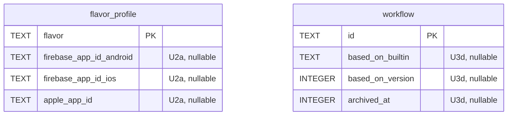

## feat: ease of use and UX, part 1: failures, dispatch, authoring and runs

> Part 1 of 2 of the [UX plan](2026-10-22-feat-ux-improvements-plan.md), PR 3 of 6 across the
> three plans. The parent has the problem statement, the research it comes from, the risks and
> the cross-plan ownership table.

Failures and waits say why everywhere, built-in workflows dispatch from the app without forking,
authoring catches mistakes before dispatch, and runs can be listed, followed and run again.

## Dependencies

- **PR 1 (runner core)** merged first, so U1a-1's wait reason can name offline runners and
  the runner listing is not duplicated here.
- UX-01 to UX-09 confirmed by the owner before U2a starts.
- U3e (comment-preserving YAML writer) is not in this PR; it stays optional in the parent plan.
- If PR 2 (any git host) or PR 5 (iOS part 1) lands first, U2c's dry run includes their skipped
  or placement reasons; if they land after, they add them (U2c's owner rule).

## Resolved design decisions

Proposed; to confirm with the owner before Phase U2 starts.

| # | Decision |
|---|---|
| UX-01 | The engine is the single source of truth for planning. The dispatch preview comes from an engine dry run, not from a client re-implementation (`packages/xp_repositories/lib/src/workflows/dispatch_preview.dart`). |
| UX-02 | The builder only ever serializes to the same YAML document; no hidden builder state (avoid Codemagic's split between editor and `codemagic.yaml`). |
| UX-03 | Per-flavor store identifiers (Firebase app id, App Store Connect app id) live on `FlavorProfile`. Built-ins read them when the matching input is empty. Inputs still override. |
| UX-04 | Inputs get a type (`string`, `boolean`, `choice`, `json`, `release`) and an optional `options` list. Untyped inputs keep today's behaviour (`string`, JSON-coerced in the CLI). `schema: 1` stays; new keys are optional. |
| UX-05 | Every API error may carry an optional `hint` (one sentence, client-neutral) and optional `details`. Clients render the hint; CLI-only advice stays in the CLI. The runner plan's `MissingCapability{reason, fix}` follows the same rule. |
| UX-06 | Workflows that have run are archived, not deleted. Archived workflows are hidden from dispatch pickers and listed under "Archived" in the builder. |
| UX-07 | Closing the main window keeps XPath running in the menu bar (setting, on by default). Quit stays ⌘Q. |
| UX-08 | Destructive actions confirm with a dialog that names the object and the consequence; reversible actions use an undo toast instead. |
| UX-09 | Words in the app, CLI and MCP match (PRODUCT §3): one name per concept, no HTTP paths or CLI commands in engine messages shown by the app. |

## Architecture

- **Engine first.** Anything the app, CLI and MCP all show (dry-run plans, input types, step
  schema, error hints, runs) is computed in `xp_engine` and served by `xpd`. Clients render;
  they do not re-derive (UX-01).
- **One YAML document.** The builder edits the workflow YAML and nothing else (UX-02). Undo is
  a stack of YAML snapshots.
- **Shared desktop widgets.** U4c adds the toast service, `XpLoading` and `XpErrorState` to
  `apps/xp_desktop/lib/widgets/`; later phases use them rather than local variants.
- **Schema changes.** U2a adds columns to the flavor profile, U3d adds `basedOn` and an
  archived flag to workflows, and U7b stores release notes. Migration numbers are assigned in
  merge order across all three plans (last today: v14). The runner plan's R10a rebuilds
  `project`; a migration here that changes `project` lands before it.




## Implementation Phases

`/build` runs these phases in order, one per context window, then reviews the whole branch
once and opens one pull request.

### Phase U1a-1: Quick fixes: failures and drafts

- **Status:** Done
- **Scope:** Show failures and waits without hovering, and stop losing builder drafts.
- **Files touched:** `apps/xp_desktop/lib/{job,workflow_builder,shell}/**`,
  `apps/xp_desktop/lib/l10n/arb/app_en.arb`, the matching tests
- **Acceptance criteria:**
  - A failed job shows the failed step's message without hovering; a queued job shows why.
  - Clicking another sidebar row with a dirty builder asks first; Cancel keeps the draft.
  - "Save as…" on a built-in succeeds on the first press with the default name.
- **Validation:** `melos run analyze && (cd apps/xp_desktop && flutter test test/job test/workflow_builder test/shell)`

Details:

- Job page: a failure banner with the failed step's `message` and the run's `message`; for a
  queued job, `job.message` (the scheduler's wait reason, e.g. "No runner can do ios-sign")
  under the hero (`apps/xp_desktop/lib/job/view/job_page.dart:80-83,366-380,408`). Once the
  runner plan's R1 has landed, the wait reason also names paired runners that are offline.
- Rename "Re-run all" to "Restart job" (it resumes the selected job from step 0,
  `job_page.dart:153-161`).
- Builder: route `ShellCubit.show` through a "can leave?" hook so sidebar navigation and ⇧⌘A
  ask before discarding a dirty draft (`apps/xp_desktop/lib/shell/cubit/shell_cubit.dart:133-136`,
  `apps/xp_desktop/lib/workflow_builder/view/workflow_builder_page.dart:76-82`).
- Builder "Save as…": pre-fill `<name>-copy`, check the name pattern and uniqueness in the
  dialog (`workflow_builder_page.dart:89-92`, `workflow_builder/widgets/workflow_dialogs.dart`).
- Builder lock chip: say that `lock: project` also makes prod flavors the default
  (`app_en.arb:1388`; `workflow_dispatcher.dart:362-375`).

### Phase U1a-2: Quick fixes: confirmations, setup detours and polish

- **Status:** Done
- **Scope:** Confirm destructive actions, keep the Add project folder, and fix small empty
  state, shortcut, formatting and banner gaps.
- **Files touched:** `apps/xp_desktop/lib/{engines,app,settings,add_project,releases,tests,credentials,approvals,project_overview,shell,widgets}/**`,
  `apps/xp_desktop/lib/l10n/arb/app_en.arb`, the matching tests
- **Acceptance criteria:**
  - Every listed destructive action asks first; Cancel changes nothing.
  - Connecting GitHub from Add project keeps the chosen folder.
  - ⌘N opens the dispatch sheet from Releases, Tests and the Job view.
- **Validation:** `melos run analyze && melos run format && melos run test:coverage`

Details:

- Confirm dialogs (UX-08, reuse `runners/widgets/revoke_runner_dialog.dart`) for: Remove engine
  (`engines/view/engines_page.dart:112`), Remove on the missing-token page plus a new "Try
  again" primary (`app/view/app.dart:200-202`), Remove GitHub token
  (`settings/widgets/github_token_section.dart:113`), Remove project in the scan review
  (`add_project/view/add_project_page.dart:207`), Mark approved / Mark live
  (`releases/widgets/store_lane.dart:268-273`), and removing a stage, job or step in the
  builder (`workflow_builder/widgets/workflow_inspector.dart:184-187,260-263`,
  `builder_controls.dart:441-445`).
- Add project: show `GitHubTokenSection` inline instead of navigating to Settings, so the
  folder and scan state survive (`add_project/view/add_project_page.dart:116-135`).
- Empty states with a call to action: Releases → "Dispatch Prod release…", Tests → "Run
  Tests…", Credentials → "Add credential…".
- ⌘N (dispatch for the current project) handled in `AppShell`, not only Overview; ⌘1–⌘9 select
  projects.
- Formatting: `fieldFileChosen` uses `formatSize` (`app_en.arb:398`); times older than 24 h
  show a date and every time has an absolute tooltip
  (`project_overview/widgets/release_rail.dart:69`, `approvals/view/approvals_page.dart:190`);
  SHAs click to copy.
- Banners: "Show log in Finder" on `localEngineTimedOut`; unlock steps on
  `bannerSecretsLocked`; for a rejected *local* engine, offer "Set up this Mac again"
  (`shell/widgets/connection_banner.dart`).
- Approvals: disable Approve and Deny together when read-only
  (`approvals/view/approvals_page.dart:290-305`).
- Store lane "Add API key" opens that flavor's credential sheet, not the whole page
  (`releases/widgets/store_lane.dart:280`).

### Phase U1b: Quick fixes: CLI, MCP and engine wording

- **Status:** Done
- **Scope:** The CLI prints what the engine knows about a failure, `--json` works everywhere,
  and engine messages carry no client jargon.
- **Files touched:** `apps/xp/lib/**`, `apps/xp/test/**`,
  `packages/xp_engine/lib/src/dispatch/**`, `packages/xp_engine/test/**`,
  `skills/xpath-release/**`, `docs/plan/2026-10-13-feat-xpath-release-tool-plan.md`
- **Acceptance criteria:**
  - `xp jobs show <failed job>` prints the step message and guard fixes.
  - `xp projects list --json` works; `xp --json runs show bad_id` prints a JSON error.
  - `xp projects add ./typo` exits 64 with "No folder at ./typo".
  - No engine error string contains `PATCH /` or `(xp `.
- **Validation:** `melos run analyze && melos run test:coverage && ! grep -rnE "PATCH /|\\(xp [a-z]" packages/xp_engine/lib`

Details:

- `xp jobs show`: print each failed step's `message` and every guard check's `fix`; print step
  states with `.wire` like jobs (`apps/xp/lib/src/commands/runs_commands.dart:211-217`).
- `--json` accepted on every subcommand, not only the root; with `--json`, errors go to stderr
  as `{"code","message","hint"}` (`apps/xp/lib/src/command_runner.dart:51-55`,
  `apps/xp/lib/src/commands/xp_command.dart:104-123`). `hint` is empty until U4a adds it.
- No Dart stack trace on usage or parse errors (`command_runner.dart:92-97`).
- `xp projects add`: a path-like argument that does not exist is a usage error, not a GitHub
  remote (`projects_commands.dart:137-140`). Remote forms (`git@host:path`, `ssh://`,
  `file://`, `https://`) are recognised first, so the runner plan's R10c can add non-GitHub
  remotes without a clash.
- `xp logs` without `-f`: wait until the job's log reports its end instead of 750 ms of silence
  (`apps/xp/lib/src/context.dart:28`).
- Engine messages without client jargon (UX-09): replace "mark one with PATCH /projects/{id}"
  (`workflow_dispatcher.dart:370-371`) and "(xp credentials assign)"
  (`step_planners.dart:564-569`) with plain wording; the CLI adds its own command hint.
- MCP: `ReferenceException` hints name MCP tools in MCP (`list_projects`) and CLI commands in
  the CLI (`apps/xp/lib/src/resolve.dart:291,314,348`, `apps/xp/lib/src/mcp/xp_tools.dart:587-588`);
  the catch-all no longer says "Invalid arguments" for non-argument errors
  (`xp_tools.dart:591-592`); tool results carry the `ApiErrorCode`.
- D-13 wording: the plan and skills say `xp approvals approve` (not `xp approve`).

### Phase U2a: Flavor store identifiers

- **Status:** Done
- **Scope:** Store ids live on the flavor, so built-ins upload without forking.
- **Files touched:** `packages/xp_api/lib/src/{project_profile,profile_edits}.dart`,
  `packages/xp_api/openapi.yaml`, `packages/xp_adapters/lib/src/sqlite/migrations.dart` and a
  new snapshot golden, `packages/xp_engine/lib/src/scan/**` (`project_scanner.dart`,
  `app_scanner.dart`) and its goldens in `packages/xp_engine/test/scan/goldens`,
  `packages/xp_client/**`, `packages/xp_repositories/lib/src/projects_repository.dart`,
  `apps/xpd/test/contract/` (a projects contract test),
  `packages/xp_engine/lib/src/workflows/{builtin_workflows,expression}.dart`,
  `apps/xpd/lib/src/api/projects/**`, `apps/xp/lib/src/commands/projects_commands.dart`,
  `apps/xp_desktop/lib/credentials/**`
- **Acceptance criteria:** with ids set on the `dev` flavor, dispatching built-in `dev-build`
  from the app with no inputs runs the `upload` job; an input still overrides the flavor value.
- **Validation:** `melos run test:coverage && melos run test:contract`

Details:

- Add `firebaseAppId` (per platform) and `appleAppId` to `FlavorProfile`
  (`packages/xp_api/lib/src/project_profile.dart`), a migration, `ProfileEdits` support, and
  expression variables `flavor.firebaseAppId` and `flavor.appleAppId`.
- Scan pre-fills them where `firebase_options.dart`, `GoogleService-Info.plist` or
  `google-services.json` name them.
- Built-ins fall back to them when `firebaseAppIds` or `appleAppIds` inputs are empty (UX-03),
  and the built-in version is bumped so existing engines pick up the change.
- Desktop: the per-flavor row in Credentials (and Project settings once U6d lands) edits them;
  scan findings for a missing id link to the field.
- CLI: `xp projects set <project> --flavor dev --firebase-app-id android=…`.

### Phase U2b: Typed inputs and the dispatch form

- **Status:** Done
- **Scope:** Workflow inputs have types, and the dispatch sheet, CLI and MCP collect them.
- **Files touched:** `packages/xp_engine/lib/src/workflows/**`,
  `packages/xp_api/lib/src/workflow.dart`, `packages/xp_api/openapi.yaml`,
  `packages/xp_repositories/lib/src/workflows/**`, `apps/xp_desktop/lib/dispatch/**`,
  `apps/xp/lib/src/commands/runs_commands.dart`, `apps/xp/lib/src/mcp/xp_tools.dart`
- **Acceptance criteria:** `shorebird-patch` dispatches from the app after picking a release;
  `dev-build` can upload to a one-off Firebase app id typed in the sheet; `xp dispatch …
  notes=true` on a `string` input sends the string `"true"`.
- **Validation:** `melos run test:coverage && melos run test:contract`

Details:

- Inputs gain `type` and `options` (UX-04) in the parser, `InputDefinition`
  (`packages/xp_engine/lib/src/workflows/workflow_definition.dart:56-80`) and the wire
  `Workflow` type; built-ins declare types (`releaseVersion: release`, app ids `json`).
- The dispatch sheet gets an Inputs section generated from the declared inputs: text, switch,
  dropdown, a JSON field with validation, and a release picker (from the project's releases)
  for `release` inputs. A `release` input with no releases yet shows "No releases yet" and
  disables Dispatch with the reason. It also gets an explicit version field next to bump. The
  request sends `inputs`, `version` and `releaseVersion`
  (`apps/xp_desktop/lib/dispatch/bloc/dispatch_bloc.dart:168-174`, `dispatch/view/dispatch_sheet.dart`).
- The last inputs per workflow and project are remembered in `workflows_repository.dart`
  (`xp_repositories`), not in the sheet; `DispatchBloc` reads them.
- CLI: `--input-file <yaml|json>`; inputs are coerced by declared type, not "anything that
  parses as JSON" (`runs_commands.dart:95-101`); on a TTY, missing required inputs are
  prompted.
- MCP `dispatch_workflow` describes the declared inputs and their types.

### Phase U2c: Engine dry run and dispatch picker

- **Status:** Done
- **Scope:** The engine plans a dispatch without running it, and every client shows that plan.
- **Files touched:** `packages/xp_engine/lib/src/dispatch/workflow_dispatcher.dart`,
  `apps/xpd/lib/src/api/workflows/workflows_routes.dart`, `packages/xp_api/**`,
  `packages/xp_client/lib/src/xp_client.dart`, `packages/xp_repositories/lib/src/workflows/**`,
  `apps/xp_desktop/lib/{dispatch,workflow_builder}/**`, `apps/xp/lib/src/commands/runs_commands.dart`
- **Acceptance criteria:** dispatching `dev-build` with no app ids shows "upload: skipped, no
  Firebase or App Store app id for dev"; the dry run allocates no build number (counter
  unchanged).
- **Validation:** `melos run test:coverage && melos run test:contract`

Details:

- `POST /projects/{id}/workflows/{wf}/dispatch?dryRun=true` (UX-01) returns stages, planned
  jobs, **skipped jobs with the reason** (false `if`, no app id, missing credential, missing
  required `with` key, a step the project's git host cannot run, a job narrowed to
  `ios-sign`), gates,
  runner capability matches (including "no connected runner offers X") and the version and
  build number it would allocate (without allocating).
- The dispatch sheet preview uses it; `packages/xp_repositories/lib/src/workflows/dispatch_preview.dart`
  and `workflow_outline.dart` are deleted in this PR. The preview never disables Dispatch
  because the client could not parse YAML the engine accepts
  (`dispatch_bloc.dart:177-181,333-337`).
- **Owner rule:** a phase in another plan that adds a skipped or placement reason (the runner
  plan's R10c, the iOS plan's Phase 3a) and lands after U2c adds its reason to the dry run in
  its own PR; one that lands before is picked up here.
- The picker shows the workflow's `name` and `description` (add both to `WorkflowSummary`),
  defaults to the last-used workflow, and hides `release-merge` and archived workflows.
- `showDispatchSheet(context, project, workflowId:)` and a "Run…" button in the builder.
- CLI `xp dispatch --dry-run` prints the same plan.

### Phase U3a: Deeper validation and structured issues

- **Status:** Done
- **Scope:** Validation catches typos and missing keys before dispatch and reports them with a
  line and a suggestion.
- **Files touched:** `packages/xp_engine/lib/src/workflows/**`,
  `packages/xp_engine/lib/src/dispatch/step_planners.dart`, `packages/xp_api/**`,
  `packages/xp_api/openapi.yaml` (`issues` on `workflow_invalid`),
  `apps/xpd/test/contract/` (workflows contract test), `apps/xpd/lib/src/api/workflows/**`,
  `apps/xp/lib/src/commands/workflows_commands.dart`
- **Acceptance criteria:** `if: inputs.firebaseAppId != null` (undeclared) is an issue with
  "did you mean `inputs.firebaseAppIds`?"; a `build.ipa` step without `exportOptionsPlist` fails
  validation with a line number.
- **Validation:** `melos run test:coverage`

Details:

- Check full member paths for known scopes: `inputs.<declared>`, `flavor.<field>`, `platform`,
  `release.<field>` (`workflow_parser.dart:547-561`, `expression.dart:51`).
- Check required `with` keys and value shapes at validate time, not only at dispatch
  (`step_planners.dart` decoders).
- "Did you mean" (edit distance) for kinds, keys, gates and variables, instead of dumping the
  catalogue (`workflow_parser.dart:414-417`).
- `workflow_invalid` error bodies carry `issues: [{line, column, message, hint}]` instead of
  one flattened sentence (`workflow_exceptions.dart:100-105`); the CLI prints one issue per
  line (`workflows_commands.dart:178-191`).
- `xp workflows validate <file>` without a project (validation is project-independent).

### Phase U3b: Rich step schema and typed step editor

- **Status:** Done
- **Scope:** Every step kind describes itself, and the builder edits `with` fields by type.
- **Files touched:** `packages/xp_api/lib/src/workflow.dart`,
  `packages/xp_engine/lib/src/workflows/step_catalog.dart`,
  `packages/xp_engine/lib/src/dispatch/step_planners.dart`,
  `apps/xp_desktop/lib/workflow_builder/**`,
  `apps/xp/lib/src/{commands/workflows_commands,mcp/xp_tools}.dart`, `skills/xpath-workflows/**`,
  `site/schema/**`
- **Acceptance criteria:** every built-in step kind has a description and typed keys (a test
  fails if one does not); the builder marks a missing required key before save.
- **Validation:** `melos run test:coverage && melos run test:contract`

Details:

- `StepType` (`packages/xp_api/lib/src/workflow.dart:247-260`) gains `title`, `description`,
  `group`, the capabilities it needs (any-of, so `build.ios` lists `ios-sign` and `ios-linux`
  once the iOS plan's Phase 3a lands), and per key `type`, `required`, `default`, `options`,
  `description`; gates gain a label. Filled from `StepPlanners` and `step_catalog.dart`.
- Builder: the kind menu is grouped and searchable with descriptions; `with` fields are typed
  (switch, dropdown, number, path, credential picker) with required markers; gates are shown by
  label; the `if` field completes variables (`workflow_inspector.dart:501-518,737-748`).
- When the engine is unreachable, the step picker is disabled with a reason instead of falling
  back to `command`, and existing issues stay visible (`workflow_inspector.dart:492-499`,
  `workflow_builder_bloc.dart:561-567`).
- `xp workflows schema [--kind <kind>]`; an MCP `get_workflow_schema` tool and the schema served
  as an MCP resource (the skill no longer tells agents to `curl`,
  `skills/xpath-workflows/SKILL.md:94`).
- Publish the schema as JSON Schema at `site/schema/workflow-1.json` for editor completion.

### Phase U3c: Builder editing: undo, inputs, templates

- **Status:** Done
- **Scope:** Undo in the builder, a visual input editor, and templates for new workflows.
- **Files touched:** `apps/xp_desktop/lib/workflow_builder/**`,
  `packages/xp_engine/lib/src/workflows/builtin_workflows.dart` (templates live beside
  built-ins), `apps/xpd/lib/src/api/workflows/**` (a templates route),
  `packages/xp_api/openapi.yaml`, `packages/xp_client/**`,
  `packages/xp_repositories/lib/src/workflows_repository.dart`, `apps/xpd/test/contract/`
- **Acceptance criteria:** remove a step, press ⌘Z, and the YAML equals the previous YAML; a
  workflow created from each template validates.
- **Validation:** `melos run test:coverage`

Details:

- Undo and redo (⌘Z / ⇧⌘Z) as a stack of YAML snapshots in `WorkflowBuilderBloc`; removing a
  stage, job or step shows an undo toast (from U4c, or a local one until then).
- Visual input editor: name, description, type, options, default, required (replaces "Inputs
  are edited in the YAML.", `workflow_inspector.dart:123-143`).
- "New workflow" offers templates: blank, Android → Firebase, iOS → TestFlight, tests only,
  Shorebird patch (`workflow_builder_bloc.dart:284-297`).

### Phase U3d: Workflow lifecycle and fork tracking

- **Status:** Done
- **Scope:** Version history, archive, rename, and forks that know when their built-in changed.
- **Files touched:** `packages/xp_api/lib/src/workflow.dart`, `packages/xp_api/openapi.yaml`,
  `packages/xp_adapters/lib/src/sqlite/migrations.dart` and a new snapshot golden
  (`packages/xp_adapters/test/src/sqlite/snapshots/v<N>.sql`: `based_on_*`, `archived_at`),
  `packages/xp_engine/lib/src/workflows/**`,
  `apps/xpd/lib/src/api/workflows/**`, `apps/xp_desktop/lib/workflow_builder/**`,
  `apps/xp/lib/src/commands/workflows_commands.dart`, `apps/xp/lib/src/mcp/xp_tools.dart`
- **Acceptance criteria:** a fork of `dev-build` shows the compare prompt after the engine ships
  a new `dev-build` version; an archived workflow is absent from the dispatch picker.
- **Validation:** `melos run test:coverage && melos run test:contract`

Details:

- Version history drawer in the builder: list versions (`Workflow.versions`), diff any two,
  restore one as a new version.
- Archive and unarchive (UX-06) in the API, app, CLI and MCP; hard delete only for workflows
  that never ran (wire up the existing `DELETE`, `workflows_routes.dart:27`,
  `xp_client.dart:193`).
- Rename.
- `basedOn: {builtin, version}` stored on "Save as" from a built-in; the builder shows
  "Built-in updated: compare" when a newer built-in exists, with a three-way diff view.
- CLI: `xp workflows delete|archive|versions|diff|copy`.

### Phase U4a: Runs API, CLI follow, MCP runs

- **Status:** Done
- **Scope:** Runs can be listed and followed from every client, and API errors carry a hint.
- **Files touched:** `packages/xp_api/**`, `packages/xp_engine/lib/src/**` (run queries),
  `packages/xp_adapters/lib/src/sqlite/**`, `apps/xpd/lib/src/api/runs/**`,
  `packages/xp_client/**`, `apps/xp/lib/**`
- **Acceptance criteria:** after `xp dispatch` in another terminal, `xp runs list --project p`
  shows the run; `xp dispatch --follow` exits 0 on success and non-zero on failure.
- **Validation:** `melos run test:coverage && melos run test:contract`

Details:

- `GET /runs?project=&workflow=&state=&limit=&before=` and `GET /projects/{id}/runs`.
- `ApiError` gains optional `hint` and `details` (UX-05,
  `packages/xp_api/lib/src/api_error.dart:88-109`); `secrets_locked`, engine unreachable,
  `workflow_invalid`, credential and runner-capability errors set hints. `xp_client` turns
  socket errors into "Cannot reach the engine at … Is xpd running?" with the health URL.
- CLI: `xp runs list`, `xp dispatch --follow` and `xp logs <run_id>` for a whole run (every
  job's log with a job prefix, exiting with the run's state; this reuses the per-job follow
  `xp logs -f` already has, `runs_commands.dart:309-339`), coloured states and
  spinners on a TTY, local times with the zone shown (`output/format.dart:24-31`).
- MCP: `list_runs`, `wait_for_run` (bounded), `wait_for_approval` (bounded).
- `xp runners list` and the MCP `list_runners` tool are not here: the runner plan's R3 owns
  them.

### Phase U4b-1: Run again and re-run failed jobs (engine and API)

- **Status:** Done
- **Scope:** The engine can re-dispatch a finished run and resume a failed run's failed jobs,
  reusing artifacts already produced.
- **Files touched:** `packages/xp_engine/lib/src/**` (re-dispatch, re-run failed),
  `apps/xpd/lib/src/api/runs/**`, `packages/xp_api/**`, `packages/xp_api/openapi.yaml`,
  `packages/xp_client/lib/src/xp_client.dart`, `apps/xpd/test/contract/` (a runs contract
  test), `apps/xp/lib/src/commands/runs_commands.dart` (`xp runs rerun [--failed]`)
- **Acceptance criteria:** "run again" creates a new run with identical inputs and the workflow
  version the first run used; re-running a failed upload does not rebuild.
- **Validation:** `melos run test:coverage && melos run test:contract`

### Phase U4b-2: Desktop runs, logs and summaries

- **Status:** Done
- **Scope:** Runs are findable from Overview, can be run again from the app, and their logs
  and artifacts are readable.
- **Files touched:** `apps/xp_desktop/lib/{project_overview,job}/**`,
  `packages/xp_repositories/lib/src/{jobs_repository,run_jobs}.dart` and a runs repository
  method, the matching tests
- **Acceptance criteria:** a dev build dispatched, then left, is reachable from Overview; "Run
  again" and "Re-run failed jobs" call U4b-1's routes.
- **Validation:** `melos run test:coverage`

Details:

- Overview: "Recent runs" (the last N runs of any workflow, with status, workflow, flavors, and
  who or what triggered it) (PRODUCT §6.2); a project-level Runs list with filters.
- "Run again" on any finished run; "Re-run failed jobs" on a failed run. When the workflow has
  changed since, "Run again" uses the version the run used and says so.
- Log view: open on the failed step, highlight the error line, search within the log, link to
  a line (copy), collapse step groups.
- Job view: artifacts list with Reveal, Copy path and Download (`job/view/job_page.dart:336`).
- A run summary card at the top of a finished run: version, build number, store links, test
  counts.

### Phase U4c: Desktop feedback kit

- **Status:** Done
- **Scope:** One toast, loading and error vocabulary across the app, and honest staleness when
  the engine is away.
- **Files touched:** `apps/xp_desktop/lib/widgets/**`, `apps/xp_desktop/lib/theme/**`, every
  feature `view/` that renders loading or errors, `packages/xp_repositories/lib/src/errors.dart`
- **Acceptance criteria:** no `XpMessage(XpStatus.scanError, …)` without a Retry remains; with
  the engine stopped, a running job's timer stops and the cached chip appears.
- **Validation:** `melos run test:coverage && ! grep -rn "'\\$error'" apps/xp_desktop/lib packages/xp_repositories/lib`

Details:

- Toasts (bottom right, 4 s / 6 s, motion tokens already defined) for every command result:
  saved, verified, marked, merged, cancelled, freed. A `ToastCubit` provided above the shell
  owns them, tested with `blocTest`. Replace ad-hoc inline messages.
- `XpLoading` skeletons replace blank `SizedBox()` placeholders
  (`shell/view/app_shell.dart:147`, `job/view/job_page.dart:59,115`, approvals, storage).
- `XpErrorState` with Retry and a human fallback instead of `'$error'`
  (`packages/xp_repositories/lib/src/errors.dart:11`, `onboarding/bloc/onboarding_bloc.dart:195`);
  it renders `ApiError.hint`. Stop borrowing unrelated statuses for load errors
  (`credentials/view/credentials_page.dart:158`).
- Staleness: a "Cached · 14:02" chip driven by the existing `cached` flags; running timers and
  spinners pause while the engine is not connected; menu bar countdowns tick.

## Success Criteria

```success-criteria
GOAL: Every failure or wait says why in the app, the CLI and MCP; built-in workflows release from the app without forking; authoring mistakes are caught before dispatch; runs are findable and can be run again.

SUCCESS CRITERIA:
- A failed job shows its failed step's message, and a queued job its wait reason, without hovering | verify: (cd apps/xp_desktop && flutter test test/job)
- `xp jobs show` prints step messages and guard fixes; no engine message contains `PATCH /` or `(xp ` | verify: (cd apps/xp && dart test test/src/commands) && ! grep -rnE "PATCH /|\(xp [a-z]" packages/xp_engine/lib
- Built-in `dev-build` uploads with flavor store ids and no inputs | verify: (cd packages/xp_engine && dart test test/src/workflows test/src/dispatch)
- `shorebird-patch` dispatches from the app after picking a release | verify: (cd apps/xp_desktop && flutter test test/dispatch)
- The dry run lists skipped jobs with reasons and allocates no build number | verify: melos run test:contract
- Validation suggests the closest name for a typo and fails missing required keys with a line number | verify: (cd packages/xp_engine && dart test test/src/workflows)
- Builder undo restores the previous YAML exactly | verify: (cd apps/xp_desktop && flutter test test/workflow_builder)
- `xp runs list` shows a run dispatched elsewhere; `xp dispatch --follow` exits with the run's state; "run again" reuses the run's inputs and workflow version | verify: (cd apps/xp && dart test test/src/commands) && melos run test:contract
- No raw `'$error'` is rendered in the app | verify: ! grep -rn "'\$error'" apps/xp_desktop/lib packages/xp_repositories/lib
- The workspace stays green | verify: dart analyze --fatal-infos && dart format --set-exit-if-changed . && dart run tool/check_layers.dart && melos run test:coverage && melos run test:contract

NON-GOALS:
- Setup, app navigation and accessibility, release controls and docs (part 2).
- U3e, the comment-preserving YAML writer.

VERIFICATION COMMAND: dart analyze --fatal-infos && dart format --set-exit-if-changed . && dart run tool/check_layers.dart && melos run test:coverage && melos run test:contract && ! grep -rnE "PATCH /|\(xp [a-z]" packages/xp_engine/lib && ! grep -rn "'\$error'" apps/xp_desktop/lib packages/xp_repositories/lib
```
