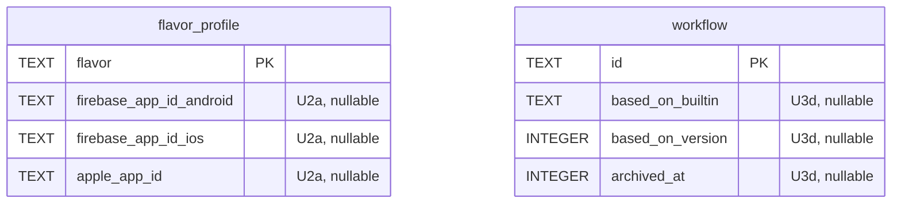

## feat: ease of use and UX, part 2: setup, the app, releases and docs

> Part 2 of 2 of the [UX plan](2026-10-22-feat-ux-improvements-plan.md), PR 4 of 6 across the
> three plans. The parent has the problem statement, the research it comes from, the risks and
> the cross-plan ownership table.

A new owner reaches a first green build from the app alone, the app gets real navigation,
notifications and accessibility, releases get rollout controls and a timeline, and the docs
become a guide.

## Dependencies

- **PR 3 (UX part 1)** merged: U4c's toast, loading and error widgets, U4a's error hints and
  runs API, U2a's store ids and U2c's dry run are used throughout.
- **PR 1 (runner core)** merged: U5b's `xp doctor` reuses R2's `DoctorCheck`; U6b's runner
  notifications use R3 and R5's events; U8 keeps the guide pages R4–R6 and R9 wrote, and runs
  its quickstart script in R8's image.
- PR 2 (any git host): U5b matches GitHub remotes until R10c switches the match to `sourceKey`;
  U5a and R10d, whichever lands second adds the non-GitHub branch.
- PR 5 (iOS part 1): U7a and iOS Phase 1 both change the App Store Connect adapter and its fake;
  whichever lands second rebases onto the other.

## Resolved design decisions

Proposed; to confirm with the owner before Phase U2 starts.

| # | Decision |
|---|---|
| UX-01 | The engine is the single source of truth for planning. The dispatch preview comes from an engine dry run, not from a client re-implementation (`packages/xp_repositories/lib/src/workflows/dispatch_preview.dart`). |
| UX-02 | The builder only ever serializes to the same YAML document; no hidden builder state (avoid Codemagic's split between editor and `codemagic.yaml`). |
| UX-03 | Per-flavor store identifiers (Firebase app id, App Store Connect app id) live on `FlavorProfile`. Built-ins read them when the matching input is empty. Inputs still override. |
| UX-04 | Inputs get a type (`string`, `boolean`, `choice`, `json`, `release`) and an optional `options` list. Untyped inputs keep today's behaviour (`string`, JSON-coerced in the CLI). `schema: 1` stays; new keys are optional. |
| UX-05 | Every API error may carry an optional `hint` (one sentence, client-neutral) and optional `details`. Clients render the hint; CLI-only advice stays in the CLI. The runner plan's `MissingCapability{reason, fix}` follows the same rule. |
| UX-06 | Workflows that have run are archived, not deleted. Archived workflows are hidden from dispatch pickers and listed under "Archived" in the builder. |
| UX-07 | Closing the main window keeps XPath running in the menu bar (setting, on by default). Quit stays ⌘Q. |
| UX-08 | Destructive actions confirm with a dialog that names the object and the consequence; reversible actions use an undo toast instead. |
| UX-09 | Words in the app, CLI and MCP match (PRODUCT §3): one name per concept, no HTTP paths or CLI commands in engine messages shown by the app. |

## Architecture

- **Engine first.** Anything the app, CLI and MCP all show (dry-run plans, input types, step
  schema, error hints, runs) is computed in `xp_engine` and served by `xpd`. Clients render;
  they do not re-derive (UX-01).
- **One YAML document.** The builder edits the workflow YAML and nothing else (UX-02). Undo is
  a stack of YAML snapshots.
- **Shared desktop widgets.** U4c adds the toast service, `XpLoading` and `XpErrorState` to
  `apps/xp_desktop/lib/widgets/`; later phases use them rather than local variants.
- **Schema changes.** U2a adds columns to the flavor profile, U3d adds `basedOn` and an
  archived flag to workflows, and U7b stores release notes. Migration numbers are assigned in
  merge order across all three plans (last today: v14). The runner plan's R10a rebuilds
  `project`; a migration here that changes `project` lands before it.




## Implementation Phases

`/build` runs these phases in order, one per context window, then reviews the whole branch
once and opens one pull request.

### Phase U5a: First run in the app

- **Status:** Done
- **Scope:** A new owner reaches a first green build from the app alone.
- **Files touched:** `apps/xp_desktop/lib/{onboarding,projects,project_overview}/**`,
  `packages/xp_engine/lib/src/workflows/builtin_workflows.dart` (debug smoke build), the
  matching tests
- **Acceptance criteria:** a new owner reaches a first green build without leaving the app or
  reading docs.
- **Validation:** `melos run test:coverage` and `manual 1. Remove ~/Library/Application Support/XPath on a test user. 2. Install the app. 3. Follow only on-screen guidance to a green dev build. 4. Count interactions (target: under 12).`

Details:

- Onboarding says up front what a first release needs (engine, GitHub, project, store
  credentials).
- A setup checklist on NoProjects and Overview: engine ✓ → GitHub → project → credentials per
  flavor → store ids (U2a) → first dispatch, each step deep-linking to its sheet; it hides once
  done. When no runner (local or remote) offers a capability the project's workflows need, the
  checklist shows that item with the reason and a link to `docs/guide/runners.md`. The GitHub
  and prod-release steps are for GitHub projects; the runner plan's R10d adds the non-GitHub
  branch (engine SSH key step) if it lands after this.
- Scan findings get actions ("Add credential…", "Set Firebase app id…", "Copy path") instead of
  text-only "Fix: …" (`projects/widgets/scan_summary.dart:254`).
- A first unsigned smoke build: "Try a debug build" right after the scan, to see green before
  signing is configured.

### Phase U5b: CLI setup: tokens, status and doctor

- **Status:** Not started
- **Scope:** The CLI can be connected from a token minted in the app, and can check itself and
  the engine.
- **Files touched:** `apps/xpd/lib/src/api/**` (token-minting route), `packages/xp_api/openapi.yaml`,
  `packages/xp_client/lib/src/xp_client.dart`, `apps/xpd/test/contract/` (token route contract
  test), `packages/xp_repositories/lib/src/settings_repository.dart`,
  `apps/xp_desktop/lib/settings/**` (a `CliTokenBloc`), `apps/xp/lib/src/commands/**`,
  `apps/xp/lib/src/config/**`, the matching tests
- **Acceptance criteria:** `xp status` works with no project argument; a token minted in the app
  connects `xp` without touching the `xpd` binary; `xp doctor` shows the engine's own missing
  capabilities.
- **Validation:** `melos run test:coverage && melos run test:contract`
- **Depends on:** the runner plan's R2 (`DoctorCheck`) for `xp doctor`.

Details:

- Tokens from the app: Settings ▸ CLI and agents ▸ "New token" shows a ready-to-paste
  `xp connect …` command and an MCP config snippet (a token-minting route for the owner's
  desktop token).
- `xp status` (engine, version, token name, health, secrets state), `xp doctor`, `xp
  disconnect`. `xp doctor` prints the runner plan's R2 `DoctorCheck` model for the engine host,
  but reads the engine's own findings over the API (the local runner's `missing` list, the
  engine's SSH key check for non-GitHub hosts, credential states) rather than probing in the
  CLI's shell, which may be on another machine and has a different `PATH` and `JAVA_HOME` from
  the engine's LaunchAgent. It adds only client checks (config file, token, reachability).
- The CLI defaults the project from the current folder's git remote when it matches one
  project. Before the runner plan's R10 it matches GitHub remotes; R10c switches the match to
  `sourceKey` so a Bitbucket clone resolves too.

### Phase U6a: Navigation, menus and the command palette

- **Status:** Not started
- **Scope:** Back and forward, a command palette and a real macOS menu.
- **Files touched:** `apps/xp_desktop/lib/shell/**`, `apps/xp_desktop/lib/app/**`,
  `apps/xp_desktop/lib/widgets/**`
- **Acceptance criteria:** every shortcut in the keyboard guide works and appears in a menu;
  Job → ⌘[ returns to the page that opened it.
- **Validation:** `melos run test:coverage`

Details:

- A history stack in `ShellCubit` with ⌘[ / ⌘] back and forward.
- ⌘K command palette: go to a project, release, run, workflow or setting; run Dispatch, Run
  again, Cancel, Approve (approve still opens the review sheet, D-13). A
  `CommandPaletteBloc` provided above the shell, tested with `blocTest`.
- A real macOS main menu via `PlatformMenuBar` (Go, Project, Job) listing every shortcut; a ⌘/
  shortcut sheet; ⌃⌘S sidebar toggle (`docs/design/system/project/guide/08-keyboard.md`).

### Phase U6b: Menu bar, notifications and window

- **Status:** Not started
- **Scope:** XPath keeps running in the menu bar and notifies on the events that matter.
- **Files touched:** `apps/xp_desktop/macos/Runner/**`, `packages/xp_macos_services/**`,
  `apps/xp_desktop/lib/{approvals,settings,app}/**`
- **Acceptance criteria:** with the window closed, a failed prod job posts a notification that
  opens the job.
- **Validation:** `melos run test:coverage` and `manual 1. Close the window. 2. Dispatch a failing prod job from xp. 3. Click the notification; the job page opens.`

Details:

- Closing the window keeps the app in the menu bar (UX-07,
  `apps/xp_desktop/macos/Runner/AppDelegate.swift:6`), with a setting.
- Menu bar extra: running jobs with progress, needs-you, quick dispatch (PRODUCT §6.13).
- macOS notifications for the engine's existing kinds beyond approvals: `jobFailed`,
  `jobSucceeded`, `releaseRejected`, `releaseApproved`, `releaseLive`, `credentialExpired`,
  `secretsLocked` (`packages/xp_api/lib/src/notification.dart`); clicking opens the page;
  per-kind toggles in Settings.
- Runner notifications, from the runner events the runner plan's R3 and R5 log: a runner lost
  while holding jobs, a capability lost (for example after a self-update), and a job waiting
  longer than 10 minutes for a runner. Owners whose engine is on a laptop need these most.
- Restore the window frame and last destination.

### Phase U6c: Accessibility, density and context menus

- **Status:** Not started
- **Scope:** Every primary action works from the keyboard and a screen reader; Reduce Motion
  and compact density are honoured.
- **Files touched:** `apps/xp_desktop/lib/{widgets,shell,approvals,job,project_overview,credentials,theme,app}/**`
- **Acceptance criteria:** every primary action is reachable with Tab and Return; a
  `meetsGuideline(textContrastGuideline)` and `labeledTapTargetGuideline` test passes on each
  page.
- **Validation:** `melos run test:coverage`

Details:

- Clickable rows become focusable (`FocusableActionDetector`): sidebar, approvals, flavor
  ledger cells, pipeline nodes, step rows, `XpSegmented`, console strip; ↑/↓/↩ in lists
  (`shell/widgets/sidebar.dart:440`).
- Semantics: labels on `XpStatusIcon` and sidebar badges; drop the `excludeSemantics` that
  hides counts (`sidebar.dart:435`); remove empty tooltips
  (`shell/widgets/engine_switcher.dart:25`, `widgets/xp_select.dart:34`); keep focus on busy
  `XpButton`s.
- Reduce Motion from `MediaQuery.disableAnimationsOf` and compact density (⌃⌘=) passed to
  `appTheme` (`app/view/app.dart:58-59`).
- Heights scale with text size; no fixed-width text columns.
- Context menus on rows (copy SHA, version, bundle id; open job; reveal artifact); credential
  row actions move into a menu with Delete styled as destructive
  (`credentials/view/credentials_page.dart:276-289`).

### Phase U6d: Information architecture

- **Status:** Not started
- **Scope:** A cross-project Home, a project settings page, and lists instead of dropdowns.
- **Files touched:** `apps/xp_desktop/lib/{shell,projects,project_overview,releases,tests,credentials,settings}/**`
- **Acceptance criteria:** an owner with three projects sees each one's live and in-review
  release on Home without clicking.
- **Validation:** `melos run test:coverage`

Details:

- Home: a cross-project dashboard (live, in review, running, needs you) instead of "first
  project" (`shell/view/app_shell.dart:150`).
- Keep the selected project expanded while on engine pages (`shell/widgets/sidebar.dart:38-40`).
- Project settings page: rename, base branch, gates (`/projects/{id}/gates`), flavor store ids,
  git host (read-only, once the runner plan's R10 lands), remove project.
- The GitHub token moves from Settings to Credentials.
- Releases and test runs become lists with status and search instead of `XpSelect` dropdowns
  (`releases/view/releases_page.dart:84`, `tests/view/tests_page.dart`).

### Phase U7a: Rollout controls

- **Status:** Not started
- **Scope:** Gated rollout controls for both stores, with CLI and MCP mirrors.
- **Files touched:** `packages/xp_engine/lib/src/{releases,stores}/**`,
  `packages/xp_adapters/lib/src/stores/**`, `apps/xpd/lib/src/api/releases/**`,
  `packages/xp_api/**`, `packages/xp_api/openapi.yaml`, `packages/xp_client/**`,
  `apps/xpd/test/contract/` (release contract tests),
  `packages/xp_repositories/lib/src/releases_repository.dart`, `apps/xp_desktop/lib/releases/**`,
  `apps/xp/lib/src/{commands/releases_commands,mcp/xp_tools}.dart`, `tool/e2e/fake_stores/**`
- **Acceptance criteria:** against the fake stores, pausing a phased release and raising a Play
  rollout from 10 % to 50 % each create an approval and, once approved, change the store state.
- **Validation:** `melos run test:coverage && melos run test:contract`

Details:

- iOS phased release pause, resume and release to all (the `updatePhasedRelease` adapter exists
  but no route uses it, `packages/xp_engine/lib/src/stores/apple/app_store_connect.dart:51`);
  Play staged rollout percentage up, halt and complete. All are gated actions (D-13).
- The App Store Connect adapter
  (`packages/xp_adapters/lib/src/stores/apple/http_app_store_connect.dart`) and its fake are
  also extended by the iOS plan's Phase 1 (build uploads); whichever lands second rebases onto
  the other's fake.
- CLI and MCP mirrors (`xp releases rollout …`); MCP can request, never approve.

### Phase U7b: Release timeline, Shorebird controls and notes

- **Status:** Not started
- **Scope:** One timeline per release, Shorebird promote and roll back, and release notes kept
  on the release.
- **Files touched:** `packages/xp_engine/lib/src/releases/**`,
  `packages/xp_adapters/lib/src/stores/shorebird/**`, `packages/xp_adapters/lib/src/sqlite/migrations.dart`
  and a new snapshot golden (`packages/xp_adapters/test/src/sqlite/snapshots/v<N>.sql`, release
  notes), `apps/xpd/lib/src/api/releases/**`, `packages/xp_api/openapi.yaml`,
  `apps/xpd/test/contract/`, `packages/xp_repositories/lib/src/releases_repository.dart`,
  `apps/xp_desktop/lib/releases/**`, `tool/e2e/fake_stores/**`
- **Acceptance criteria:** a released version's page lists candidate, approvals, store review,
  rollout, merge and patches with timestamps and who acted; a patch can be promoted and rolled
  back against the fake Shorebird; notes typed on the release reach the fake stores' uploads.
- **Validation:** `melos run test:coverage && melos run test:contract`

Details:

- Release timeline per version: candidate → approvals → store review → rollout → merge →
  Shorebird patches, with timestamps and who acted. The merge entry is absent for projects
  that cannot merge (the runner plan's R10).
- Shorebird: promote a patch between tracks and roll back from the release page (gated).
- Release notes and "What to test" text kept on the release and sent with uploads.

### Phase U8: Docs, quickstart and troubleshooting

- **Status:** Not started
- **Scope:** A guide a new user can follow alone, a troubleshooting page the error hints link
  to, and a README short enough to read. Absorbs the docs part of Phase 19.
- **Files touched:** `docs/guide/**`, `docs/reference/**`, `README.md`, `site/**`, `skills/**`,
  `.github/ISSUE_TEMPLATE/**`, `.github/pull_request_template.md`
- **Acceptance criteria:** README under 20 KB; every guide page linked from the README; every
  guide link in CLI, app and hint text resolves; the CLI quickstart script reaches a green
  `test` run.
- **Validation:** `test $(wc -c < README.md) -lt 20480 && for f in docs/guide/*.md; do grep -q "$(basename "$f")" README.md || exit 1; done && tool/e2e/quickstart_cli.sh`

Details:

- `docs/guide/quickstart.md` (the app path and the CLI-only, Linux and Docker path), then one
  page per topic: install, projects, credentials, workflows (inputs, expressions, gates,
  templates), runners, MCP, approvals, releases, storage, uninstall.
- The runner plan writes `docs/guide/runners.md` (R5, R6, R8) and `docs/guide/install.md`
  (R9) directly; U8 builds the other pages around them and keeps their anchors, which the CLI
  and the app link to. The iOS plan's Phase 5 adds its Linux iOS section to `runners.md`.
- Every link printed by the CLI, the app or an `ApiError.hint` points at a guide anchor, never
  a README section. A test lists those links and checks each anchor exists.
- The CLI-only path of the quickstart is also a script, `tool/e2e/quickstart_cli.sh`, run in
  the runner plan's R8 image, so the page cannot drift from what works.
- `docs/guide/troubleshooting.md` built from `skills/xpath-setup/references/troubleshooting.md`
  and `skills/xpath-release/references/failures.md`; API error hints link to its anchors.
- README trimmed to overview, install, quickstart link and a docs index; engine internals
  (migration history etc.) move to `docs/reference/`. The site "Docs" link points at the
  guide.
- Replace owner-specific values (`mataa_new_app`, team `AFBD5TBR5U`) in
  `docs/guide/try-it-locally.md` with placeholders.
- Fix the setup skill's Docker instructions to use `ghcr.io/abdurahmanalmehdi/xpath`.
- `.github/ISSUE_TEMPLATE/{bug_report,feature_request}.yml` (the bug template asks for
  `xp --version` and the engine version) and a PR template.

## Success Criteria

```success-criteria
GOAL: A new owner reaches a first green build and a first release from the app without reading the README, the app meets its own design guides, and the docs are a guide a new user can follow.

SUCCESS CRITERIA:
- A new owner reaches a first green dev build in under 12 interactions from on-screen guidance only | verify: manual 1. Remove ~/Library/Application Support/XPath on a test user. 2. Install the app. 3. Follow only on-screen guidance to a green dev build. 4. Count interactions.
- `xp status` works with no project; a token minted in the app connects `xp`; `xp doctor` shows the engine's own missing capabilities | verify: (cd apps/xp && dart test test/src/commands) && melos run test:contract
- Every shortcut in the keyboard guide works and appears in a menu | verify: (cd apps/xp_desktop && flutter test test/shell)
- With the window closed, a failed prod job posts a notification that opens the job | verify: manual 1. Close the window. 2. Dispatch a failing prod job from xp. 3. Click the notification.
- Every primary action is reachable with Tab and Return, and the contrast and tap-target guidelines pass on each page | verify: (cd apps/xp_desktop && flutter test)
- Pausing a phased release and raising a Play rollout each go through an approval | verify: (cd packages/xp_engine && dart test test/src/releases) && melos run test:contract
- README under 20 KB, every guide page linked from it, and the CLI quickstart script passes | verify: test $(wc -c < README.md) -lt 20480 && tool/e2e/quickstart_cli.sh
- The workspace stays green | verify: dart analyze --fatal-infos && dart format --set-exit-if-changed . && dart run tool/check_layers.dart && melos run test:coverage && melos run test:contract

NON-GOALS:
- Store vitals and automatic rollout halts; schedule and push triggers; a step marketplace; a web dashboard.

VERIFICATION COMMAND: dart analyze --fatal-infos && dart format --set-exit-if-changed . && dart run tool/check_layers.dart && melos run test:coverage && melos run test:contract && test $(wc -c < README.md) -lt 20480 && tool/e2e/quickstart_cli.sh
```
