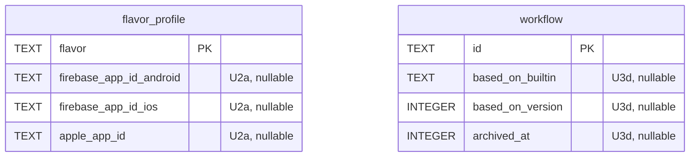

## feat: ease of use and UX across workflows, the app, the CLI and MCP - Extensive

> Consolidated from the 2026-10-21 UX plan (branch `claude/pensive-knuth-veti8e`). It is
> checked against the [runner onboarding plan](2026-10-22-feat-remote-runner-onboarding-plan.md)
> and the [iOS-on-Linux plan](2026-10-22-feat-ios-builds-on-linux-plan.md); see
> [Related plans](#related-plans) for what each plan owns.

> **Note:** This plan was split into parts for building. See the -part-N files in this
> directory; run `/build` on a part file, one pull request per part, never on this file.

## Overview

XPath 1.0 works end to end, but the path a new owner takes from install to a first release,
and the path an existing owner takes when something fails, have more friction than the engine
warrants. The engine already records most of what the user needs (step messages, queue
reasons, guard fixes, notification kinds, phased-release state); the clients often drop it.

This plan collects every change from the 2026-10-20 UX research (four audits: workflows, the
desktop app, the CLI/MCP/docs, and a benchmark of Codemagic, Bitrise, Xcode Cloud, GitHub
Actions, EAS, Fastlane, Runway, Tramline, Appcircle and the Shorebird console) and orders them
into phases. Each phase is one PR (or one per sub-phase), fits one context window, and leaves
the workspace green.

Phases are numbered `U1`…`U8` so they do not collide with the 1.0 plan's numbering, the runner
plan's `R1`…`R10` or the iOS plan's `Phase 0`…`5`. Phase U8 absorbs the docs part of the 1.0
plan's Phase 19.

## Problem Statement

- **Releasing from the app is not possible for the built-ins.** The dispatch sheet sends only
  app, ref, flavors, platforms and bump
  (`apps/xp_desktop/lib/dispatch/bloc/dispatch_bloc.dart:168-174`). `dev-build` never uploads
  (its `upload` job needs `firebaseAppIds`/`appleAppIds` inputs,
  `packages/xp_engine/lib/src/workflows/builtin_workflows.dart:94-96`) and `shorebird-patch`
  always fails with "give releaseVersion"
  (`packages/xp_engine/lib/src/dispatch/workflow_dispatcher.dart:425-430`). The guide's
  workaround is to fork a built-in and hand-edit JSON (`docs/guide/try-it-locally.md:158-174`).
- **Failures and waits are silent.** The job hero says "Failed at <step>"; `step.message` is a
  hover tooltip (`apps/xp_desktop/lib/job/widgets/step_list.dart:95-96`); the scheduler's queue
  reasons in `job.message` are only rendered inside the interrupted banner
  (`apps/xp_desktop/lib/job/view/job_page.dart:408`). `xp jobs show` drops `step.message` and
  guard `fix`es (`apps/xp/lib/src/commands/runs_commands.dart:211-217`).
- **Work is easy to lose.** Builder edits vanish on sidebar navigation; there is no undo;
  several destructive actions have no confirmation; the GitHub-token detour in Add project
  drops the typed folder; a dispatched dev build is unreachable once you navigate away; there
  is no `GET /runs`.
- **Authoring workflows is raw.** Every `with` field is free text ("YAML value"), inputs are
  read-only in the builder, typos in variable paths validate and evaluate to `null`, required
  `with` keys fail only at dispatch, and forks of built-ins never receive engine updates.
- **The app does not yet match its own design guides.** No toasts, skeletons, ⌘K,
  back/forward, menus, context menus, Reduce Motion or compact mode; many rows are mouse-only;
  closing the window quits the app and its menu bar extra
  (`apps/xp_desktop/macos/Runner/AppDelegate.swift:6`).
- **Setup and docs.** Getting a CLI/MCP token needs the bundled `xpd` path; there is no
  `xp status`/`doctor`; the README is a 180 KB reference with no Quickstart or Troubleshooting.

## Proposed Solution

Fix what loses work or hides a failure first (U1), make the built-ins dispatchable from the app
(U2), make authoring safe (U3), make runs findable and feedback consistent (U4), then setup
(U5), the app's navigation and accessibility (U6), release controls (U7) and the docs (U8).

### Resolved design decisions

Proposed; to confirm with the owner before Phase U2 starts.

| # | Decision |
|---|---|
| UX-01 | The engine is the single source of truth for planning. The dispatch preview comes from an engine dry run, not from a client re-implementation (`packages/xp_repositories/lib/src/workflows/dispatch_preview.dart`). |
| UX-02 | The builder only ever serializes to the same YAML document; no hidden builder state (avoid Codemagic's split between editor and `codemagic.yaml`). |
| UX-03 | Per-flavor store identifiers (Firebase app id, App Store Connect app id) live on `FlavorProfile`. Built-ins read them when the matching input is empty. Inputs still override. |
| UX-04 | Inputs get a type (`string`, `boolean`, `choice`, `json`, `release`) and an optional `options` list. Untyped inputs keep today's behaviour (`string`, JSON-coerced in the CLI). `schema: 1` stays; new keys are optional. |
| UX-05 | Every API error may carry an optional `hint` (one sentence, client-neutral) and optional `details`. Clients render the hint; CLI-only advice stays in the CLI. The runner plan's `MissingCapability{reason, fix}` follows the same rule. |
| UX-06 | Workflows that have run are archived, not deleted. Archived workflows are hidden from dispatch pickers and listed under "Archived" in the builder. |
| UX-07 | Closing the main window keeps XPath running in the menu bar (setting, on by default). Quit stays ⌘Q. |
| UX-08 | Destructive actions confirm with a dialog that names the object and the consequence; reversible actions use an undo toast instead. |
| UX-09 | Words in the app, CLI and MCP match (PRODUCT §3): one name per concept, no HTTP paths or CLI commands in engine messages shown by the app. |

## Technical Approach

### Architecture

- **Engine first.** Anything the app, CLI and MCP all show (dry-run plans, input types, step
  schema, error hints, runs) is computed in `xp_engine` and served by `xpd`. Clients render;
  they do not re-derive (UX-01).
- **One YAML document.** The builder edits the workflow YAML and nothing else (UX-02). Undo is
  a stack of YAML snapshots.
- **Shared desktop widgets.** U4c adds the toast service, `XpLoading` and `XpErrorState` to
  `apps/xp_desktop/lib/widgets/`; later phases use them rather than local variants.
- **Schema changes.** U2a adds columns to the flavor profile, U3d adds `basedOn` and an
  archived flag to workflows, and U7b stores release notes. Migration numbers are assigned in
  merge order across all three plans (last today: v14). The runner plan's R10a rebuilds
  `project`; a migration here that changes `project` lands before it.



## Implementation Phases

| Phase | PR | Phase | PR |
|---|---|---|---|
| U1a-1 | Quick fixes: failures and drafts | U4b-1 | Run again and re-run failed (engine, API) |
| U1a-2 | Quick fixes: confirmations, detours, polish | U4b-2 | Desktop runs, logs and summaries |
| U1b | Quick fixes: CLI, MCP and engine wording | U4c | Desktop feedback kit |
| U2a | Flavor store identifiers | U5a | First run in the app |
| U2b | Typed inputs and the dispatch form | U5b | CLI setup: tokens, status and doctor |
| U2c | Engine dry run and dispatch picker | U6a | Navigation, menus and the command palette |
| U3a | Deeper validation and structured issues | U6b | Menu bar, notifications and window |
| U3b | Rich step schema and typed step editor | U6c | Accessibility, density and context menus |
| U3c | Builder editing: undo, inputs, templates | U6d | Information architecture |
| U3d | Workflow lifecycle and fork tracking | U7a | Rollout controls |
| U3e | Comment-preserving YAML writer (optional) | U7b | Release timeline, Shorebird controls, notes |
| U4a | Runs API, run follow, MCP runs | U8 | Docs, quickstart and troubleshooting |

Order:

- U1a-1, U1a-2 and U1b are independent and can land in any order.
- U2a → U2b → U2c are ordered.
- U3c depends on U2b (typed inputs) for its input editor.
- U4a precedes U4b-1, which precedes U4b-2. U4a's `ApiError.hint` lands before U4c renders
  it.
- U6 starts after U4c (toasts are used by the palette and context menus).
- U5b's `xp doctor` starts after the runner plan's R2 (it reuses the check model).
- U7a coordinates with the iOS plan's Phase 1, which changes the same App Store Connect
  adapter.
- U8 runs last, after the runner plan's guide pages (R4, R5, R6, R9) exist, and after its R8
  image, which runs the quickstart script. It keeps their anchors. Its Quickstart can be
  drafted after U2.
- Every phase that adds or changes a bloc also checks that bloc's coverage is 100%:
  `melos run test:coverage` enforces only 90% on `xp_desktop`, so run `flutter test --coverage`
  in `apps/xp_desktop` and check the bloc files in `coverage/lcov.info`.

### Pull requests

These phases are built from the part files, one `/build` run and one pull request each.
Their full text, with the `Status` markers `/build` updates, is in the part files only.

| PR | Part file | Contains |
|---|---|---|
| 1 | [Runner core](2026-10-22-feat-remote-runner-onboarding-part-1-plan.md) | R1–R9 |
| 2 | [Projects on any git host](2026-10-22-feat-remote-runner-onboarding-part-2-plan.md) | R10a–R10d |
| 3 | [UX part 1](2026-10-22-feat-ux-improvements-part-1-plan.md) | U1a-1 to U4c |
| 4 | [UX part 2](2026-10-22-feat-ux-improvements-part-2-plan.md) | U5a to U8 |
| 5 | [iOS on Linux part 1](2026-10-22-feat-ios-builds-on-linux-part-1-plan.md) | Phases 1, 2, 3a |
| 6 | [iOS on Linux part 2](2026-10-22-feat-ios-builds-on-linux-part-2-plan.md) | Phases 4a, 3b, 4b, 5 |

Order: PR 1 first. Then PRs 2, 3 and 5, in parallel. Then PRs 4 and 6.

| Part | Phases |
|---|---|
| [Part 1](2026-10-22-feat-ux-improvements-part-1-plan.md) | U1a-1, U1a-2, U1b, U2a, U2b, U2c, U3a, U3b, U3c, U3d, U4a, U4b-1, U4b-2, U4c |
| [Part 2](2026-10-22-feat-ux-improvements-part-2-plan.md) | U5a, U5b, U6a, U6b, U6c, U6d, U7a, U7b, U8 |

U3e is in no part. It stays here, optional, until owners report lost comments.

### Phase U3e: Comment-preserving YAML writer (optional)

- **Status:** Not started
- **Scope:** Visual edits apply minimal changes with `yaml_edit` instead of regenerating the
  document with `toYaml()`, so comments and layout survive (`workflow_document.dart:10-15`,
  `workflow_builder_bloc.dart:514`). Do it only if owners report lost comments after U3c.
- **Files touched:** `packages/xp_repositories/lib/src/workflows/workflow_document.dart`,
  `packages/xp_repositories/pubspec.yaml` (`yaml_edit`), `apps/xp_desktop/lib/workflow_builder/**`
- **Acceptance criteria:** a commented workflow, edited visually (rename a job), keeps every
  comment; the existing round-trip test still passes.
- **Validation:** `melos run test:coverage`

## Alternative Approaches Considered

- **Client-side dispatch preview (today's `WorkflowOutline`).** Rejected (UX-01): it disagrees
  with the engine and disables Dispatch on YAML the engine accepts.
- **A builder model separate from the YAML.** Rejected (UX-02): Codemagic's split between the
  editor and `codemagic.yaml` is the pattern to avoid.
- **Store ids as workflow inputs only.** Rejected (UX-03): it forces a fork of every built-in.
- **Deleting workflows that ran.** Rejected (UX-06): runs reference workflow versions.

## Success Criteria

```success-criteria
GOAL: A new owner reaches a first green build and a first release from the app without forking a built-in or reading the README, and every failure or wait says why in the app, the CLI and MCP.

SUCCESS CRITERIA:
- A failed job shows its failed step's message, and a queued job its wait reason, without hovering | verify: (cd apps/xp_desktop && flutter test test/job)
- `xp jobs show` prints step messages and guard fixes; no engine message contains `PATCH /` or `(xp ` | verify: (cd apps/xp && dart test test/src/commands) && ! grep -rnE "PATCH /|\(xp [a-z]" packages/xp_engine/lib
- Built-in `dev-build` uploads with flavor store ids and no inputs | verify: (cd packages/xp_engine && dart test test/src/workflows test/src/dispatch)
- `shorebird-patch` dispatches from the app after picking a release | verify: (cd apps/xp_desktop && flutter test test/dispatch)
- The dry run lists skipped jobs with reasons and allocates no build number | verify: melos run test:contract
- Validation suggests the closest name for a typo and fails missing required keys with a line number | verify: (cd packages/xp_engine && dart test test/src/workflows)
- Builder undo restores the previous YAML exactly | verify: (cd apps/xp_desktop && flutter test test/workflow_builder)
- `xp runs list` shows a run dispatched elsewhere; `xp dispatch --follow` exits with the run's state | verify: (cd apps/xp && dart test test/src/commands)
- No raw `'$error'` is rendered in the app | verify: ! grep -rn "'\$error'" apps/xp_desktop/lib packages/xp_repositories/lib
- A new owner reaches a first green dev build in under 12 interactions from on-screen guidance only | verify: manual 1. Remove ~/Library/Application Support/XPath on a test user. 2. Install the app. 3. Follow only on-screen guidance to a green dev build. 4. Count interactions.
- With the window closed, a failed prod job posts a notification that opens the job | verify: manual 1. Close the window. 2. Dispatch a failing prod job from xp. 3. Click the notification.
- Pausing a phased release and raising a Play rollout each go through an approval | verify: (cd packages/xp_engine && dart test test/src/releases)
- README under 20 KB and every guide page linked from it | verify: test $(wc -c < README.md) -lt 20480
- The workspace stays green | verify: dart analyze --fatal-infos && dart format --set-exit-if-changed . && dart run tool/check_layers.dart && melos run test:coverage && melos run test:contract

NON-GOALS:
- Build-number management (already handled by D-11).
- Store vitals and automatic rollout halts (out of scope for 1.0, `docs/design/DECISIONS.md:42`).
- Schedule and push triggers (a separate engine feature).
- A step marketplace (steps stay built-in, D-03).
- Timed SSH into runners after a failure (needs a security review first).
- A web dashboard (PRODUCT §3 "later").
- Runner listing and runner doctor (the runner plan owns them).

VERIFICATION COMMAND: dart analyze --fatal-infos && dart format --set-exit-if-changed . && dart run tool/check_layers.dart && melos run test:coverage && melos run test:contract && ! grep -rnE "PATCH /|\(xp [a-z]" packages/xp_engine/lib && ! grep -rn "'\$error'" apps/xp_desktop/lib packages/xp_repositories/lib && test $(wc -c < README.md) -lt 20480
```

## Success Metrics

- Interactions from a fresh install to a first green dev build: from about 15–20 to under 12
  (U5a manual validation).
- Built-in workflows forked only to set store ids: zero (U2a).
- Failures diagnosable from the app without opening logs or the CLI: every failed step shows
  its message and fix (U1a-1, U4b-2).
- Every shortcut in `08-keyboard.md` implemented and listed in a menu (U6a).

## Dependencies & Prerequisites

- UX-01 to UX-09 confirmed by the owner before U2 starts.
- The runner plan's R2 before U5b's `xp doctor`; its R3 owns runner listing; its R10c before U5b
  matches projects by `sourceKey`.
- The iOS plan's Phase 1 and U7a both change the App Store Connect adapter and its fake.
- macOS for U6b's manual check and the desktop goldens.

## Risk Analysis & Mitigation

| Risk | Mitigation |
|---|---|
| The dry run drifts from the real dispatch | Both call the same planner; the dry run only skips allocation and job creation. A test dispatches after each dry run and compares the plans. |
| Typed inputs break existing workflows | New keys are optional; untyped inputs keep today's behaviour; `schema: 1` stays. |
| U6 touches every page and conflicts with feature work | U6 is split into four PRs and starts after U4c, when the shared widgets exist. |
| Trimming the README breaks links from skills and the site | U8 greps for README anchors in `skills/` and `site/` and points them at the guide. |
| Two plans change the App Store Connect fake at once | Whichever of U7a and the iOS plan's Phase 1 lands second rebases onto the other. |

## Resource Requirements

One engineer, phase by phase; most phases are one PR of a few days. U6 and U7 are the largest.
A Mac for desktop work and goldens.

## Future Considerations

- Store vitals and health-based rollout halts after U7a.
- Schedule and push triggers.
- A web dashboard reusing the dry-run and runs APIs.

## Documentation Plan

- U8 owns the guide, troubleshooting and the README trim.
- Each phase updates the skills it changes (`skills/xpath-release`, `skills/xpath-workflows`,
  `skills/xpath-setup`) in the same PR.

## Related plans

| Topic | Owner | Note |
|---|---|---|
| `xp runners list`, MCP `list_runners` | Runner plan (R3) | Removed from U4a. |
| `xp runner doctor` and the `DoctorCheck` model | Runner plan (R2) | U5b's `xp doctor` reuses it. |
| Error hints and wording (UX-05, UX-09) | **This plan** | The runner plan's capability reasons and the iOS plan's plan-time rejections follow them. |
| Dry-run skipped-job reasons | **This plan (U2c)** | Includes the runner plan's git-host refusals and the iOS plan's `ios-linux` rejections. |
| Step schema capabilities | **This plan (U3b)** | Lists the any-of requirement from the iOS plan's Phase 2. |
| App Store Connect adapter | Shared | U7a adds phased-release routes; the iOS plan's Phase 1 adds build uploads. |
| Runner and version docs | Runner plan | Written straight into `docs/guide/runners.md` and `install.md`; U8 keeps their anchors. |
| Runner notifications | **This plan (U6b)** | From the runner plan's R3 and R5 events. |
| Engine SSH key check for non-GitHub hosts | Runner plan (R10) | U5b's `xp doctor` shows it. |
| Migration numbers | — | Assigned in merge order across all three plans (last today: v14). |

## References & Research

### Internal References

- `docs/plan/2026-10-13-feat-xpath-release-tool-plan.md` (Phase 17, Phase 19, D-11, D-13)
- `docs/design/PRODUCT.md` §2, §3, §5, §6, §8; `docs/design/DECISIONS.md`
- `docs/design/system/project/guide/07-formatting.md`, `08-keyboard.md`, `09-contrast.md`
- `docs/adr/0010-split-builtin-workflows.md`, `docs/adr/0013-named-credentials.md`

### External References

- [Bitrise default workflows](https://docs.bitrise.io/en/bitrise-ci/workflows-and-pipelines/workflows/default-workflows)
- [Codemagic: moving from the Workflow Editor to YAML](https://docs.codemagic.io/flutter-configuration/moving-wfe-to-yaml/)
- [GitHub: re-running workflows and jobs](https://docs.github.com/en/actions/how-tos/manage-workflow-runs/re-run-workflows-and-jobs)
- [GitHub: job summaries](https://github.blog/news-insights/product-news/supercharging-github-actions-with-job-summaries/)
- [GitHub: environments](https://docs.github.com/en/enterprise-cloud@latest/actions/how-tos/deploy/configure-and-manage-deployments/manage-environments)
- [EAS app versions](https://docs.expo.dev/build-reference/app-versions/)
- [Tramline store releases](https://docs-pr-18-pzox.onrender.com/using-tramline/working-pane/store-releases)
- [Shorebird rollback](https://docs.shorebird.dev/code-push/rollback/)

### Related Work

- [Runner onboarding plan](2026-10-22-feat-remote-runner-onboarding-plan.md)
- [iOS builds on Linux plan](2026-10-22-feat-ios-builds-on-linux-plan.md) and
  [ADR 0014](../adr/0014-ios-builds-on-linux.md)
