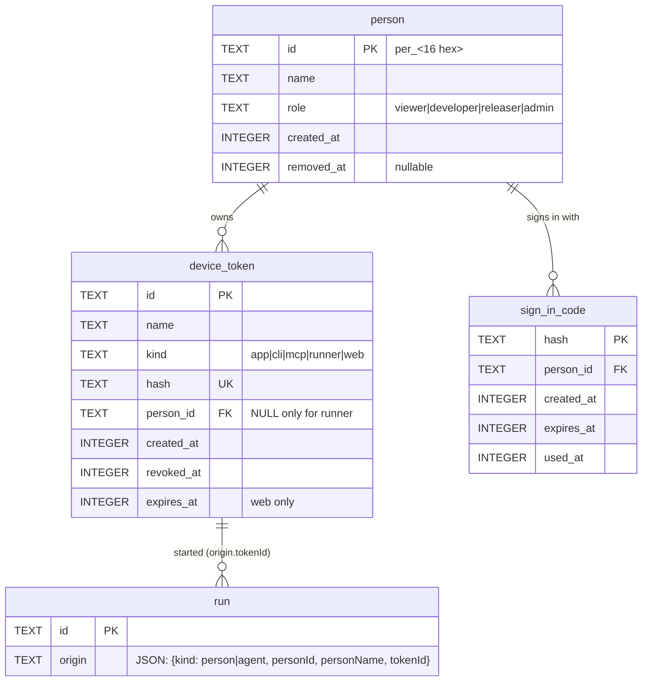

## feat: web dashboard with people and roles

> Plan 2 of the three plans in the
> [CI triggers, web dashboard and containers brainstorm](../brainstorm/2026-11-12-ci-triggers-web-dashboard-containers-brainstorm-doc.md).
> The triggers plan (Plan 1) depends on the people, roles and run origin built here. The
> container plan (Plan 3) is independent.

## Overview

XPath gets people with roles, browser sign-in, and a Vue web dashboard that `xpd` serves on its
own origin. The dashboard matches the macOS app, minus the parts that only make sense on a Mac.
Every approval and every run then records a person, not just a device token. Linux-only teams
get a GUI.

## Problem Statement

- **The only GUI is the macOS app.** An engine on Linux (bundle or Docker) can be driven only with `xp` and `xp mcp`.
- **Identity is a device token.** A token has a kind (`app`, `cli`, `mcp`, `runner`) and a name, and nothing else. Who may do what
  is decided by kind (`approval_service.dart:306`, `release_service.dart:1020`, `housekeeping_service.dart:268`,
  `runner_service.dart:275`, `github_token_service.dart:157`, `credential_service.dart:858`, `tokens_routes.dart:31`).
  So any `cli` token can approve a production release, and an approval records a device ("Mac mini"), not a person.
- **Runs do not record who started them.** `RunRecord` has no origin field, and Plan 1 needs one to tell a person, an agent and
  a trigger apart.
- **Browsers are refused.** Every socket is `allowedOrigins: const []`, there is no cookie auth, and `xpd` serves no static
  files (`xpd_server.dart`).

## Proposed Solution

1. **People and roles.** A `person` (name, role: `viewer` < `developer` < `releaser` < `admin`) owns every token except runner
   tokens. One table (`AccessPolicy`) maps each mutating action to a minimum role, and the existing token-kind rules stay
   on top of it: `mcp` and `runner` tokens never decide or change gates.
2. **Run origin.** `RunRecord.origin` records a person or an agent. Plan 1 adds triggers.
3. **The API under `/api/v1`.** The root paths stay as aliases for bearer clients until 2.0, on or after 2027-11-14. The SPA owns every other path.
4. **Browser sessions.**
   - An admin issues a one-time sign-in code, and the browser exchanges it for a `web` token in a `__Host-` cookie
     (HttpOnly, Secure, SameSite=Strict).
   - Requests that change something also need a CSRF header and a matching Origin.
   - Sockets authenticate with the cookie plus an exact Origin check, and they close when their token is revoked.
   - Sign-in works on loopback or through an HTTPS public URL.
5. **`apps/xp_web`.**
   - Vue 3 + TypeScript + Pinia + Vue Router + Vite, with a typed client generated from `openapi.yaml`.
   - It uses the `xp-tokens.css` design tokens.
   - Tests are Vitest plus Playwright against a real `xpd`.
   - The files are built once in CI and embedded in every `xpd` bundle, the Docker image and the Mac app's engine.

## Decisions

The owner's answers to the brainstorm's open questions (2026-11-12), and the defaults this plan sets for the gaps that the
user-flow analysis and the best-practices research (OWASP Session Management, CSRF and WebSocket cheat sheets) found. The
defaults can be changed in review without restructuring the plan.

Where the brainstorm says otherwise, this plan wins:
- The app runs on the engine's own origin (same origin).
- Sockets use the cookie, with no ticket.
- Runner tokens have no person.
- Triggers screens are in Plan 1.

| # | Question | Decision | Source |
|---|---|---|---|
| D1 | URL space | The API moves to `/api/v1`. Root paths stay as **bearer-only** aliases with `Deprecation` and `Sunset` headers, removed in the first major release (2.0) on or after 2027-11-14, as a `feat!` change. Everything else is the SPA. | owner (2026-11-14: 2.0, one year out) |
| D2 | Live updates | The existing WebSockets, authenticated by the session cookie plus an exact `Origin` match. No ticket, no SSE. | owner |
| D3 | TLS | No TLS in `xpd`. Browser sign-in works only on loopback or through the configured HTTPS public URL. Plain HTTP from another machine gets `403` with the reason. | owner |
| D3a | Cookie attributes | Chosen by the scheme of the origin that is signing in, never by request headers. Through the HTTPS `public_url`: `__Host-xp_session; Secure; HttpOnly; SameSite=Strict; Path=/`. On a loopback origin: `xp_session; HttpOnly; SameSite=Strict; Path=/`. Safari still refuses `Secure` cookies on `http://localhost` (WebKit bug 232088), and a loopback cookie never leaves the machine. | research |
| D4 | Packaging | `npm run build` runs once in CI, and `bundles.sh` copies `dist/` into every `xpd` bundle as `xpd/web/`. | owner |
| D5 | TS coverage | 100% lines for `src/api/**` and every Pinia store, 90% for the rest. This mirrors the repo's 100% client and bloc, 90% glue tiers. | plan default |
| D6 | Runner tokens | They belong to no person (`person_id` NULL is allowed only for `kind = 'runner'`). A runner is a machine, so removing a person never breaks a runner. | plan default; refines the brainstorm's "every kind" |
| D7 | Upgrade | Migration creates the person `Owner` (admin), who owns every non-runner token. It can be renamed later. | plan default |
| D8 | First admin, headless | `xpd person create --name <n> --role admin` prints a sign-in code. `xpd person code <name>` issues a new one. Both write to the database directly, like `xpd token create`. | plan default |
| D9 | Mac or CLI owner opening the dashboard | `xp dashboard` and a Settings button in the Mac app ask for a sign-in code for **their own** person and open `<origin>/sign-in#code=…`. A fragment never reaches a server log. They pass that link to `open`/`xdg-open` as a process argument: an **accepted exception** to the rule that no secret goes in process arguments, since the code is single-use, expires in 10 minutes and the browser redeems it within seconds; `xp dashboard --print` avoids it. Recorded in ADR 0018. | plan default; exception accepted by the owner (2026-11-15) |
| D10 | Sign-in code | 16 Crockford base32 characters (80 bits), shown as `XXXX-XXXX-XXXX-XXXX`. It lasts 10 minutes and works once. Issuing a code deletes the person's unused codes. Only the SHA-256 is stored, and it is the primary key. 20 failures in total per 10 minutes, then `429`. Unknown, used and expired codes all get the same `401`. It is used up atomically (`UPDATE … WHERE hash = ? AND used_at IS NULL AND expires_at > ?`, then the row count is checked). | plan default |
| D11 | Session lifetime | A `web` token expires 8 hours after sign-in, with no sliding renewal. Signing out revokes the token on the server and clears the cookie (`Max-Age=0`). Responses under `/api/v1/session` and `/api/v1/me` are `no-store`. | plan default (within OWASP's 4–8 h absolute timeout) |
| D12 | Revocation while signed in | The role is read with the token on every request, so a role change applies to the next request. Revoking a token, signing out, removing the person or expiry closes the affected sockets with code 4401: a push on revocation, plus a sweep every 60 s for expiry. The next REST call answers `401`, and the SPA goes to `/sign-in?next=<path>`. Every tab holds its own socket, so each tab learns on its own. | plan default |
| D13 | People removal | Soft removal (`removed_at`) that revokes all their tokens. Approvals and run origins keep the name. The last active admin cannot be demoted or removed (`409`). | plan default |
| D14 | CSRF | Any request authenticated by cookie with a method other than GET/HEAD/OPTIONS needs both of these:<br>- an `Origin` in the D15 set (an absent `Origin` is refused);<br>- the header `X-XPath-CSRF: 1`. `xpd` sends no CORS headers, so a cross-site page cannot add it without a preflight that fails.<br>Together with `SameSite=Strict`, that makes three independent layers. `POST /session` checks `Origin`, which covers login CSRF. A request with `Authorization` is bearer: the cookie is ignored and CSRF does not apply. `xpd` never sends CORS headers. GET never changes anything. | research (OWASP CSRF); simplified in review and confirmed by the owner: no HMAC token, no `Sec-Fetch-Site` |
| D15 | Allowed origins | Exact string matches only:<br>- the configured `public_url` origin;<br>- the loopback origins of the bound port (`http://127.0.0.1:<p>`, `http://localhost:<p>`, `http://[::1]:<p>`), but only when the `Host` header is one of those too, which blocks DNS rebinding.<br>`X-Forwarded-*` is never trusted. | research (OWASP WebSocket) |
| D16 | Role-aware UI | `GET /api/v1/me` returns the person and their `permissions` (the four above). The SPA hides actions it may not take and never reimplements the rules. | plan default |
| D17 | Tokens per person | Any person lists, creates (`cli`, `mcp`) and revokes their own tokens. Admins see and revoke everyone's. Creating a token needs an interactive token (`app` or `web`). | plan default |

### Role matrix (`AccessPolicy`)

Every role may read everything a token can read today, including secrets' metadata but never their values. Each row needs
the role named or higher.

| Permission | Min role | Routes / actions |
|---|---|---|
| `develop` | developer | workflow dispatch, run again, rerun failed, cancel run/job, resume job, add/update a project, project scan, run tests, baseline, create/update/delete project workflows, pin/unpin artifacts, and the gated release requests (store refresh, new build, merge, rollout, patch moves), whose gate approval needs a releaser |
| `decideApproval` | releaser | approve/deny any gate. Kept separate because Plan 1 lowers `pr_from_fork` to developer |
| `release` | releaser | abandon a release, notes/texts, store status, turn a gate on |
| `administer` | admin | turn a gate off (also needs an `app` or `web` token; today only `app`), remove projects, credentials, distribution certificates, GitHub token, runners (pairing, revoke, runner URL), storage (free, retention), public URL, people, sign-in codes for others, others' tokens |

The owner confirmed two rows on 2026-11-14: adding and updating a project need `develop`, so `xp mcp`'s `add_project`
and `update_project` keep working for agents, and the gated release requests need `develop` because the gate's approval
(releaser or higher) is the control.

Kind rules apply on top of roles:
- `mcp` tokens never decide approvals or change gates.
- `runner` tokens stay scoped by ADR 0011.
- Only `app` and `web` tokens create tokens or loosen gates.

## Technical Approach

### Architecture

- **Engine (`xp_engine`, framework-free).**
  - `people/`: `Person`, `PersonRepository` (interface), `PersonService` (create, rename, set role, remove, last-admin rule).
  - `access/`: `Permission`, `AccessPolicy.allows(token, permission)` and `AccessDeniedException`. It is pure, so it gets 100% coverage.
  - `DeviceToken` gains `personId`, `role` (joined on read) and `expiresAt`.
  - `TokenService` gains `issueWeb`, `listFor(person)` and a revocation stream (`revocations`) that the socket routes listen to.
  - `signin/`: `SignInCodeService` (issue, redeem, rate limit with an injected clock).
  - Approval, release, housekeeping, runner, GitHub token and credential services replace their kind checks with
    `AccessPolicy`.
- **Adapters (`xp_adapters`).** SQLite repositories for `person` and `sign_in_code`. Migrations go in merge order
  (next is v23, golden `snapshots/v<N>.sql`).
- **API (`xp_api`).**
  - New: `Person`, `PersonRole`, `Me`, `SignInCode`, `RunOrigin`, `DeviceTokenKind.web`.
  - `TokenInfo` gains `personId`, and `DecidedBy` gains `personId` and `personName` (optional, so old rows still parse).
  - `openapi.yaml` gets the `servers` URL `…/api/v1` and the new paths.
- **Server (`apps/xpd`).**
  - `api_handler.dart` mounts the router at `/api/v1`.
  - A `legacyAlias` dispatcher sends root requests that carry `Authorization`, plus `/health`, `/version` and `/runners/pair`, to the
    same router, and adds `Deprecation: true` and a `Link` to the successor.
  - Dispatch order:
    1. `/api/v1/*` goes to the API. An unknown path gets a JSON `404`, never `index.html`.
    2. A root path goes to the API if and only if it carries `Authorization` or is a public path.
    3. Everything else goes to `WebAssets`.
  - Root responses carry `Vary: Authorization`.
  - `WebAssets` serves:
    - hashed `/assets/*` with `Cache-Control: public, max-age=31536000, immutable`
    - `index.html` with `no-cache` for any `GET` that accepts `text/html`
    - `404` JSON for anything else (including `/` on an engine built without `web/`), and never the SPA for `/api/*`
  - Headers on SPA responses:
    - CSP: `default-src 'self'; script-src 'self'; style-src 'self'; img-src 'self' data:; font-src 'self'; connect-src 'self' <ws origin of public_url>; object-src 'none'; base-uri 'none'; form-action 'self'; frame-ancestors 'none'`
    - `X-Content-Type-Options: nosniff`
    - `Referrer-Policy: no-referrer`
  - The Vue runtime-only build keeps `unsafe-eval` out.
  - `authMiddleware` takes a bearer token **or** the session cookie (D3a). `Authorization` wins when both are present. A
    cookie only authenticates `web` tokens and only under `/api/v1`.
  - `csrfMiddleware` (D14) and `permissionMiddleware`:
    - A table in `route_permissions.dart` maps every mutating route to a `Permission`.
    - A test walks the router and fails on any mutating route missing from the table.
    - A route missing from the table is closed (`administer`), as ADR 0011 closes new routes to runners.
- **Sockets.**
  - `events_route.dart` and `job_logs_route.dart` accept the cookie and check `Origin` against D15.
  - Both keep a token id → sockets map and close with 4401 on `TokenService.revocations`.
  - `runner_connect_route.dart` stays closed to browsers.
- **Clients.**
  - `xp_client._uri` prefixes `api/v1`. On connect it probes `/api/v1/version` and falls back to root paths for an engine older than
    this change. A Homebrew or tarball `xp` can be newer than a remote engine, and no rule says the versions match, so this
    probe stays.
  - `xp_repositories`, the Mac app and the runner get it for free.
- **Web (`apps/xp_web`)**:

  ```text
  apps/xp_web/
    package.json, package-lock.json, .nvmrc (Node 24 LTS), vite.config.ts, tsconfig*.json,
    vitest.config.ts, playwright.config.ts, eslint.config.js, index.html
    src/
      api/          schema.d.ts (generated), client.ts, sockets.ts (event + log feeds, reconnect)
      app/          main.ts, router.ts (auth guard, ?next= validated as a same-origin path), App.vue
      ui/           shared components; xp-tokens.css imported from docs/design through a Vite alias
      features/<feature>/{stores,views,components}/
        session, projects, dispatch, runs, jobs, approvals, releases, tests, runners,
        storage, credentials, workflows, people, tokens, settings
    e2e/            Playwright specs
  ```

  - Composition API only. One Pinia store per feature. Views read stores, and stores call `api/`.
  - Pinned exact versions (checked with `npm view` on 2026-11-13):
    - runtime: vue 3.5.45, pinia 4.1.0, and vue-router pinned exactly in `package.json` (every dependency, `@pinia/testing`
      included, uses an exact version and no `^`)
    - build and types: vite 8.3.8, TypeScript 5.x (openapi-typescript 7.13.0 peers on TypeScript 5, so not 7)
    - client: openapi-typescript 7.13.0 for the types and openapi-fetch 0.17.0 for the client. Its middleware adds
      `X-XPath-CSRF: 1` and turns `401` into the signed-out state.
    - tests: vitest 5.1.0 with @vitest/coverage-v8 5.1.0, @vue/test-utils 2.5.1, @pinia/testing, @playwright/test 1.65.0
  - Testing approach:
    - Store tests mock `fetch` at the network layer, not the stores.
    - The Vitest `coverage.include` is `src/**/*.{ts,vue}`, so files no test imports still count. `schema.d.ts` and
      `main.ts` are excluded.
    - Playwright runs the full suite on Chromium, and `signin.spec.ts` on WebKit too. WebKit over `http://localhost` covers
      the cookie without `Secure` (D3a).
  - Strings in English inside the components (the desktop app is English-only too).

### Data model



`device_token` is rebuilt (`foreignKeysOff: true`, like v20/v22) to widen the `kind` CHECK and add `person_id`, with
`CHECK (kind = 'runner' OR person_id IS NOT NULL)`.

### New API (all under `/api/v1`)

| Method | Path | Who |
|---|---|---|
| `POST` | `/session` `{code}` → `Me` + `Set-Cookie` | public; D3, D10 |
| `DELETE` | `/session` | cookie |
| `GET` | `/me` | any |
| `GET` / `POST` | `/people` | any / admin |
| `GET` / `PATCH` / `DELETE` | `/people/{id}` | any / admin / admin |
| `POST` | `/people/{id}/sign-in-codes` | admin; or the person themself with an `app`/`cli` token (D9) |
| `GET` | `/tokens` | own; admin sees all |
| `POST` | `/tokens` | `app`/`web` token, for its own person (D17) |
| `DELETE` | `/tokens/{id}` | own; admin any |
| `GET` / `PUT` | `/settings/public-url` | any / admin |

`Run` gains `origin`. No new API events: a socket closing with 4401 is the signal, and a role change applies to the next request.

## Implementation Phases

`/build` runs these phases in order, one per context window. Each phase leaves the gate green, and lands its own ADR,
migration golden, contract tests and `xp_client` methods.

Scope: about 9–12k lines across Dart and Vue. The owner chose to keep one plan with phases (2026-11-13). The phase ends are
also clean PR boundaries:
- Phases 1–3: engine and API.
- Phases 4–5: sessions and the web shell, not announced yet.
- Phase 6: the first useful dashboard, where it goes public.
- Phases 7, 8 and 9: in any order.

So the branch can be cut into PRs at a phase end if review needs it. Plan 1 can start after Phase 2.

Shell setup, assumed by every validation command below:

```sh
export PATH="$PWD/.fvm/flutter_sdk/bin:$HOME/.pub-cache/bin:$PATH"
```

### Phase 1: People, roles and the access policy in the engine

- **Status:** Done
- **Built (notes for later phases):**
  - `Person` and `PersonRole` live in `xp_api` and the engine uses them directly (no engine-side record).
  - `DeviceToken` has `personId` (stored) and `person` (read by `TokenService.authenticate` on every request; `role`
    is `person?.role`). A token of a removed or missing person does not authenticate.
  - `TokenService` takes a `PersonRepository`. `issue(personId:)` defaults to the eldest active admin, which
    `xpd token create` and the test engines rely on. `revokeAllOf(personId)` backs `PersonService.remove`.
  - Services keep their own `…ForbiddenException` (already mapped to `403`) and build the message from
    `AccessPolicy.refusal`. There is no `AccessDeniedException` yet; add it with `permissionMiddleware` in Phase 2 if needed.
    `AccessPolicy.mayLoosenGates` and `mayCreateTokens` hold the `app`/`web`-only kind rules.
  - `device_token.expires_at` is not added yet (Phase 4 can `ADD COLUMN` it).
  - `openapi.yaml` already has `TokenInfo.personId`, `DecidedBy.personId`/`personName` and `web` in both kind enums.
- **Scope:**
  - The person model, plus migration v23:
    - a `person` table;
    - a rebuild of `device_token` (`kind` CHECK widened to `web`, plus `person_id`);
    - a rebuild of `approval` (`decided_by_kind` CHECK widened to `web`, today `IN ('app','cli')` at `migrations.dart:338`,
      plus `decided_by_person_id` and `decided_by_person_name`);
    - an `Owner` admin backfilled.
  - `PersonService` with the last-admin rule.
  - `AccessPolicy` replaces every kind check, without changing what today's owner can do.
  - ADR 0017 (people and roles), in the same PR.
- **Files touched:**
  - `packages/xp_api/lib/src/{person,device_token_kind,approval,token}.dart` and the `.g.dart` files, `packages/xp_api/lib/xp_api.dart`
  - `packages/xp_engine/lib/src/{people,access}/**`, `packages/xp_engine/lib/xp_engine.dart`
  - `packages/xp_engine/lib/src/tokens/{device_token,token_service}.dart`
  - `packages/xp_engine/lib/src/{approvals/approval_service,releases/release_service,housekeeping/housekeeping_service,runners/runner_service,git/github_token_service,credentials/credential_service}.dart`
  - `packages/xp_adapters/lib/src/sqlite/{migrations,sqlite_person_repository,sqlite_device_token_repository,sqlite_approval_repository}.dart`
  - `packages/xp_adapters/test/src/sqlite/snapshots/v23.sql`
  - `docs/adr/0017-people-and-roles.md`, `.github/cspell.json`
  - the matching tests
- **Acceptance criteria:**
  - An upgraded database has one admin `Owner` who owns every non-runner token.
  - `AccessPolicy` has a test row for every role × kind × permission.
  - The approval tests still pass for `app` and `cli` tokens of an admin, and now fail with `403` for a viewer's `cli` token.
  - An approval decided by a `web` token persists and reads back with `personName`.
  - No kind check is left outside `access/`.
  - ADR 0017 names what it amends: the 1.0 non-goal on multi-user accounts, and D-13's kind rule.
- **Validation:** `(cd packages/xp_adapters && dart test test/src/sqlite/) && melos run test:coverage:strict && ! grep -rnE "kind (!=|==) DeviceTokenKind\.(app|cli)" packages/xp_engine/lib apps/xpd/lib --exclude-dir=access`

### Phase 2: People, tokens, run origin and permissions over the API

- **Status:** Done
- **Built (notes for later phases):**
  - `Permission` moved to `xp_api` (`me.dart`, wire names `develop`, `decide_approval`, `release`, `administer`)
    next to `Me`; `AccessPolicy.permissionsOf(token)` backs `GET /me` (`Cache-Control: no-store`).
  - `ApiRouter` (`api/api_router.dart`) wraps `shelf_router`'s `Router` (which is `@sealed`) and records every
    route; every `addTo` takes it. `XpdServer.routes` exposes them, and `route_permissions_test.dart` checks the
    table both ways. `permissionMiddleware` runs after `runnerScopeMiddleware`, matches routes in registration
    order, skips reads and public paths, and treats a listed route with `RouteAccess.open` as the handler's call.
    An unknown path still gets the router's `404`. No `AccessDeniedException` was needed.
  - Deviation: the gated release requests (`refresh`, `builds`, `merge`, `rollout`, `patches`) need `develop`,
    not `release`, as a dispatch does, so `xp mcp`'s `request_rollout` and today's agent behaviour keep working;
    the gate still needs a releaser. `POST /storage/free` is open (a dry run is a read; the service keeps the
    real delete to admins). Store status, texts and abandon stay `release`.
  - `RunOrigin` (`person` | `agent`, with `tokenId`, `personId`, `personName`) comes from
    `DeviceToken.runOrigin`; `WorkflowDispatcher.dispatch/again` and `ReleaseService.newBuild/requestMerge/
    requestRollout/requestPatch` take `origin:`, and `DispatchWorkflow` gained a named `origin`. Plan 1 adds
    a trigger kind. Migration v24 adds `run.origin` (JSON, NULL for old runs).
  - `TokenService.listFor(asker)` / `revokeFor(asker, id)` (D17): own person's valid tokens, everyone's for a
    token that may `administer`; runner tokens are never listed (revoked with their runner); a token the asker
    cannot see is `404`.
  - `xpd person create|list` print the person id / a tab-separated list. Deferred to Phase 4, which owns the
    `sign_in_code` table: `xpd person code`, the code `xpd person create` should print, and
    `POST /people/{id}/sign-in-codes`.
  - `openapi.yaml`: every route that now needs a permission lists `403`; `TestEngine.tokenFor(role, kind:)`
    makes a token of a person with a role.
- **Scope:**
  - Routes for `/people`, `/me`, token list/create/revoke and sign-in codes for others.
  - `permissionMiddleware` with the route table and the "every mutating route is listed" test.
  - `Run.origin`, with migration v24 adding the `run.origin` column.
  - `xpd person create|code|list`, the `xp_client` methods, `openapi.yaml` and contract tests.
- **Files touched:**
  - `apps/xpd/lib/src/api/people/people_routes.dart`, `apps/xpd/lib/src/api/session/me_routes.dart`, `apps/xpd/lib/src/api/tokens/tokens_routes.dart`
  - `apps/xpd/lib/src/api/{route_permissions,permission_middleware,api_handler}.dart`
  - `apps/xpd/lib/src/cli/person_command.dart`
  - `packages/xp_engine/lib/src/scheduler/run_record.dart`, `packages/xp_engine/lib/src/dispatch/workflow_dispatcher.dart`
  - `packages/xp_api/lib/src/{run,me,run_origin}.dart`, `packages/xp_api/openapi.yaml`
  - `packages/xp_client/lib/src/xp_client.dart`
  - `packages/xp_adapters/lib/src/sqlite/{migrations,sqlite_run_repository}.dart`, `packages/xp_adapters/test/src/sqlite/snapshots/v24.sql`
  - `apps/xpd/test/src/api/route_permissions_test.dart`
  - `apps/xpd/test/contract/{people,tokens,runs}_contract_test.dart` (`/me` goes in `people_contract_test.dart`)
- **Acceptance criteria:**
  - A viewer gets `403` on dispatch, and a developer gets `403` on approve.
  - A run started with a `cli` token shows `origin.kind = person` with the person's name, and one started with `mcp` shows `agent`.
  - `xpd person create --name Sam --role admin` prints a code.
  - Demoting the last admin gets `409`.
- **Validation:** `(cd packages/xp_adapters && dart test test/src/sqlite/) && (cd apps/xpd && dart test) && melos run test:contract && melos run test:coverage:strict`

### Phase 3: The API under `/api/v1`

- **Status:** Done
- **Built (notes for later phases):**
  - `legacyAlias` (`api/legacy_alias.dart`) wraps the API pipeline in `buildApiHandler`, so `XpdServer` serves one
    handler. Under `/api/v1` the request reaches the API with `api/v1` as its handler path; middlewares and routes read
    `request.url.path` (relative), never `requestedUri.path`. A root-relative `Location` gets the `/api/v1` prefix.
  - A root path without `Authorization` that is not public gets a JSON `404` with `Vary: Authorization`: Phase 5's
    `WebAssets` takes that branch (keep `/api/*` out of the SPA). Aliases carry `Deprecation: true`,
    `Sunset` (`legacySunset`) and `Link: </api/v1/…>; rel="successor-version"`.
  - The released versions were already past 1.0 (tags `v1.x`), so the owner moved the removal (2026-11-14): the
    aliases go in the first major release (2.0) on or after the `Sunset` date, 2027-11-14, as a `feat!` change.
  - `xp_client` probes `GET /api/v1/version` once without a token: `200` means `/api/v1`, `401`/`404` the root (an
    older engine answers `401` there); any other answer or a connection failure is not remembered. Its test
    `FakeEngine` serves `/api/v1` by default (`servesApiV1: false` for an old engine), so tests keep API paths.
  - `TestEngine.request`, `handshake`, `download` and the socket helpers go to `/api/v1`; `root: true` (and
    `connectRunner(root: true)`) hits the alias. `legacy_alias_contract_test.dart` checks one route per group.
- **Scope:**
  - Mount the router at `/api/v1`, plus the bearer-only root alias dispatcher with `Deprecation` and `Sunset` headers.
  - `openapi.yaml` servers go to `/api/v1`.
  - `xp_client` moves, with a probe fallback for older engines.
  - The contract tests call `/api/v1`, plus one alias test per route group.
  - ADR 0018 (the web dashboard: same origin, `/api/v1` with aliases until 2.0, cookie sessions, CSRF, sockets, packaging;
    it amends the "browsers are refused" rule), in the same PR.
- **Files touched:**
  - `apps/xpd/lib/src/api/{api_handler,legacy_alias}.dart`, `apps/xpd/lib/src/server/xpd_server.dart`
  - `packages/xp_client/lib/src/{xp_client,web_socket_connector}.dart`
  - `packages/xp_api/openapi.yaml`, `apps/xpd/test/contract/**`, `tool/e2e/smoke_bundle.sh`
  - `docs/adr/0018-web-dashboard.md`
- **Acceptance criteria:**
  - `curl -H 'Authorization: Bearer …' /projects` and `/api/v1/projects` give the same body, and only the first has
    `Deprecation: true`.
  - `/projects` with no `Authorization` header is not the API.
  - An old runner bundle still pairs and connects through `/runners/pair` and `/runners/connect`.
  - `xp` against an engine without `/api/v1` still works (the probe falls back to root paths).
- **Validation:** `melos run test:contract && melos run test:coverage:strict && tool/e2e/smoke_bundle.sh && tool/e2e/quickstart_cli.sh && tool/e2e/mcp_gate_e2e.sh`

### Phase 4: Browser sessions

- **Status:** Done
- **Built (notes for later phases):**
  - Engine: `signin/` has `SignInCodeService` (`issue`, `issueFor(asker, id)`, `signIn(code)` → a `web`
    `IssuedToken`; the 20-failure window is in memory), `SignInCodeRepository` (`use` is one
    `UPDATE … RETURNING`) and `PublicUrlService` (an `https` origin only, kept once read, key `public_url`).
    `AccessPolicy.mayIssueSignInCode` holds D9. `TokenService.issueWeb` (8 h, name `Browser`),
    `revocations` (ids from `revoke`, `revokeFor`, `revokeAllOf`) and expiry in `authenticate`/`listFor`
    (`DeviceToken.expiresAt`, `isValidAt`). Migration v25 adds `device_token.expires_at` (web only) and
    `sign_in_code`.
  - API: new codes `csrf` (403) and `rate_limited` (429, `Retry-After`); close code `sessionEndedCloseCode`
    (4401) in `xp_api`; models `SignInCode` (`signInUrl(origin)` puts the code in the fragment),
    `SignInRequest`, `PublicUrl`, `SetPublicUrlRequest`.
  - xpd: `AllowedOrigins` (D15, port from the connection's `localPort`, `fromLoopback` for D3),
    `SessionCookie` (names and `Set-Cookie`), `authMiddleware(publicRoutes:)` reads the cookie only under
    `/api/v1` and without `Authorization` (`authenticatedByCookie`), `csrfMiddleware` after it,
    `socketOriginRefusal` and `TokenSockets` (shared by `/events` and job logs; `XpdServer.start(socketSweep:)`)
    for D12. `POST /session` refuses the root alias (404); its `403` for a foreign origin carries a `hint`.
    `SessionRoutes` also serves `POST /people/{id}/sign-in-codes`; `SettingsRoutes` the public URL.
    `TestEngine` has `signIn`, `publicUrl`, `loopbackOrigin`, `signInBrowser()`, `browser(cookie)`.
  - `xpd person create` keeps the id alone on stdout and tells the code on stderr; `xpd person code
    <name or id>` prints the code on stdout.
  - Clients: `XpClient.createSignInCode`, `publicUrl`, `setPublicUrl`, `dashboardSignInUrl()` (me → code →
    public URL, else the client's base URL); `SettingsRepository.dashboardSignInUrl`; `xp dashboard
    [--print]` (`XpContext.openBrowser`), `xp settings public-url [<url> | --clear]`; the Mac app's
    Settings ▸ Web dashboard (`DashboardBloc`, `droppable`, takes `AppServices.openUrl`). No settings goldens
    exist, so none changed.
  - Like the Mac app's `openUrl`, `xp dashboard` hands the link (with its one-time code) to `open` /
    `xdg-open` as an argument, as D9 asks; `--print` avoids it.
- **Scope:**
  - Sign-in codes, with migration v25 (the `sign_in_code` table), plus what Phase 2 deferred to them:
    `POST /people/{id}/sign-in-codes`, `xpd person code <name>`, and the code `xpd person create` prints.
  - `POST`/`DELETE /session` and the cookie (D3a), with the 8-hour expiry (D11).
  - `csrf_middleware.dart` (D14), the D15 origin set, and the `public_url` setting: the route and `xp settings public-url`. The
    web Settings page comes in Phase 8.
  - Sockets accept the cookie, check Origin and close on revocation (D12).
  - `xp dashboard` and the Mac app's "Open dashboard" button (D9), which opens the browser through `AppServices.openUrl`.
- **Files touched:**
  - `packages/xp_engine/lib/src/signin/**`, `packages/xp_engine/lib/src/tokens/token_service.dart`
  - `packages/xp_adapters/lib/src/sqlite/{migrations,sqlite_sign_in_code_repository}.dart`, `packages/xp_adapters/test/src/sqlite/snapshots/v25.sql`
  - `apps/xpd/lib/src/api/session/session_routes.dart`, `apps/xpd/lib/src/api/settings/settings_routes.dart`
  - `apps/xpd/lib/src/api/{csrf_middleware,middleware,events_route,jobs/job_logs_route}.dart`
  - `apps/xpd/test/src/api/{session/**,csrf_middleware_test.dart,events_route_test.dart}`
  - `apps/xpd/test/contract/{session,settings}_contract_test.dart`
  - `packages/xp_api/openapi.yaml`, `packages/xp_client/lib/src/xp_client.dart`
  - `packages/xp_repositories/lib/src/settings_repository.dart`
  - `apps/xp/lib/src/commands/{dashboard_command,settings_commands}.dart`
  - `apps/xp_desktop/lib/settings/{bloc/dashboard_bloc.dart,widgets/dashboard_section.dart,settings.dart}` (`droppable`, following
    `runner_url_bloc.dart`)
  - `apps/xp_desktop/lib/l10n/arb/app_en.arb` and `lib/l10n/gen` (`flutter gen-l10n`)
  - `apps/xp_desktop/test/settings/{settings_blocs_test,settings_page_test}.dart`, with the goldens updated on macOS
    (`flutter test --update-goldens --tags golden`)
- **Acceptance criteria:**
  - On loopback, a code exchanged at `/api/v1/session` sets `xp_session` (HttpOnly, SameSite=Strict, Path=/).
  - Through an HTTPS `public_url`, it sets `__Host-xp_session` with `Secure`.
  - A loopback origin with a foreign `Host` (DNS rebinding) is refused.
  - The same code a second time gets `401`. The 21st bad code within 10 minutes gets `429`.
  - A cookie `POST` gets `403 csrf` when `X-XPath-CSRF` is missing, or `Origin` is foreign or absent.
  - A request with both a bearer token and a cookie is treated as bearer.
  - A sign-in from a non-loopback address with no HTTPS `public_url` gets `403` with the reason.
  - An open `/api/v1/events` socket closes with 4401 when an admin revokes the token, and within 60 s of expiry.
  - A socket upgrade with a foreign Origin is refused.
- **Validation:** `(cd packages/xp_adapters && dart test test/src/sqlite/) && (cd apps/xpd && dart test) && (cd apps/xp && dart test) && (cd apps/xp_desktop && flutter test test/settings) && melos run test:contract && melos run test:coverage:strict`

### Phase 5: The `xp_web` scaffold, serving and packaging

- **Status:** Done
- **Built (notes for later phases):**
  - Versions (exact, `npm view` on 2026-11-14): vue 3.5.45, pinia 4.1.0, vue-router 5.5.1, vite 8.3.8,
    typescript 5.9.3, vue-tsc 3.3.14, @vitejs/plugin-vue 6.0.11, openapi-typescript 7.13.0, openapi-fetch 0.17.0,
    vitest and @vitest/coverage-v8 5.1.0, jsdom 31.0.1, @vue/test-utils 2.5.1, @pinia/testing 2.0.2 (installed,
    no test needs it yet), @playwright/test 1.65.0, eslint 10.15.0 with eslint-plugin-vue 10.12.1 and
    @vue/eslint-config-typescript 14.9.0. `.nvmrc` is 24; `engines` asks for Node 22.12 or later (Vitest 5's
    floor), and the local checks ran on Node 22.23.3.
  - Layout: `src/api/client.ts` (`api`, `onSignedOut`, `errorMessage`), `src/app/{main,router,next,navigation}.ts`,
    `src/features/session/{stores/session.ts,views/SignInView.vue}`, `src/ui/{AppShell,HomeView,NotFoundView}.vue`
    and `base.css` (imports `@design/xp-tokens.css`, light and dark from the OS). A new screen is a child of the
    shell route in `router.ts` (before the catch-all `not-found`) and a link in `navigation.ts`, which already
    lists Projects, Runs, Approvals, Runners, Storage, Credentials, People and Settings.
  - The client adds `X-XPath-CSRF: 1` to every request and turns any `401` but `POST /session`'s into
    `onSignedOut`; `followSessionEnd(router)` (called in `main.ts`) then goes to `/sign-in?next=<path>`. It
    reads `globalThis.fetch` on every call, so tests stub `fetch` with `src/testing/fetch.ts` (`stubEngine`,
    `meOf`, `errorBody`; excluded from coverage). A test that navigates to a lazy route waits with `vi.waitFor`.
  - `safeNext` (`app/next.ts`) accepts a path that starts with one `/` and has no backslash or control
    character; `//…`, schemes, `/sign-in…` and anything else go home. vue-router keeps `/` unencoded in a query,
    so the address reads `/sign-in?next=/runs/abc` (the same value as `%2Fruns%2Fabc`).
  - xpd: `WebAssets` (`server/web_assets.dart`) is the new `site` of `legacyAlias` (default `notTheApi`, the JSON
    `404`), through `buildApiHandler(site:)` and `XpdServer.start(webDirectory:)`; `TestEngine.start(webDirectory:)`
    too. A page needs `GET`/`HEAD` with `Accept` naming `text/html`; `/api…` and a missing asset are the JSON `404`.
    CSP `connect-src` is `'self'` plus `wss://` of the public URL; same-origin sockets on loopback rely on `'self'`,
    which Phase 6 should prove in Chromium and WebKit. `webRoot(executable:)` (`serve_command.dart`) finds
    `<bundle>/web` or `Contents/Resources/web`, and `xpd serve` prints `xpd serves the dashboard in <dir>`.
  - Packaging: `tool/release/web_dist.sh` prints the built dashboard: `$XPATH_WEB_DIST`, or `apps/xp_web/dist`
    after `npm ci && npm run build`. `bundles.sh` (every `xpd/web`), `smoke_bundle.sh` and `web_e2e.sh` use it;
    `build_mac.sh` requires it and copies it to `Contents/Resources/web`; the `Dockerfile` refuses a bundle without
    `xpd/web/index.html`. In `release.yml` the `bundles` job builds it once and the `dmg` job takes the Linux
    bundle's `web/` from the `release` artifact.
  - CI: `changes` has a `web` output (`apps/xp_web/**` or `openapi.yaml`); the `web` job runs the license check,
    lint, typecheck, coverage, `gen:api:check`, the build, then `web_e2e.sh` (Flutter and the Playwright browsers);
    `gate` accepts it skipped when `web == false`. `smoke` now sets up Node: it builds the dashboard into its bundle.
  - The `smoke` job builds the dashboard on every code PR, by the owner's choice (2026-11-15), so every PR proves
    that a bundled engine serves the SPA.
  - Deviation: the npm license check is `npm run licenses` (`scripts/check-licenses.mjs`), which reads each
    package's `license` from `package-lock.json` against an allow list, instead of a third-party checker.
  - `tool/e2e/web_e2e.sh [<filter>…]` builds the AOT `xpd`, starts it with the dashboard and passes
    `XPD_URL`, `XPD_BIN` and `XPD_DATA_DIR` to Playwright; `e2e/engine.ts` has `createPerson` and `signInCode`
    (`xpd person` on the data directory). WebKit runs only `signin.spec.ts`, at `http://localhost:<port>`.
- **Scope:**
  - Scaffold `apps/xp_web`:
    - the generated client, with a CI freshness check;
    - the session store and the router guard;
    - the sign-in page, which reads `#code=`;
    - the shell with navigation, and the design tokens in light and dark.
  - `package.json` scripts: `lint` (eslint), `typecheck` (`vue-tsc --noEmit`), `test`, `test:coverage`, `gen:api`,
    `gen:api:check` (`gen:api` and then `git diff --exit-code src/api/schema.d.ts`) and `build` (`vue-tsc --noEmit && vite build`).
  - Type definitions: `src/env.d.ts` (`/// <reference types="vite/client" />`), plus the generated `src/api/schema.d.ts`.
  - `xpd` serves `web/` from next to its binary, or `Contents/Resources/web` in the Mac app. Without it, `/` is a JSON `404`.
  - `bundles.sh`, `release.yml`, `build_mac.sh` and the `Dockerfile` carry the files.
  - CI:
    - `gate.yaml` gets a `web` output in `changes` (set by `apps/xp_web/**` or `packages/xp_api/openapi.yaml`), a `web` job,
      and `web` in `gate.needs`.
    - `gate` accepts `web` as skipped when `web == false`.
    - The npm license check runs in the same job.
  - The Playwright harness `tool/e2e/web_e2e.sh` with a sign-in spec.
- **Files touched:**
  - `apps/xp_web/**`, `apps/xpd/lib/src/server/{xpd_server,web_assets}.dart`, `apps/xpd/lib/src/cli/serve_command.dart`
  - `tool/release/{bundles.sh,build_mac.sh}`, `.github/workflows/{gate.yaml,release.yml}`
  - `tool/e2e/{web_e2e.sh,smoke_bundle.sh}`, `.gitignore`
- **Acceptance criteria:**
  - `GET /` on a bundled `xpd` returns the SPA with the CSP header, and `/assets/*.js` is `immutable`.
  - Deep link `/runs/abc` while signed out lands on `/sign-in?next=%2Fruns%2Fabc`, and after sign-in returns there.
  - `next=//evil.example` is ignored.
  - `npm run gen:api:check` fails when `openapi.yaml` changes without regenerating.
  - A Dart-only PR leaves `gate` green with `web` skipped.
- **Validation:** `(cd apps/xp_web && npm ci && npm run lint && npm run typecheck && npm run test:coverage && npm run gen:api:check && npm run build) && tool/e2e/smoke_bundle.sh && tool/e2e/web_e2e.sh`

### Phase 6: Projects, dispatch, runs and the job view

- **Status:** Done
- **Built (notes for later phases):**
  - `src/api/client.ts` exports the API types the screens use, `sessionEnded()` (what a `401` and a 4401 close
    both call), `dataOf(call)` (the data, or an `ApiFailure` with `status` and `reason`: `details.reason`, else
    the code) and `failureMessage`. Stores call `dataOf` in `try`/`catch` and keep `error`.
  - `src/api/sockets.ts`: `followEvents(listener)` keeps one `/events` socket per tab while someone listens,
    resumes with `after=<seq>`, and emits `{kind: 'resync'}` on 4409 or when an upgrade with a cursor is refused
    (a browser cannot read the `409`). `followJobLog(id, after, …)` resumes after the last line, reconnects at once
    over a `gap`, and stops at `end`. Both back off from 1 s to 30 s; a 4401 calls `sessionEnded()` and never
    reconnects. `payloadValue(event, key)` reads a payload string. Tests drive `src/testing/sockets.ts`
    (`stubSockets`, `FakeSocket`, `openEventFeed`).
  - A store's `follow()` subscribes to the events it cares about and reloads through `coalesced()`
    (`src/app/coalesce.ts`: a burst loads at most twice); views call `useFollowing(store.follow, …)`
    (`src/ui/following.ts`). Labels and formats of states, step kinds, versions, durations and origins are in
    `src/ui/format.ts`, as the Mac app words them; `StatusBadge.vue` draws a state.
  - Stores: `projects/stores/{projects,project,workflows}` (`workflows` caches each project's list for the
    names runs show), `runs/stores/{runs,run}`, `jobs/stores/{job,log}`, `dispatch/stores/dispatch`. The log
    store grows one `shallowRef` list and `triggerRef`s it, so `LogView` reads the store, not a prop.
  - Routes under the shell: `/projects`, `/projects/:id`, `/projects/:id/runs`, `/projects/:id/dispatch`
    (`?workflow=` an id or a name), `/runs` (`?project=&workflow=&state=`), `/runs/:id`, `/jobs/:id`.
  - Deviations from the Mac app: Dispatch is a page, not a sheet. It starts with the inputs of the workflow's
    newest run on the engine, where the Mac app remembers per device. It has no branch/tag switch, and no
    check of GitHub steps before the engine's refusal. The run page and the job page are separate (no pipeline
    graph). Artifacts, test results, the release rail, the credentials ledger and the "needs you" count are left
    to Phases 7 and 8.
  - CSP: `connect-src 'self'` covers the same-origin `ws:` sockets on loopback in Chromium and in WebKit
    (`http://localhost`); `web_assets.dart` is unchanged. `playwright.config.ts` runs `runs.spec.ts` on WebKit
    too. `e2e/engine.ts` has `fixtureRepository(name)` (tool/e2e/build_app with a `file://` origin);
    `runs.spec.ts` adds it as a project, dispatches `dev-build` (then cancels it) and a `count` workflow whose
    log socket the spec drops once.
  - `docs/guide/dashboard.md`: signing in, the first admin of a headless engine, roles, dispatch and logs, and
    the proxy recipe (Caddy, Tailscale) with `xp settings public-url`.
- **Scope:**
  - Projects list and project overview (apps, flavors, last runs). This mirrors `apps/xp_desktop/lib/{projects,project_overview}`.
  - Dispatch form (workflow, app, flavors, platforms, bump, inputs) from `/workflows/schema`. This mirrors `lib/dispatch`.
  - Global and per-project runs list with filters in the query string, the run page, and the job view. This mirrors
    `lib/{runs,job}`.
  - Live logs in the job view: the text can be selected, and the view follows the tail.
  - Live updates from the event feed.
  - `docs/guide/dashboard.md`: signing in, roles, and the proxy recipe with `public_url`. The dashboard is announced from
    this phase.
- **Files touched:** `apps/xp_web/src/features/{projects,dispatch,runs,jobs}/**`, `apps/xp_web/src/api/sockets.ts`, `apps/xp_web/e2e/runs.spec.ts`, `docs/guide/dashboard.md`
- **Acceptance criteria:**
  - Dispatching `dev-build` from the browser creates a run whose origin is the signed-in person.
  - The job page streams logs and survives a socket reconnect without duplicate lines.
  - A viewer sees no Dispatch button.
- **Validation:** `(cd apps/xp_web && npm run test:coverage && npm run typecheck) && tool/e2e/web_e2e.sh runs`

### Phase 7: Approvals, releases and tests

- **Status:** Done
- **Built (notes for later phases):**
  - Approvals (`features/approvals`): `stores/approvals` (the inbox: Pending, Decided, Expired; the
    picked approval, from `/approvals/:id`, is shown under its own filter and that filter follows it
    once it is decided), `stores/approval` (one approval with its job and release, and its review:
    Approve arms after `armingDelay` (1 s), Return never approves, ⌘↩ or Ctrl+↩ does; a `409
    already_decided` takes the approval it carries, so the review says who won), `stores/pending`
    (the "needs you" count). Copy and labels in `labels.ts`; `deciderOf` names the person
    (`decidedBy.personName`), else the device. Decide buttons need `decide_approval`; a developer
    sees the approval and "your role cannot".
  - The shell follows the pending approvals from sign-in on (`NavItem.needsYou`), so every page has
    the `/events` socket open; a spec that waits for that socket must start waiting after sign-in.
  - Releases (`features/releases`): `/projects/:id/releases/:releaseId?` with `stores/releases`
    (releases, approvals and credentials of the project, the shown release's history and notes, and
    each command with a `notice` once it went through). Refresh, merge, rollout, new build and patch
    moves need `develop`; store marks and texts need `release`. Like the Mac app it has no Abandon
    button and no "Add API key" button (credentials are Phase 8).
  - Tests (`features/tests`): `/projects/:id/tests?job=` with `stores/tests` (baselines, runs that
    end while the page is open from `test_run.completed`, the run of a job). The job page links to
    the test results of a job that ran `test`, and to Approvals while it waits for one; the project
    page links to Releases and Tests.
  - `ui/Badge.vue` draws any `StatusLabel` (tone `merged` added); `StatusBadge` uses it.
    `ui/CopyButton.vue`; `shortSha` and `formatCountdown` in `ui/format.ts`. `a.button` without
    `primary` now looks like a button.
  - e2e: `approvals.spec.ts` adds a project from the fixture repository and a `gated` workflow
    (`git.checkout`, then a `command` behind `gate: prod_release`), so a run reaches the gate with no
    toolchain. It runs on Chromium and WebKit. The race test cuts the tab's event socket with
    `routeWebSocket` so the `409` is what tells it.
  - Left for later: the run page's release rail (no screen needs it yet), the needs-you bar on a
    project or release page.
- **Scope:**
  - Approvals inbox and detail (approve or deny with a reason, and the "already decided" race).
  - Releases list and detail (stores, builds, rollout, merge, patches, notes and texts, history).
  - Test results with the baseline comparison.
  - This mirrors `apps/xp_desktop/lib/{approvals,releases,tests}`.
- **Files touched:** `apps/xp_web/src/features/{approvals,releases,tests}/**`, `apps/xp_web/e2e/approvals.spec.ts`
- **Acceptance criteria:**
  - A releaser approves a `prod_release` gate in the browser, the job resumes, and the approval shows the person's name.
  - A developer sees the approval with no Approve button.
  - A `409 already_decided` shows who won.
- **Validation:** `(cd apps/xp_web && npm run test:coverage) && tool/e2e/web_e2e.sh approvals`

### Phase 8: Runners, storage, credentials, add project, people, tokens and settings

- **Status:** Done
- **Built (notes for later phases):**
  - Role changes: the client tells `onForbidden` listeners of any `403` (but `POST /session`'s);
    `followForbidden()` (session store, called in `main.ts`) then runs `session.refresh()`, which reads `/me`
    again, so a demoted person's buttons go at once. `doneOf(call)` is `dataOf` for answers without a body.
  - Shared UI: `ui/Dialog.vue` (scrim, title as accessible name, Escape closes; the approvals review keeps its
    own), `ui/SecretWell.vue` (a code well with a copy button), and `.form`, `.field`, `.well` in `base.css`.
  - Secrets shown once (pairing tokens, sign-in codes, new tokens) come back from a store action
    (`runners.pairingToken`, `people.signInCode`, `tokens.create`) and live only in the dialog's `ref`, which
    clears it on close and unmount; stores never keep them. `CredentialForm` keeps typed secrets and the picked
    `File`s in component state (files in a plain `Map`, never reactive), reads them only at submit
    (`File.text()` for `.p8`, PEM, JSON and dart-define files; base64 of the bytes for keystores and
    certificates), shows only `name · size`, and forgets everything on save, kind change and unmount. Key
    files are file-only (no paste box, unlike the Mac app); every secret field is `type=password`
    `autocomplete=new-password`. The GitHub token is a write-only password field in Settings.
  - Screens (all children of the shell): `/runners` (pair dialog with the `xp runner pair` command and the
    runner URL warning, revoke), `/storage` (report, free by category, retention), `/credentials`
    (`?project=`: named credentials with check, rename, replace, delete, and the flavors table with a Manage
    dialog that assigns and unassigns), `/projects/add` (git URL or engine-machine folder, the SSH URL offer
    of a `422`, the scan review with Scan again and Remove project), `/people` (add, which issues a code at
    once, role menu, sign-in code, remove; a refused role shows the engine's message and the menu goes back),
    `/tokens` (new under Engine in `navigation.ts`: own tokens, an admin's everyone's; new `xp`/agent token
    with `xp connect` or the MCP config) and `/settings` (public URL, runner URL, GitHub token).
  - Deviations from the Mac app: the GitHub token is in Settings as the plan scopes it (the Mac app has it
    under Credentials); freeing space uses the report's reclaimable numbers, with no dry run. Release lanes the
    engine cannot read now link an admin to `/credentials?project=<id>` ("Add API key…", "Add service account…").
  - Create certificate (added after Phase 8): an admin's flavors table offers "Create certificate…" for a flavor of
    an iOS app (`AppProfile.hasIos`) with no Apple Distribution identity, as the Mac app does. Its dialog prefills
    the Mac app's name (`Apple Distribution · <project> <flavor>`, editable; a project folder too long for the
    80-character limit keeps its last part) and calls `createDistributionCertificate`
    (`flavorCredentials.createCertificate`); at Apple's limit (`409`, `certificate_limit`) it lists the team's
    certificates from `details` with its own fix, since the engine's hint names `xp` flags. The engine already took
    `web` tokens there (`Permission.administer`); only the openapi sentence was stale. `web_e2e.sh` now starts the
    fake App Store Connect (`fake_stores/asc/bin/serve.dart`, two certificates of the team) as `XPD_TEST_ASC_URL`,
    and `admin.spec.ts` creates one and then meets the limit.
  - D5's store glob is `src/features/**/stores/**`, so `projects/add/stores` is held to 100% too.
  - `web_e2e.sh` starts `xpd` with `XPD_TEST_FILE_SECRETS=1` (no Keychain), a GitHub URL nothing answers
    at, and a `keytool` shim on `PATH` that accepts the made-up keystore. `admin.spec.ts` (Chromium) signs
    in as `Owner`, the database's first admin and the only one any spec makes, copies a new developer's code
    through the clipboard into a second context, demotes them mid-session, uploads a keystore (asserting the
    request carries its base64 and no response body of the session carries its bytes or password), pairs a
    runner, and gets the last-admin `409`.
- **Scope:**
  - Runners list and pairing (the pairing token is shown once). Storage with free space and retention.
  - Credentials, with file upload in the browser (`.p8`, `.json`, keystore, dart-define files) and verify.
  - Add project, from a git URL or a path on the engine's machine.
  - People admin (create, role, remove, issue a code shown once), my tokens, and settings (public URL, runner URL, GitHub token).
  - This mirrors `apps/xp_desktop/lib/{runners,storage,credentials,add_project,settings}`.
- **Files touched:** `apps/xp_web/src/features/{runners,storage,credentials,projects/add,people,tokens,settings}/**`, `apps/xp_web/e2e/admin.spec.ts`
- **Acceptance criteria:**
  - An admin creates a developer and copies the code, and a second browser context signs in with it.
  - After the admin demotes them, the developer's next action gets `403`, and the SPA refetches `/me` and hides the button.
  - Uploading a keystore stores a credential, and no response contains its bytes.
  - The last-admin `409` shows a clear message.
- **Validation:** `(cd apps/xp_web && npm run test:coverage) && tool/e2e/web_e2e.sh admin`

### Phase 9: Workflow builder

- **Status:** Done
- **Built (notes for later phases):**
  - Both views shipped (the YAML-only fallback was not needed). `/projects/:id/workflows/:workflowId?` (linked from
    the project page). `stores/builder` holds the YAML as the one source of truth, as the Mac app's bloc does: a visual
    edit writes the model back with `toYaml`, typing reads it with `parseWorkflow`, and the visual view waits (disabled,
    last good reading) while the YAML cannot be read. The engine checks it through `POST /projects/{id}/workflows/validate`
    400 ms after it stops changing (`timing.validateAfterMs`, 0 in tests); an older answer is dropped.
  - `features/workflows/document.ts` ports `xp_repositories`' `WorkflowDocument` (same keys, messages, lines and
    canonical writer), with the Mac app's test cases. Like the Mac app, a visual edit rewrites the YAML in the built-in
    layout, so comments go; nothing expects them kept. Parsing is `yaml` 2.9.1 (ISC). One known difference: a `with`
    key that reads as a whole number (`'1'`) goes first, as JavaScript objects order such keys.
  - `ApiFailure` carries `issues` (the `422 workflow_invalid` list): a refused save shows the message, lists each issue
    as "Line N", marks its line in the editor and puts the cursor there (`store.reveal`); picking an issue does too.
  - CodeMirror 6 (`@codemirror/{state,view,commands,language,lang-yaml,lint}` and `@lezer/highlight`, exact pins, MIT)
    lives in `components/yamlEditor.ts`, which `YamlEditor.vue` imports with `import()`; the e2e spec proves the entry
    and its preloads hold none of it. CSP: style-mod writes a `<style>` element in a document, which `style-src 'self'`
    blocks, but a constructable sheet in a shadow root, which the CSP does not govern; so the editor renders in a shadow
    root and its look is a CodeMirror theme on the design tokens. `web_assets.dart` is unchanged; the spec checks the
    header and records `securitypolicyviolation` events on Chromium and WebKit (none).
  - Edits need `develop` (role matrix); a viewer gets a read-only editor and no New/Save. A built-in is read-only, with
    "Copy to edit" (a `POST` with `basedOn`); the spec also shows the engine's `409` on a `PUT`. Unsaved changes ask
    before leaving (route guards, `beforeunload`); ⌘S/Ctrl+S saves.
  - Deviations from the Mac app: inputs are listed but edited in the YAML; no version history, compare with the
    built-in, rename, archive, delete, import or export; undo is the editor's own (visual edits enter its history);
    templates come from `/workflows/templates` in a dialog. Playwright runs `workflows.spec.ts` on WebKit too.
- **Scope:**
  - The visual builder (jobs, steps, gates, `with` keys from `/workflows/schema`) and a YAML editor (CodeMirror 6, lazy loaded).
  - Both edit one document, with validation through `/workflows/validate`.
  - Built-in workflows are read-only (`409`), with "Copy to edit".
  - This mirrors `apps/xp_desktop/lib/workflow_builder`.
- **Files touched:** `apps/xp_web/src/features/workflows/**`, `apps/xp_web/e2e/workflows.spec.ts`
- **Note:** This is the riskiest UI in the plan: two-way sync between the visual builder and YAML. It stays because the
  brainstorm scopes the builder (visual plus YAML) into desktop parity. If it runs long, the YAML editor alone can ship
  first and the visual view can follow.
- **Acceptance criteria:**
  - Adding a step in the visual view shows up in YAML, and the reverse.
  - Saving invalid YAML shows the validator's line and message.
  - The CodeMirror chunk is not in the entry bundle.
- **Validation:** `(cd apps/xp_web && npm run test:coverage && npm run build) && tool/e2e/web_e2e.sh workflows`

### Phase 10: Reference docs and the proxy check

- **Status:** Done except the manual proxy check on a VM
- **Built (notes):**
  - Guides: `approvals.md` (roles, the token kinds that decide, the dashboard's inbox), `install.md` (every engine
    serves the dashboard, the first admin, Docker, `Owner`, `/api/v1` and the aliases), `runners.md` (the runner URL
    is not the public URL; what an exposed engine leaves open), and `dashboard.md` (the D9 exception, `Owner`, Docker,
    the refusal as observed). Reference: `engine.md` (`xpd person`, `/api/v1` and the aliases, serving, sessions,
    CSRF, sockets), `clients.md` (`xp dashboard`, `xp settings public-url`, the client's probe, the app's Open
    dashboard, a web dashboard section) and `development.md` (`apps/xp_web`, the `web` job). README: the dashboard
    in the clients and the guide table. ADR 0018 and D9: the accepted exception. cspell: `nosniff`.
  - `openapi.yaml`: 28 description sentences that said "Only `app` and `cli` tokens" (or that an `app` or `cli`
    token approves, or that only the app loosens a gate) now name the role and the `app`, `cli` and `web` kinds
    `AccessPolicy` and `route_permissions.dart` enforce. Descriptions only; `schema.d.ts` regenerated, contract
    tests green.
  - Proxy check, on the build Mac: a throwaway AOT `xpd` with the dashboard, bound to the Mac's LAN address on a
    free port, served `/sign-in` at `http://<lan-ip>:<port>`. Signing in there in Chromium and WebKit got `403
    forbidden` with the message the guide quotes and the hint, and no cookie. Caddy is not installed there, so the
    recipe itself was not run.
  - Found while writing `install.md`: in Docker's bridge network the engine sees the host's browser come from
    Docker's gateway, not loopback (`AllowedOrigins.fromLoopback`), so sign-in at `http://127.0.0.1:7480` is
    refused and a Docker engine's dashboard needs the proxy. Documented; not run (no Docker daemon was up).
- **Left for the owner (manual):**
  1. On a Linux VM with a domain name: the engine bundle and Caddy with the guide's `Caddyfile`, then
     `xp settings public-url https://<domain>`.
  2. From another machine: open `https://<domain>`, sign in with an `xpd person code`, and check the cookie is
     `__Host-xp_session` with `Secure`, a job's live log streams (`wss`), and sign-out works.
  3. On that VM with `xpd serve --host 0.0.0.0`: `http://<vm-ip>:7480/sign-in` refuses with the documented
     message (already seen on macOS).
  4. Docker: `docker run -p 127.0.0.1:7480:7480 …`; sign-in at `http://127.0.0.1:7480` on the host is refused as
     `install.md` says, and works through the proxy.
- **Scope:**
  - Updates to:
    - `approvals.md` (roles)
    - `install.md` (bundles carry `web/`; Docker)
    - `runners.md` (the runner URL is not the public URL)
    - `docs/reference/{engine,clients}.md` (`/api/v1` and the aliases)
  - README links and the cspell words.
  - The manual proxy check.
  - The ADRs are in Phases 1 and 3, and the guide is in Phase 6.
- **Files touched:** `docs/guide/{approvals,install,runners}.md`, `docs/reference/{engine,clients}.md`, `README.md`, `.github/cspell.json`
- **Acceptance criteria:** The spell check passes. The guide's proxy recipe works as written (manual check).
- **Validation:** `npx --yes cspell@8 --config .github/cspell.json "README.md" "docs/adr/**/*.md"` — and `manual 1. Follow docs/guide/dashboard.md "Behind a proxy" with Caddy on a Linux VM 2. Sign in from another machine over https 3. Confirm plain http://<lan-ip>:7480/sign-in refuses with the documented message`

## Alternative Approaches Considered

- **Serving the UI under `/ui/`** would keep the API at the root with no aliases. The owner chose `/api/v1` for a clean URL space,
  so this plan pays for the alias dispatcher and the client fallback.
- **A socket ticket, or SSE.** With a same-origin cookie and an exact Origin check, a ticket adds an endpoint and a store and protects nothing extra.
  SSE would be a second streaming transport next to the sockets the CLI and the Mac app already use.
- **Native TLS in `xpd`** would make XPath manage certificates. A proxy (Caddy, `tailscale serve`, Cloudflare Tunnel) already
  does this better, and the runner guide already recommends one.
- **Role checks in each service only.** That spreads the matrix over seven services. One `AccessPolicy` table plus a route
  table with an exhaustiveness test keeps the rules in one place and closed by default.
- **Runner tokens owned by a person** (the brainstorm's wording) makes removing a person break runners or move their
  tokens to someone else. A runner is a machine, so it has no person (D6).
- **Flutter web from `apps/xp_desktop`** was rejected in the brainstorm because of URLs, history, text selection in logs,
  accessibility and first-load size.

## Success Criteria

```success-criteria
GOAL: A person signs in to the engine's own web dashboard with a one-time code, sees and does exactly what their role allows (at parity with the macOS app minus Mac-only parts), and every approval and run records that person.

SUCCESS CRITERIA:
- An existing database migrates to one admin "Owner" owning every non-runner token, and the migration golden matches | verify: cd packages/xp_adapters && dart test test/src/sqlite/migrations_test.dart
- Role checks replace every token-kind check in the engine services and xpd routes | verify: ! grep -rnE "kind (!=|==) DeviceTokenKind\.(app|cli)" packages/xp_engine/lib apps/xpd/lib --exclude-dir=access
- Every mutating route has a permission in the route table (the exhaustiveness test passes) | verify: cd apps/xpd && dart test test/src/api/route_permissions_test.dart
- The API answers under /api/v1, bearer clients still reach the root aliases with a Deprecation header, and every response matches openapi.yaml | verify: melos run test:contract
- Sign-in, CSRF, Origin, rate limit, expiry and socket closing on revocation behave as D3, D10–D15 say | verify: cd apps/xpd && dart test test/src/api/session test/src/api/csrf_middleware_test.dart test/src/api/events_route_test.dart
- Engine, API, client and repositories stay at 100% line coverage, everything else at 90% or more | verify: melos run test:coverage
- Layer rules still hold | verify: dart run tool/check_layers.dart
- The web app lints, type-checks, meets D5 coverage, has an up-to-date generated client, and builds | verify: cd apps/xp_web && npm ci && npm run lint && npm run typecheck && npm run test:coverage && npm run gen:api:check && npm run build
- The AOT xpd bundle serves the SPA at / and the API at /api/v1 | verify: tool/e2e/smoke_bundle.sh
- Browser flows pass end to end against a real xpd: sign-in, dispatch with live logs, a releaser approving a gate, admin people management with a mid-session demotion, workflow builder | verify: tool/e2e/web_e2e.sh
- xp and xp mcp keep working, including against the root aliases | verify: tool/e2e/quickstart_cli.sh && tool/e2e/mcp_gate_e2e.sh
- The Dart workspace is analyzer- and format-clean | verify: dart analyze --fatal-infos && dart format --set-exit-if-changed .
- A Mac owner opens the dashboard from the app and a Linux owner from the terminal | verify: manual 1. In the Mac app, Settings → Open dashboard; the browser opens signed in as Owner 2. On a Linux bundle, run `xpd person create --name Sam --role admin`, open http://127.0.0.1:7480/sign-in and enter the printed code 3. Both reach the projects page
- The dashboard is usable in light and dark and on a 1280px and a 390px wide window | verify: manual 1. Toggle the OS appearance 2. Check the run page, job logs and approvals at both widths 3. No horizontal page scroll, logs scroll on their own

NON-GOALS:
- Triggers, the GitHub App, PR feedback and the `pr_from_fork` gate (Plan 1); Docker isolation and caching (Plan 3)
- Passwords, OAuth or git-host login; email; SSO
- TLS inside xpd
- Mac-only parts in the web: local engine agent, CLI link, menu bar extra, Remove XPath
- People management in the Mac app (it gets the "Open dashboard" button and the public URL field only)
- Localization of the web app
- Removing the root API aliases (scheduled for 2.0, on or after 2027-11-14)

VERIFICATION COMMAND: export PATH="$PWD/.fvm/flutter_sdk/bin:$HOME/.pub-cache/bin:$PATH" && dart analyze --fatal-infos && dart format --set-exit-if-changed . && dart run tool/check_layers.dart && (cd packages/xp_adapters && dart test test/src/sqlite/) && ! grep -rnE "kind (!=|==) DeviceTokenKind\.(app|cli)" packages/xp_engine/lib apps/xpd/lib --exclude-dir=access && (cd apps/xpd && dart test) && melos run test:coverage && melos run test:contract && (cd apps/xp_web && npm ci && npm run lint && npm run typecheck && npm run test:coverage && npm run gen:api:check && npm run build) && tool/e2e/smoke_bundle.sh && tool/e2e/web_e2e.sh && tool/e2e/quickstart_cli.sh && tool/e2e/mcp_gate_e2e.sh
```

## Success Metrics

- Every mutating route is in the permission table (an exhaustiveness test, so the count is zero by construction).
- An approval in the dashboard has the same steps as in the Mac app: no extra confirmation and no extra page.

## Dependencies & Prerequisites

- None in code. This plan comes first. Plan 1 waits for Phases 1–2 (people, roles, run origin) and Phase 4 (sessions, for the
  check-run links that need `public_url`).
- Node 24 LTS in CI (`actions/setup-node`) and on any Mac that runs `build_mac.sh`.
- Migration numbers are v23–v25 if nothing else merges first. They are assigned in merge order, and their goldens are redone if
  another branch takes a number.

## Risk Analysis & Mitigation

| Risk | Mitigation |
|---|---|
| A role mistake lets a viewer release | `AccessPolicy` is pure and tested across every role × kind × permission. The route table is exhaustive and closed by default. Phase 1 keeps today's owner behaviour (admin) bit-for-bit. |
| Moving to `/api/v1` breaks an installed runner or `xp` | Bearer-only aliases until 2.0 (on or after 2027-11-14). The client probes and falls back. `quickstart_cli.sh`, `mcp_gate_e2e.sh` and an old-runner alias test cover it. |
| CSRF or cross-site socket hijacking | SameSite=Strict plus `X-XPath-CSRF` plus an exact Origin set (D14, D15). Cookies are refused on aliases and on the runner socket. A test for each refusal. |
| The cookie is not set on plain-HTTP LAN | D3 refuses sign-in with a message that names the fix (public URL behind HTTPS). The guide has the Caddy and `tailscale serve` recipes. |
| A secret reaches the browser | The API already never returns secret values (contract tests). Uploads are write-only. A Playwright check asserts no credential bytes in any response during the admin spec. |
| Node in a Dart repo slows CI | One `web` job with an npm cache. It runs only when the `changes` job's new `web` output is true (`apps/xp_web/**` or `openapi.yaml`), and `gate` accepts it as skipped otherwise. |
| Screens drift from the Mac app | Phases 6–9 each name the desktop feature folder they mirror. The Playwright specs follow the desktop's flows. |

## Resource Requirements

- One developer. Dart for Phases 1–4, Vue and TypeScript for 5–9.
- A Mac for `melos run test:coverage` (macOS and golden tags) and `build_mac.sh`. A Linux VM with a reverse proxy for the Phase 10
  manual check.

## Future Considerations

- A git-host login (GitHub, GitLab) attached to the same `person`.
- Removing the root aliases in 2.0, on or after 2027-11-14.
- Plan 1 reuses `public_url` for check-run links, `RunOrigin` for triggers, and `AccessPolicy` for `pr_from_fork` (developer).
- People management in the Mac app, if Mac-only teams want it.

## Documentation Plan

- ADR 0017 (Phase 1), people and roles. It amends the 1.0 non-goal "multi-user accounts and roles" in
  `docs/plan/2026-10-13-feat-xpath-release-tool-plan.md` and D-13's kind-based rule.
- ADR 0018 (Phase 3), the web dashboard. It covers `/api/v1`, cookie sessions, CSRF, sockets and packaging, and amends `allowedOrigins: const []`.
- `docs/guide/dashboard.md` (new, Phase 6), plus updates (Phase 10) to `approvals.md` (roles), `install.md` (bundles carry `web/`; Docker),
  `runners.md` (the runner URL is not the public URL), `docs/reference/engine.md` and `clients.md` (`/api/v1`, aliases).
- `packages/xp_api/openapi.yaml`, with the description amended for cookie auth and `/api/v1`.

## References & Research

### Internal References

- Auth today: `apps/xpd/lib/src/api/middleware.dart:68` (`authMiddleware`), `:111` (`runnerScopeMiddleware`), `api_handler.dart:24` (`publicPaths`).
- Kind checks to replace: `packages/xp_engine/lib/src/approvals/approval_service.dart:283,306`,
  `releases/release_service.dart:1020`, `housekeeping/housekeeping_service.dart:268`, `runners/runner_service.dart:275`,
  `git/github_token_service.dart:157`, `credentials/credential_service.dart:858`, `apps/xpd/lib/src/api/tokens/tokens_routes.dart:31`.
- Tokens: `packages/xp_engine/lib/src/tokens/token_service.dart`, `packages/xp_api/lib/src/device_token_kind.dart`, schema `migrations.dart:37`.
- Approval attribution: `packages/xp_api/lib/src/approval.dart:38` (`DecidedBy`).
- Settings: `packages/xp_engine/lib/src/runners/runner_service.dart:43` (`runner_url` in `engine_setting`).
- Server and sockets: `apps/xpd/lib/src/server/xpd_server.dart`, `api/events_route.dart`, `api/jobs/job_logs_route.dart`.
- Client URL building: `packages/xp_client/lib/src/xp_client.dart:992` (`_uri`).
- Packaging: `tool/release/bundles.sh`, `tool/release/build_mac.sh`, `Dockerfile`, `.github/workflows/{gate.yaml,release.yml}`.
- Design tokens: `docs/design/system/project/assets/Handoff/xp-tokens.css`.
- House rules: the `xpath-contributing` skill (layers, coverage, migrations with goldens, contract tests, ADRs).

### External References

- OWASP Session Management: https://cheatsheetseries.owasp.org/cheatsheets/Session_Management_Cheat_Sheet.html
- OWASP CSRF Prevention: https://cheatsheetseries.owasp.org/cheatsheets/Cross-Site_Request_Forgery_Prevention_Cheat_Sheet.html
- OWASP WebSocket Security: https://cheatsheetseries.owasp.org/cheatsheets/WebSocket_Security_Cheat_Sheet.html
- `Set-Cookie`, Secure on localhost: https://developer.mozilla.org/en-US/docs/Web/HTTP/Reference/Headers/Set-Cookie
- Safari and Secure cookies on loopback (open): https://bugs.webkit.org/show_bug.cgi?id=232088
- openapi-fetch: https://openapi-ts.dev/openapi-fetch/
- Vitest coverage config: https://vitest.dev/config/coverage
- Woodpecker (cookie + CSRF + SSE) and Concourse (cookie + `X-Csrf-Token`), from the brainstorm's prior art.

### Related Work

- Brainstorm: `docs/brainstorm/2026-11-12-ci-triggers-web-dashboard-containers-brainstorm-doc.md`.
- ADR 0011 (runner token scope), ADR 0015 (projects on any git host).
